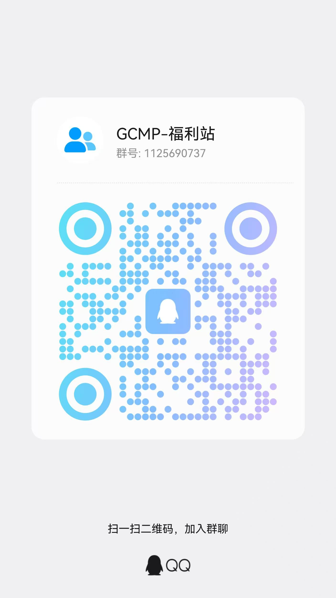

<p align="center"><a href="README.md"><kbd>　中文　</kbd></a>　<kbd>　English　</kbd></p>

<h1 align="center">AI Welfare Hub · Free Claude Code / Codex credit tracker</h1>

<p align="center">Free credits · a collection of relay and community services for free Claude Code / Codex / Cursor quota · daily check-ins</p>

<p align="center">
  
  
  
  
</p>

<p align="center">
  <a href="https://agentrouter.org/register?aff=aibw"><b>AgentRouter sign up</b></a> ·
  <a href="https://chuan.sylu.cc/sign-up?aff=zD17"><b>启源星 sign up</b></a> ·
  <a href="https://docode.cc/register?aff=1Qof"><b>DoCode sign up</b></a> ·
  <a href="https://us-3.nianhuaapi.com/sign-up?aff=aonj"><b>NianHua API sign up</b></a> ·
  <a href="https://nova.vcrauo.com/sign-up?aff=0hvb"><b>Orbelis sign up</b></a> ·
  <a href="https://free.supxh.xin/register?code=MVU8GX"><b>ShawnAI sign up</b></a> ·
  <a href="https://api456.me/register?aff=zmza"><b>api456.me sign up</b></a> ·
  <a href="https://api.justwoker.icu/register?aff=OIWh"><b>JustDoWork sign up</b></a> ·
  <a href="https://matrix.mzsjai.com/login?redirect=%2Fapp%2Fgrowth%3FinviteCode%3DMX3CDVGATLJW"><b>Matrix sign up</b></a> ·
  <a href="https://seekai.cc/sign-up?aff=dDJy"><b>SeekAi sign up</b></a> ·
  <a href="https://aaawinn.xyz/sign-up?aff=ijFL"><b>Long's AI sign up</b></a> ·
  <a href="https://api.hcnsec.cn/sign-up?aff=3J8z"><b>Xinjiang Huancheng Security sign up</b></a>
</p>

---

## 🚀 Get started in a minute

> Both tables below point to third-party services. This repo only aggregates information.

| Service | Status | First day | How it adds up | After that | Protocols | Models | Sign up | Invite code |
| :-- | :--: | :--: | :-- | :--: | :--: | :--: | :--: | :--: |
| **AgentRouter** 🔥 | 🟢 Online | **$175** | signup $100 + this page's invite $50 + first check-in $25 | $25/day | Anthropic + OpenAI | 4 listed | <a href="https://agentrouter.org/register?aff=aibw" target="_blank" rel="noopener">Sign up →</a> | — |
| **启源星** | 🟢 Online | **150 pts** | signup 150 pts | Daily check-in | Anthropic + OpenAI | 3 listed | <a href="https://chuan.sylu.cc/sign-up?aff=zD17" target="_blank" rel="noopener">GitHub sign up →</a> | — |
| **DoCode** | 🟢 Online | **300 site-USD** | signup 50 site-USD + this page's invite 250 site-USD | No check-in | Anthropic + OpenAI | Sign in to see | <a href="https://docode.cc/register?aff=1Qof" target="_blank" rel="noopener">Sign up →</a> | `1Qof` |
| **NianHua API** | 🟢 Online | Posted on site | — | Daily check-in | Anthropic + OpenAI | 149 listed | <a href="https://us-3.nianhuaapi.com/sign-up?aff=aonj" target="_blank" rel="noopener">Sign up →</a> | `aonj` |
| **Orbelis** | 🟢 Online | **1 site-USD** | this page's invite 1 site-USD | Daily check-in | Anthropic + OpenAI | 122 listed | <a href="https://nova.vcrauo.com/sign-up?aff=0hvb" target="_blank" rel="noopener">Sign up →</a> | `0hvb` |
| **ShawnAI** | 🟢 Online | **≈14000 pts** | signup 7000 pts + this page's invite 5000 pts + first check-in ≈2000 pts | ≈2000 pts/day | Anthropic + OpenAI | Sign in to see | <a href="https://free.supxh.xin/register?code=MVU8GX" target="_blank" rel="noopener">Sign up →</a> | `MVU8GX` |
| **api456.me** | 🟢 Online | **$50** | signup $20 + this page's invite $20 + first check-in $10 | $10/day | OpenAI | Sign in to see | <a href="https://api456.me/register?aff=zmza" target="_blank" rel="noopener">Sign up →</a> | `zmza` |
| **JustDoWork** | 🟢 Online | Posted on site | — | Daily check-in | Anthropic + OpenAI | Sign in to see | <a href="https://api.justwoker.icu/register?aff=OIWh" target="_blank" rel="noopener">GitHub sign up →</a> | `OIWh` |
| **Matrix** | 🟢 Online | **2600 pts** | this page's invite 600 pts + ID verification 2000 pts | — | OpenAI-compatible | Sign in to see | <a href="https://matrix.mzsjai.com/login?redirect=%2Fapp%2Fgrowth%3FinviteCode%3DMX3CDVGATLJW" target="_blank" rel="noopener">Sign up →</a> | — |
| **SeekAi** | 🟢 Online | Posted on site | — | Daily check-in | OpenAI | Sign in to see | <a href="https://seekai.cc/sign-up?aff=dDJy" target="_blank" rel="noopener">Sign up →</a> | `dDJy` |
| **Long's AI** | 🟢 Online | Free | Free tier, zero cost | No check-in | Anthropic + OpenAI | Sign in to see | <a href="https://aaawinn.xyz/sign-up?aff=ijFL" target="_blank" rel="noopener">GitHub sign up →</a> | `ijFL` |
| **Xinjiang Huancheng Security** | 🟢 Online | **30000 site-USD** | signup 30000 site-USD | Daily check-in | Anthropic + OpenAI | Sign in to see | <a href="https://api.hcnsec.cn/sign-up?aff=3J8z" target="_blank" rel="noopener">Sign up →</a> | `3J8z` |

> "First day" = signup bonus + invite bonus from this page + whatever check-in pays out on day one (services with a daily reset pool count a single day's pool). Models, prices and status are scraped from each service's public API. Last update: `2026-10-22 11:52 UTC`.
>
> Services with a code in the "Invite code" column (DoCode `1Qof`, NianHua API `aonj`, Orbelis `0hvb`, ShawnAI `MVU8GX`, api456.me `zmza`, JustDoWork `OIWh`, SeekAi `dDJy`, Long's AI `ijFL`, Xinjiang Huancheng Security `3J8z`) require **typing the code yourself** in the signup form. Miss it and you only get the base signup bonus — it cannot be added afterwards. A dash means the invite bonus travels inside the link and needs no typing.
>
> Signing up for all 5 USD-priced services that still accept new users gets you roughly **$225** on day one; 启源星 separately credits 150 pts, DoCode separately credits 300 site-USD, Orbelis separately credits 1 site-USD, ShawnAI separately credits ≈14000 pts, Matrix separately credits 2600 pts, Long's AI separately credits Free, Xinjiang Huancheng Security separately credits 30000 site-USD — each service prices in its own unit with no published USD conversion, so those are left out of this total.
>
> 🟡 2 services have not returned fresh API data for over 48 hours. Details show the last successful snapshot; online status reflects whether the signup page actually loads.

**Just want to use Claude Code right now?** Three steps:

1. Open a signup link from the table above and log in however that service allows (GitHub / email). Credits are attached to the invite link — stripping it usually costs you the bonus.
2. In the dashboard, create a key under "Tokens / API Keys".
3. Run the helper script below, or copy the environment variables from that service's section.

```bash
# Interactively writes Claude Code environment variables (macOS / Linux)
bash scripts/quickstart.sh
```

```powershell
# Windows PowerShell
powershell -ExecutionPolicy Bypass -File scripts/quickstart.ps1
```

## 📚 Service details


### 🟢 AgentRouter 🔥 Top pick

> AI coding community service · credit on signup, daily check-in keeps it alive

<a href="https://agentrouter.org/register?aff=aibw" target="_blank" rel="noopener"></a>

**Why sign up**

- $100 on signup, plus another $50 if you enter through this page's invite link — no top-up needed, no credit card
- Daily check-in pays another $25; up to $175 total on day one, and a steady supply for long-term free use
- Offers both Anthropic- and OpenAI-compatible protocols, so Claude Code / Codex / Cline / Cursor connect directly
- Official docs cover a dozen-plus clients — copy the config and go

**How much you get**

- Signup bonus: **$100**
- Extra via this page's invite link: **$50** (matches the service API)
- Daily check-in: **$25/day** (what keeps the free tier alive)
- First day total: **$175** (signup $100 + this page's invite $50 + first check-in $25)

**Live data** (scraped from public APIs)

- ⚠ No fresh API data for 177 hours; the info below is a snapshot from `2026-10-15 03:05 UTC`
- Panel name: **Agent Router**
- Panel version: `init-20261009-3d8bb4d7`
- Referral bonus: **$50**
- Login methods: GitHub / LinuxDO
- API latency: 238 ms

**Mirrors / alternate entry points**

- Mainland China alternate domain: <https://ps.air-outer.com> · <a href="https://ps.air-outer.com/register?aff=szt3" target="_blank" rel="noopener">Sign up via the mirror</a>

**Available models**

| Model | Ratio | Input / 1M tokens | Output / 1M tokens | Protocols |
| :-- | :--: | :--: | :--: | :--: |
| `claude-opus-4-8` | 4 | $8 | $40 | anthropic / openai |
| `claude-opus-5` | 4 | $8 | $40 | anthropic / openai |
| `deepseek-v4-flash` | 2 | $4 | $12 | openai / anthropic |
| `gpt-6-astra` | 3 | $6 | $30 | openai |

<sub>Ratio 1 ≈ $2 / 1M tokens; output price = ratio × completion ratio × $2. Always confirm against in-site pricing.</sub>

**Signup requirements**

- You must sign up through this page's invite link, otherwise the invite bonus will not be credited
- After signing up, log out and log back in once for the credit to appear

**Client setup**

<details open><summary><b>Claude Code</b> (Anthropic-compatible; Base URL without <code>/v1</code>)</summary>

```bash
# macOS / Linux
export ANTHROPIC_BASE_URL=https://agentrouter.org
export ANTHROPIC_AUTH_TOKEN=YOUR_API_KEY
export ANTHROPIC_MODEL=claude-opus-5
npm install -g @anthropic-ai/claude-code@latest && claude
```

```powershell
# Windows PowerShell
$env:ANTHROPIC_BASE_URL = "https://agentrouter.org"
$env:ANTHROPIC_AUTH_TOKEN = "YOUR_API_KEY"
$env:ANTHROPIC_MODEL = "claude-opus-5"
claude
```

</details>

<details><summary><b>Codex CLI</b> (OpenAI-compatible; goes into <code>~/.codex/config.toml</code>)</summary>

```toml
model = "gpt-6-astra"
model_provider = "agentrouter"

[model_providers.agentrouter]
name = "AgentRouter"
base_url = "https://agentrouter.org/v1"
env_key = "AGENTROUTER_API_KEY"
wire_api = "chat"
```

</details>

<details><summary><b>OpenAI SDK / Cherry Studio / Cursor and other generic clients</b></summary>

```python
from openai import OpenAI

client = OpenAI(api_key="YOUR_API_KEY", base_url="https://agentrouter.org/v1")
resp = client.chat.completions.create(model="gpt-6-astra", messages=[{"role": "user", "content": "ping"}])
print(resp.choices[0].message.content)
```

Generic clients need two fields: **Base URL** = `https://agentrouter.org/v1`, **API Key** = the key you created in the dashboard.

</details>

<details><summary><b>Connectivity self-test</b></summary>

```bash
curl -s https://agentrouter.org/v1/chat/completions \
  -H "Authorization: Bearer $KEY" -H "Content-Type: application/json" \
  -d '{"model":"gpt-6-astra","messages":[{"role":"user","content":"reply OK only"}]}'
```

</details>

**How to keep earning credits**

- Daily check-in for credit (log into the dashboard and click check-in)
- Bind an email to join the official periodic giveaway codes
- Invite others — the inviter earns credit too

**⚠️ Read before use**

- Officially positioned as a community service: no SLA, no top-ups, and some models may be temporarily unavailable when upstream wobbles
- Request content is accepted only in Chinese / English / French / German / Russian; other languages are blocked with a 400
- Bulk registration, traffic farming, reselling credit and fake referrals are strictly prohibited and will get the account banned

**Official channels**

- Discord: https://discord.gg/aYq5B4RW3
- X: https://x.com/AgentRouter_0
- Email: agent_router_org@163.com

---

### 🟢 启源星

> New API community service · 150 site credit on signup, check-in and tasks keep it alive, and only 3 models — but they are the good ones: claude-fable-5.1 and Grok-4.6

<a href="https://chuan.sylu.cc/sign-up?aff=zD17" target="_blank" rel="noopener"></a>

**Why sign up**

- 150 site credit on signup, no top-up and no credit card (credit is the site's own unit "⭐": the panel reports quota_display_type = CUSTOM, symbol ⭐ and price = 7.3, and the pricing page's "top-up" view shows claude-fable-5.1 as ⭐21.9, i.e. ⭐3 × 7.3; this page records credit as-is and does not convert it to USD or fold it into the cross-service USD total)
- Daily check-in and site tasks both keep the credit coming (the panel reports checkin_enabled and enable_task are both true)
- Only 3 models are on the shelf, but they are the good ones: claude-fable-5.1 (⭐3 per request in standard view) plus Grok-4.6 / Grok-4.5 (⭐1 per request each) — billed per request, not per token
- Both native routes are mounted: anonymous probes of /v1/messages and /v1/chat/completions return New API's 401 Invalid token rather than 404, so Claude Code connects directly with the Base URL and Codex CLI uses /v1
- The panel's public config ships one-click deeplinks for CC Switch, Cherry Studio, DeepChat, Lobe Chat, OpenCat, AionUI and AMA — push the key to your client straight from the dashboard
- The signup page offers both GitHub login and a username + password form, and password login works (the panel reports password_login_enabled = true)

**How much you get**

- Signup bonus: **150 pts**
- First day total: **150 pts**

**Live data** (scraped from public APIs)

- Panel version: `v0.9.0-liminality-20260825`
- Daily check-in: ✅
- Open signups: ✅ (The service turned off email/password signup, so you have to create the account with GitHub (a common anti-abuse measure).)
- Login methods: GitHub / Email + password
- API latency: 620 ms

**Available models**

| Model | Ratio | Input / 1M tokens | Output / 1M tokens | Protocols |
| :-- | :--: | :--: | :--: | :--: |
| `claude-fable-5.1` | per call | **$3 / call** | — | openai |
| `Grok-4.5` | per call | **$1 / call** | — | openai |
| `Grok-4.6` | per call | **$1 / call** | — | openai |

<sub>Rows marked "per call" are billed per request regardless of token usage; everything else uses ratio 1 ≈ $2 / 1M tokens. Always confirm against in-site pricing.</sub>

**Signup requirements**

- Enter through this page's invite link (?aff=zD17); the referral relationship and reward are settled by the site's own invite mechanism
- Registration passes Cloudflare Turnstile (turnstile_check = true); the registration endpoint rejects requests without a Turnstile token (it returned "Turnstile token 为空" when probed)
- The public config has password_register_enabled = false, email_verification = false and github_oauth = true: the signup page does render a username + password form, but submitting it was still blocked by Turnstile during testing, so GitHub is the safer route

**Client setup**

<details open><summary><b>Claude Code</b> (Anthropic-compatible; Base URL without <code>/v1</code>)</summary>

```bash
# macOS / Linux
export ANTHROPIC_BASE_URL=https://chuan.sylu.cc
export ANTHROPIC_AUTH_TOKEN=YOUR_API_KEY
export ANTHROPIC_MODEL=claude-fable-5.1
npm install -g @anthropic-ai/claude-code@latest && claude
```

```powershell
# Windows PowerShell
$env:ANTHROPIC_BASE_URL = "https://chuan.sylu.cc"
$env:ANTHROPIC_AUTH_TOKEN = "YOUR_API_KEY"
$env:ANTHROPIC_MODEL = "claude-fable-5.1"
claude
```

</details>

<details><summary><b>Codex CLI</b> (OpenAI-compatible; goes into <code>~/.codex/config.toml</code>)</summary>

```toml
model = "claude-fable-5.1"
model_provider = "chuan"

[model_providers.chuan]
name = "启源星"
base_url = "https://chuan.sylu.cc/v1"
env_key = "CHUAN_API_KEY"
wire_api = "chat"
```

</details>

<details><summary><b>OpenAI SDK / Cherry Studio / Cursor and other generic clients</b></summary>

```python
from openai import OpenAI

client = OpenAI(api_key="YOUR_API_KEY", base_url="https://chuan.sylu.cc/v1")
resp = client.chat.completions.create(model="claude-fable-5.1", messages=[{"role": "user", "content": "ping"}])
print(resp.choices[0].message.content)
```

Generic clients need two fields: **Base URL** = `https://chuan.sylu.cc/v1`, **API Key** = the key you created in the dashboard.

</details>

<details><summary><b>Connectivity self-test</b></summary>

```bash
curl -s https://chuan.sylu.cc/v1/chat/completions \
  -H "Authorization: Bearer $KEY" -H "Content-Type: application/json" \
  -d '{"model":"claude-fable-5.1","messages":[{"role":"user","content":"reply OK only"}]}'
```

</details>

**How to keep earning credits**

- Daily check-in grants credit (the panel reports checkin_enabled = true — click it in the dashboard)
- The site task center grants credit too (enable_task = true)
- The announcement about scripted accounts farming "check-in credit" for resale confirms check-in really does produce credit steadily
- Watch the site announcements and FAQ for occasional campaigns

**⚠️ Read before use**

- Site credit is the service's own unit: the panel reports quota_display_type = CUSTOM, symbol "⭐" and price = 7.3 (in the pricing page's "top-up" view claude-fable-5.1 shows as ⭐21.9, i.e. ⭐3 × 7.3), the same convention as hcnsec — so this page records credit as-is, does not convert it to USD and does not fold it into the cross-service USD total
- Site announcement of 2026-10-04: user numbers surged and a wave of scripted accounts farmed GitHub logins to harvest check-in credit for resale. They are investigating one by one, and in the meantime "some model prices will surge" — free credit can shrink without notice, so do not treat long-term free use as a promise
- The model pool is only 3 deep and all per-request: claude-fable-5.1 costs 3 credit per call and the Grok pair 1 credit each, so 150 credit is roughly a few dozen to a bit over a hundred calls; adds and delistings are entirely up to the site
- Success rates are not perfect: the site publishes 88.9% for claude-fable-5.1, 97.1% for Grok-4.5 and only 68.9% for Grok-4.6, with average latencies of 15–32s — roughly a third of Grok-4.6 requests fail, so do not use it as a stable production channel
- Both the signup page and the API sit behind Cloudflare, so datacenter IPs get blocked on the signup page (which is why this page's automated probe will show that too); home broadband is fine
- The public status API does not expose signup or invite credit (quota_for_new_user, quota_for_invitee and quota_for_inviter are all absent — the same for hcnsec / DoCode / Long的AI), so the 150 credit recorded here is the site's published figure — verify it in the dashboard before doing the math

**Official channels**

- Site: https://chuan.sylu.cc
- Announcements: https://chuan.sylu.cc/api/status (public announcements field)

---

### 🟢 DoCode

> New API relay · 50 site-dollars on signup, 250 more with invite code zMRe, 300 on day one — both Claude and GPT on the shelf

<a href="https://docode.cc/register?aff=1Qof" target="_blank" rel="noopener"></a>

**Why sign up**

- ⚠ Do not miss the invite code: type zMRe into the "Invite code" field of the signup form or the 250 site-dollars will not arrive. Entering through this page's link normally fills it in automatically, but check that field with your own eyes before submitting — miss it and you only get the 50 signup bonus, which cannot be added later
- 50 site-dollars on signup, 250 more with invite code zMRe — 300 on day one with no top-up. Note this "dollar" is the site's own unit, not USD; see the risk notes below
- Claude and GPT are both online: announcements name cc / cc-kiro group sonnet-5 and pay-per-call opus4.6, plus GPT pro / plus, Grok, Gemini and fable-5. One key covers everything, whereas most services on this page offer only one side
- Both native routes are open (anonymous probes of /v1/messages and /v1/chat/completions return New API's 401 Invalid token), so Claude Code connects directly with the Base URL and Codex CLI uses /v1
- The panel's public config ships one-click deeplinks for CC Switch, Cherry Studio, DeepChat, OpenCat, Lobe Chat and more — push the key straight from the dashboard
- Besides the main domain there is api.docode.cc (announcements call it "direct to US"); both were alive in testing, so switch over if the main site is unreachable

**How much you get**

- Signup bonus: **50 site-USD**
- Extra via this page's invite link: **250 site-USD**
- First day total: **300 site-USD** (signup 50 site-USD + this page's invite 250 site-USD)

**Live data** (scraped from public APIs)

- Panel name: **DoCode**
- Daily check-in: ❌
- Open signups: ✅
- Login methods: Email + password
- API latency: 836 ms

**Mirrors / alternate entry points**

- Direct to US: <https://api.docode.cc> · <a href="https://api.docode.cc/register?aff=zMRe" target="_blank" rel="noopener">Sign up via the mirror</a>

> This service put its pricing page behind login (`/api/pricing` returns 401; its own nav config sets pricing.requireAuth = true), so this page does not list a model table. Announcements name Claude (cc / cc-kiro groups: sonnet-5 and pay-per-call opus4.6), GPT pro / plus, Grok, Gemini, fable-5, plus a separate image endpoint at img.docode.cc. Check the console's "Pricing" page after signing up for the full list, groups and ratios.

**Signup requirements**

- Invite code = zMRe. Entering through this page's link (with ?aff=zMRe) normally fills the signup form's "Invite code" field automatically; double-check it yourself — leaving it empty gets you only the 50 signup site-dollars
- The 250 site-dollars is settled at registration. Filling the invite code in from the dashboard afterwards does nothing
- Email + password only: github / linuxdo / discord / telegram / WeChat / OIDC / Passkey are all false in the public config, so there is no third-party login
- Registration needs an email verification code (email_verification = true) and passes Cloudflare Turnstile
- If the main domain is unreachable, switch to api.docode.cc — same account, same credit

**Client setup**

<details open><summary><b>Claude Code</b> (Anthropic-compatible; Base URL without <code>/v1</code>)</summary>

```bash
# macOS / Linux
export ANTHROPIC_BASE_URL=https://docode.cc
export ANTHROPIC_AUTH_TOKEN=YOUR_API_KEY
export ANTHROPIC_MODEL=<sign in to see available model names>
npm install -g @anthropic-ai/claude-code@latest && claude
```

```powershell
# Windows PowerShell
$env:ANTHROPIC_BASE_URL = "https://docode.cc"
$env:ANTHROPIC_AUTH_TOKEN = "YOUR_API_KEY"
$env:ANTHROPIC_MODEL = "<sign in to see available model names>"
claude
```

</details>

<details><summary><b>Codex CLI</b> (OpenAI-compatible; goes into <code>~/.codex/config.toml</code>)</summary>

```toml
model = "<sign in to see available model names>"
model_provider = "docode"

[model_providers.docode]
name = "DoCode"
base_url = "https://docode.cc/v1"
env_key = "DOCODE_API_KEY"
wire_api = "chat"
```

</details>

<details><summary><b>OpenAI SDK / Cherry Studio / Cursor and other generic clients</b></summary>

```python
from openai import OpenAI

client = OpenAI(api_key="YOUR_API_KEY", base_url="https://docode.cc/v1")
resp = client.chat.completions.create(model="<sign in to see available model names>", messages=[{"role": "user", "content": "ping"}])
print(resp.choices[0].message.content)
```

Generic clients need two fields: **Base URL** = `https://docode.cc/v1`, **API Key** = the key you created in the dashboard.

</details>

<details><summary><b>Connectivity self-test</b></summary>

```bash
curl -s https://docode.cc/v1/chat/completions \
  -H "Authorization: Bearer $KEY" -H "Content-Type: application/json" \
  -d '{"model":"<sign in to see available model names>","messages":[{"role":"user","content":"reply OK only"}]}'
```

</details>

**How to keep earning credits**

- There is no site check-in (the panel reports checkin_enabled = false); credit comes from top-ups and occasional campaigns — announcements have run limited promos like "top up 100, get 500 dollars"
- Inviting others also pays; an announcement raised the VIP referral bonus from 80 to 120 — confirm the exact figure on the dashboard's "Invite" page

**⚠️ Read before use**

- The site's "dollar" is not USD: the public price = 0.02 is the top-up ratio, 1 CNY = 50 site-dollars (announcements say it returns to 1:25 normally), while other services on this page give ¥7.3 ≈ $1. So 300 site-dollars corresponds to only ¥6–12 of face value, and this page does not fold it into the cross-service USD total
- Billing is multiplied again by group ratios: announcements put the GPT pro group at 7–14× as upstream account prices move (New API convention: ratio 1 = $2 per million tokens). At roughly 13×, 300 site-dollars is on the order of ten million input tokens, with output multiplied by the completion ratio again — not a small amount, but always defer to the console's live ratio
- The credit figures (50 signup / 250 invite) are not exposed by the public API: /api/status has neither quota_for_new_user nor quota_for_invitee. This page records what the site publishes; verify in the dashboard before doing the math
- There is no daily check-in, so once credit runs out you must top up or wait for a campaign — no daily top-up like AgentRouter
- This is a paid relay, not a community service: online top-ups are enabled (Stripe at ¥8) and most announcements are about top-up bonuses and ratio swings. Exhausted free credit means paying to continue
- The FAQ's alternate domains ai.docode.pro / ai.docode.life and the announced hk.docode.cc all fail HTTPS (the first two have certificates issued only for docode.cc and therefore mismatch; hk fails the TLS handshake outright). This page lists only the verified api.docode.cc
- Upstream instability is documented in the announcements: GPT plus "wiped out" then "temporarily revived", gpt-5.4 fully delisted, and on Sept 10 they were still saying "openai blew up, all of gpt is bad". Do not treat it as a stable production channel

---

### 🟢 NianHua API

> Custom New API relay · ratios publicly readable (89 models / 16 groups), random check-in rewards, a 0.05-ratio community group and multimodal models at zero per call

<a href="https://us-3.nianhuaapi.com/sign-up?aff=aonj" target="_blank" rel="noopener"></a>

**Why sign up**

- All 89 models and 16 group ratios hang off the public API (/api/pricing is readable without login, measured 2026-09-24). Claude side: opus-5 / opus-5-5 / opus-4-8 / sonnet-5 / fable-5-1; GPT side: the gpt-6 and gpt-5.6 families; Grok 4.3–4.6, Gemini 3.x and the kiro group are also on the shelf
- The "community" group has a 0.05 ratio, the cheapest pricing group on the site (11 models including gpt-5-5 / gpt-5-3 / gpt-5-mini / agnes, described in the panel as "free for svip"), plus 3 MiMo voice models priced at zero (mimo-v2.5-tts / -voiceclone / -voicedesign)
- Daily check-in is enabled (panel checkin_enabled = true) with random credit rewards — a steady source that keeps free use alive
- All four endpoints are live: /v1/chat/completions, /v1/messages, /v1/responses and /v1/images/generations return 401 rather than 404 anonymously (measured 2026-09-24). There is also a native Gemini path and /v1/embeddings, so Claude Code / Codex / Gemini CLI all work
- The docs spell out the three routes: US3 is the only web frontend and the default API entry; US1 and the old master node are API-only fallbacks. "All active nodes share account, token, balance and model permissions", so switching routes needs no re-registration
- Client setup is tabulated in the official docs: Claude Code uses https://us-3.nianhuaapi.com (Messages path /v1/messages), while Codex / Cherry Studio / Open WebUI use https://us-3.nianhuaapi.com/v1. The panel FAQ also covers one-click CC Switch import (Token page → More → CC Switch)

**Live data** (scraped from public APIs)

- Panel version: `1.0.0-rc.22-nianhua-bba9838-payguard-20261015`
- Daily check-in: ✅
- Open signups: ✅
- Login methods: Email + password
- API latency: 1067 ms

**Available models**

| Model | Ratio | Input / 1M tokens | Output / 1M tokens | Protocols |
| :-- | :--: | :--: | :--: | :--: |
| `agnes-1.5-flash` | per call | **$1 / call** | — | openai |
| `agnes-2.0-flash` | per call | **$1 / call** | — | openai |
| `agnes-2.5-flash` | 37.5 | $75 | $75 | openai |
| `agnes-3.0-flash` | 37.5 | $75 | $75 | openai |
| `agnes-image-2.0-flash` | 37.5 | $75 | $75 | openai |
| `agnes-image-2.1-flash` | 37.5 | $75 | $75 | openai |
| `agnes-image-2.5-flash` | 37.5 | $75 | $75 | openai |
| `agnes-video-2.5-flash` | 37.5 | $75 | $75 | openai |
| `bge-m3` | 0 | $0 | $0 | openai |
| `bge-multilingual-gemma2` | 0 | $0 | $0 | openai |
| `big-pickle` | 0 | $0 | $0 | openai |
| `cat-jam-free` | 0 | $0 | $0 | openai |
| `claude-fable-5` | 5 | $10 | $50 | anthropic / openai |
| `claude-fable-5-1` | 5 | $10 | $50 | anthropic / openai |
| `claude-haiku-4-5` | 0.5 | $1 | $5 | anthropic / openai |
| `claude-haiku-4-5-20251001` | 0.5 | $1 | $5 | anthropic / openai |
| `claude-opus-4-5-20251101` | 2.5 | $5 | $25 | anthropic / openai |
| `claude-opus-4-6` | 2.5 | $5 | $25 | anthropic / openai |
| `claude-opus-4-6-thinking` | 2.5 | $5 | $25 | anthropic / openai |
| `claude-opus-4-7` | 2.5 | $5 | $25 | anthropic / openai |
| `claude-opus-4-8` | 2.5 | $5 | $25 | anthropic / openai |
| `claude-opus-5` | 2.5 | $5 | $25 | anthropic / openai |
| `claude-opus-5-5` | 2 | $4 | $20 | anthropic / openai |
| `claude-sonnet-4-6` | 1.5 | $3 | $15 | anthropic / openai |
| `claude-sonnet-4-6-thinking` | 2.5 | $5 | $25 | anthropic / openai |
| `claude-sonnet-5` | 1.5 | $3 | $3 | anthropic / openai |
| `claude-sonnet-5-5` | 37.5 | $75 | $75 | anthropic / openai |
| `codex-auto-review` | 1.25 | $2.5 | $15 | openai |
| `codex-gpt-image-2` | per call | **$0.3 / call** | — | openai |
| `cohere/north-mini-code:free` | 0 | $0 | $0 | openai |
| `DeepSeek-V4-Flash-0731` | 1.5 | $3 | $9 | openai |
| `deepseek-v4.1-flash-free` | 1 | $2 | $8 | openai |
| `dots-studio/dots-3-note-preview:free` | 0 | $0 | $0 | openai |
| `gemini-2.5-flash` | 0.15 | $0.3 | $2.5 | gemini / openai |
| `gemini-2.5-flash-lite` | 0.05 | $0.1 | $0.4 | gemini / openai |
| `gemini-2.5-pro` | 0.625 | $1.25 | $10 | gemini / openai |
| `gemini-3-flash` | 0.25 | $0.5 | $3 | gemini / openai |
| `gemini-3-flash-agent` | 0.125 | $0.25 | $1.5 | gemini / openai |
| `gemini-3-flash-preview` | 0.25 | $0.5 | $3 | gemini / openai |
| `gemini-3-pro-high` | 2 | $4 | $18 | gemini / openai |
| `gemini-3-pro-low` | 1 | $2 | $12 | gemini / openai |
| `gemini-3.1-flash-image` | per call | **$0.5 / call** | — | gemini / openai |
| `gemini-3.1-flash-lite` | 0.125 | $0.25 | $1.5 | gemini / openai |
| `gemini-3.1-flash-lite-preview` | 0.125 | $0.25 | $1.5 | gemini / openai |
| `gemini-3.1-pro` | 2 | $4 | $18 | gemini / openai |
| `gemini-3.1-pro-low` | 1 | $2 | $12 | gemini / openai |
| `gemini-3.5-flash` | 0.25 | $0.5 | $3 | gemini / openai |
| `gemini-3.5-flash-low` | 0.125 | $0.25 | $1.5 | gemini / openai |
| `gemini-3.7-flash` | 0.75 | $1.5 | $7.5 | gemini / openai |
| `gemini-3.8-flash` | 0.75 | $1.5 | $7.5 | gemini / openai |
| `gemini-4-argon` | 2 | $4 | $20 | gemini / openai |
| `gemini-pro-agent` | 2 | $4 | $18 | gemini / openai |
| `GLM-5.3-Flash` | 0.4 | $0.8 | $2.8 | openai |
| `gpt-4o-audio-preview` | 1.25 | $2.5 | $10 | openai |
| `gpt-4o-realtime-preview` | 2.5 | $5 | $20 | openai |
| `gpt-5-3` | 0.875 | $1.75 | $14 | openai |
| `gpt-5-3-mini` | 0.875 | $1.75 | $14 | openai |
| `gpt-5-5` | 0.5 | $1 | $8 | openai |
| `gpt-5-5-mini` | 0 | $0 | $0 | openai |
| `gpt-5-mini` | 0.125 | $0.25 | $2 | openai |
| `gpt-5.1-codex` | 0.625 | $1.25 | $10 | openai |
| `gpt-5.2` | 0.875 | $1.75 | $14 | openai |
| `gpt-5.2-2025-12-11` | 0.875 | $1.75 | $14 | openai |
| `gpt-5.2-chat-latest` | 0.875 | $1.75 | $14 | openai |
| `gpt-5.2-pro` | 10.5 | $21 | $168 | openai |
| `gpt-5.2-pro-2025-12-11` | 10.5 | $21 | $168 | openai |
| `gpt-5.3-codex` | 0.875 | $1.75 | $14 | openai |
| `gpt-5.3-codex-spark` | 0.875 | $1.75 | $14 | openai |
| `gpt-5.4` | 1.25 | $2.5 | $15 | openai |
| `gpt-5.4-2026-03-05` | 1.25 | $2.5 | $15 | openai |
| `gpt-5.4-mini` | 0.375 | $0.75 | $4.5 | openai |
| `gpt-5.4-openai-compact` | 2.5 | $5 | $30 | openai |
| `gpt-5.5` | 2.5 | $5 | $30 | openai |
| `gpt-5.5-openai-compact` | 2.5 | $5 | $30 | openai |
| `gpt-5.6` | 2 | $4 | $20 | openai |
| `gpt-5.6-luna` | 37.5 | $75 | $450 | openai |
| `gpt-5.6-sol` | 2.5 | $5 | $30 | openai |
| `gpt-5.6-terra` | 37.5 | $75 | $450 | openai |
| `gpt-6` | 37.5 | $75 | $150 | openai |
| `gpt-6-astra` | 37.5 | $75 | $150 | openai |
| `gpt-6-luna` | 37.5 | $75 | $150 | openai |
| `gpt-6-sol` | 37.5 | $75 | $150 | openai |
| `gpt-6.1-sol` | 37.5 | $75 | $150 | openai |
| `gpt-image-1` | 2.5 | $5 | $40 | image-generation / openai |
| `gpt-image-1.5` | per call | **$0.16 / call** | — | image-generation / openai |
| `gpt-image-2` | per call | **$0.16 / call** | — | openai |
| `gpt-image-2-4k` | per call | **$0.45 / call** | — | openai |
| `gpt-image-2-max` | per call | **$0.2 / call** | — | openai |
| `gpt-image-2.5` | per call | **$0.16 / call** | — | openai |
| `gpt-image-2.5-flare` | per call | **$0.16 / call** | — | openai |
| `gpt-image-2.5-sunburst` | per call | **$0.16 / call** | — | openai |
| `gpt-oss-120b` | 0.075 | $0.15 | $0.6 | openai |
| `gpt-oss:20b-llm7` | 0.0375 | $0.075 | $0.3 | openai |
| `gpt-oss:20b-ovh` | 0.0375 | $0.075 | $0.3 | openai |
| `gpt-oss:20b-pollinations` | 0.0375 | $0.075 | $0.3 | openai |
| `gpt-reserve` | 37.5 | $75 | $150 | openai |
| `grok-3-mini` | 1.25 | $2.5 | $5 | openai / openai-response |
| `grok-3-mini-fast` | 1.25 | $2.5 | $5 | openai / openai-response |
| `grok-4.20-0309-reasoning` | 1.25 | $2.5 | $5 | openai / openai-response |
| `grok-4.20-multi-agent-0309` | 1.25 | $2.5 | $5 | openai / openai-response |
| `grok-4.3` | 1.25 | $2.5 | $5 | openai / openai-response |
| `grok-4.5` | 1 | $2 | $6 | openai / openai-response |
| `grok-4.6` | 1 | $2 | $6 | openai / openai-response |
| `grok-build` | 1 | $2 | $6 | openai / openai-response |
| `grok-build-0.1` | 1 | $2 | $4 | openai / openai-response |
| `grok-imagine` | per call | **$0.2 / call** | — | openai / openai-response |
| `grok-imagine-image` | per call | **$0.3 / call** | — | openai / openai-response |
| `grok-imagine-image-quality` | per call | **$0.4 / call** | — | openai / openai-response |
| `grok-imagine-video` | per call | **$6 / call** | — | openai / openai-response |
| `grok-imagine-video-1.5` | per call | **$10 / call** | — | openai / openai-response |
| `grok-imagine-video-1.5-preview` | per call | **$17.5 / call** | — | openai / openai-response |
| `kilo-auto/free` | 0 | $0 | $0 | openai |
| `liquid/lfm-2.5-2.6b:free` | 0 | $0 | $0 | openai |
| `longcat-2.5-preview-free` | 0 | $0 | $0 | openai |
| `Meta-Llama-3_3-70B-Instruct` | 0.37 | $0.74 | $0.74 | openai |
| `mimo-v2.5-asr` | 0.14 | $0.28 | $0.56 | openai |
| `mimo-v2.5-tts` | 0 | $0 | $0 | openai |
| `mimo-v2.5-tts-voiceclone` | 0 | $0 | $0 | openai |
| `mimo-v2.5-tts-voicedesign` | 0 | $0 | $0 | openai |
| `mimo-v2.6-flash-free` | 0.5 | $1 | $2 | openai |
| `minimax-m2.7` | 0.3 | $0.6 | $2.4 | openai |
| `Mistral-7B-Instruct-v0.3` | 0.055 | $0.11 | $0.11 | openai |
| `Mistral-Nemo-Instruct-2407` | 0 | $0 | $0 | openai |
| `Mistral-Small-3.2-24B-Instruct-2506` | 0.05 | $0.1 | $0.31 | openai |
| `muse-spark-1.2-contributor-free` | 0 | $0 | $0 | openai |
| `muse-spark-1.3-contributor-free` | 0 | $0 | $0 | openai |
| `nano-banana-2` | per call | **$0.3 / call** | — | gemini / openai |
| `nemotron-3-nano:30b` | 0 | $0 | $0 | openai |
| `nemotron-3.5-lightning-free-kilo` | 0 | $0 | $0 | openai |
| `nemotron-3.5-lightning-free-opencode` | 0 | $0 | $0 | openai |
| `nvidia/nemotron-3-nano-omni-30b-a3b-reasoning:free` | 0 | $0 | $0 | openai |
| `nvidia/nemotron-3-super-120b-a12b:free` | 0 | $0 | $0 | openai |
| `nvidia/nemotron-3-ultra-550b-a55b:free` | 0 | $0 | $0 | openai |
| `openrouter/free` | 0 | $0 | $0 | openai |
| `poolside/laguna-s-2.1:free` | 0 | $0 | $0 | openai |
| `poolside/laguna-xs-2.1:free` | 0 | $0 | $0 | openai |
| `Qwen2.5-VL-72B-Instruct` | 0 | $0 | $0 | openai |
| `Qwen3-Embedding-8B` | 0 | $0 | $0 | openai |
| `Qwen3.5-397B-A17B` | 0.6 | $1.2 | $7.2 | openai |
| `Qwen3.5-9B` | 0 | $0 | $0 | openai |
| `Qwen3.6-27B` | 1.5 | $3 | $18 | openai |
| `Qwen3.8-27B` | 1.5 | $3 | $12 | openai |
| `space-bunny-free` | 0 | $0 | $0 | openai |
| `stable-diffusion-xl-base-v10` | 0 | $0 | $0 | openai |
| `step-5-preview-free-kilo` | 3.5 | $7 | $20 | openai |
| `step-5-preview-free-opencode` | 3.5 | $7 | $20 | openai |
| `thinkingmachines/inkling-small:free` | 0 | $0 | $0 | openai |
| `whisper-large-v3` | 1.3583333333333334 | $2.717 | $0 | openai |
| `whisper-large-v3-turbo` | 0.425 | $0.85 | $0 | openai |

<sub>Rows marked "per call" are billed per request regardless of token usage; everything else uses ratio 1 ≈ $2 / 1M tokens. Always confirm against in-site pricing.</sub>

**Signup requirements**

- Sign up through this page's invite link (?aff=aonj) so the invite bonus is settled
- Email + password only: GitHub / LinuxDO / Discord / Telegram / WeChat / OIDC / Passkey are all disabled in the panel, so there is no third-party login (password_register_enabled = true)
- Registration needs an email verification code (email_verification = true) and passes Cloudflare Turnstile (turnstile_check = true)
- This is a paid relay; signup does not require payment, but free credit is limited to check-in (random) and the community group — do not treat it as a pure community service

**Client setup**

<details open><summary><b>Claude Code</b> (Anthropic-compatible; Base URL without <code>/v1</code>)</summary>

```bash
# macOS / Linux
export ANTHROPIC_BASE_URL=https://us-3.nianhuaapi.com
export ANTHROPIC_AUTH_TOKEN=YOUR_API_KEY
export ANTHROPIC_MODEL=claude-opus-5-5
npm install -g @anthropic-ai/claude-code@latest && claude
```

```powershell
# Windows PowerShell
$env:ANTHROPIC_BASE_URL = "https://us-3.nianhuaapi.com"
$env:ANTHROPIC_AUTH_TOKEN = "YOUR_API_KEY"
$env:ANTHROPIC_MODEL = "claude-opus-5-5"
claude
```

</details>

<details><summary><b>Codex CLI</b> (OpenAI-compatible; goes into <code>~/.codex/config.toml</code>)</summary>

```toml
model = "gpt-oss-120b"
model_provider = "nianhua"

[model_providers.nianhua]
name = "NianHua API"
base_url = "https://us-3.nianhuaapi.com/v1"
env_key = "NIANHUA_API_KEY"
wire_api = "chat"
```

</details>

<details><summary><b>OpenAI SDK / Cherry Studio / Cursor and other generic clients</b></summary>

```python
from openai import OpenAI

client = OpenAI(api_key="YOUR_API_KEY", base_url="https://us-3.nianhuaapi.com/v1")
resp = client.chat.completions.create(model="gpt-oss-120b", messages=[{"role": "user", "content": "ping"}])
print(resp.choices[0].message.content)
```

Generic clients need two fields: **Base URL** = `https://us-3.nianhuaapi.com/v1`, **API Key** = the key you created in the dashboard.

</details>

<details><summary><b>Connectivity self-test</b></summary>

```bash
curl -s https://us-3.nianhuaapi.com/v1/chat/completions \
  -H "Authorization: Bearer $KEY" -H "Content-Type: application/json" \
  -d '{"model":"gpt-oss-120b","messages":[{"role":"user","content":"reply OK only"}]}'
```

</details>

**How to keep earning credits**

- Daily random check-in (enabled in the panel) — just click it in the dashboard
- Invite others (the panel ships an Invitation Code / Invitation Quota / Invitee Reward set) — check the dashboard for the amounts
- The 0.05-ratio community group is almost free and svip users ride free there; 3 zero-price MiMo voice models and the agnes family can be run for nothing too
- Subscription plans and redemption codes are enabled (enable_task and a promo-code entry exist); announcements post occasional campaign prices

**⚠️ Read before use**

- This is a paid relay, not a community service: online top-ups are on (Stripe at ¥8), the FAQ is mostly about plans and ratios, and the site's own announcements say "removed the max group because costs are too high" and "cancelled the free credit for new users (could not take it)" — free credit is only check-in and the community group
- The site's "dollar" is not USD: panel price = 1 (about ¥1 ≈ 1 site-dollar), 7× off the ¥7.3 ≈ $1 used by most services, while the FAQ also says "plans 0.05–0.24 CNY per USD of credit" and "normal users 0.8x / plan users 0.6x" — the figures do not reconcile. This page does not fold it into the cross-service USD total; defer to the console's live ratios
- The community group's GPT models are documented as "supports web search but not tool calling"; to run tool calling there, use the agnes family (the announcement says "kept agnes, supports full tool calling"). Claude Code / Codex need the kiro / CCMax / GPT groups
- Hyphenated model names are the cut-down versions: the FAQ says gpt-5-5 "only supports text chat, no images or any other calls" while gpt-5.5 is the full model, and image2 only generates at the default resolution with only image2-max doing 4K — do not pick models by how similar the names look
- The panel's auto_groups does not include "community": it lists GPT / GPTPro / enterprise-Pro / Grok / Gemini / kiro / CCMax / GPT-official / GPT-Image, so new tokens on auto grouping will not land there — select it manually on the token
- No specific signup / check-in / invite figures are recorded here: the public API exposes neither quota_for_new_user nor quota_for_invitee, the 2026-06-03 announcement cancelled the new-user free credit and moved referral credit to the backup site api.nianhua.store (currently unreachable), and circulating numbers do not match the announcements — so we do not guess. Verify in the dashboard after signing up
- The site had one data-loss incident: the 2026-05-16 announcement says "the relay's IDC server vendor ran off and data was lost; users after #340 need to re-register, and paying users can recover credit by sending payment records in the QQ group"
- The other two routes the site publishes (US1 three-network CMI, and the old master newapi.makelove.cloud) are unreachable on the current network, and the docs themselves note "unreachable on some Chinese networks". This page lists only the verified US3; verify backups yourself
- Both the signup page and the API sit behind Cloudflare, so datacenter IPs may be 403'd on the signup page (home broadband is fine), and registration passes Turnstile. Upstream is multi-channel aggregation (announcements say sub2api scheduling over kiro / anti pools), so actual quality varies by group — do not treat it as a stable production channel

**Official channels**

- QQ group: 1093317048 (the chat group posted in panel announcement id 1)
- Server monitoring: https://vps.makelove.cloud (listed in the footer)
- Docs: https://us-3.nianhuaapi.com/docs/

---

### 🟢 Orbelis

> Custom New API relay · 117 models / 47 groups, domestic-NVIDIA group at 0.0001 ratio and gptfree at 0.04, AFF gives both sides 1U, and the main site blocks mainland direct connections so bring a proxy

<a href="https://nova.vcrauo.com/sign-up?aff=0hvb" target="_blank" rel="noopener"></a>

**Why sign up**

- ⚠ The main panel blocks direct connections from CN / HK / MO / TW: mainland IPs get 403 unsupported_region on the signup page, docs and panel alike, so registration needs a proxy in an unrestricted region. The site does run two API-only routes — api.vcrauo.lat (direct, unaccelerated) and fast.vcrauo.lat (optimized tri-network, high bandwidth) — where mainland IPs get 401 Invalid token rather than a 403 region block (measured 2026-10-15). In short: proxy to register, none needed to call
- Big model lineup: /api/pricing is readable without login and returned 117 models and 47 pricing groups on 2026-10-15. Claude side has claude-opus-5 / opus-5-5 / opus-4-8 / opus-4-7 / opus-4-6 / sonnet-5 / sonnet-5-5 / sonnet-4-6 / haiku-4-5 / fable-5 / fable-5.1 all on the shelf; GPT side gpt-6-sol / gpt-6.1-sol / gpt-6-astra / gpt-5.6-sol / gpt-5.6-terra / gpt-5.5(-pro) / gpt-5.3-codex; also grok-4.7 (with build-fast), kimi-k3, deepseek-v4-pro, glm-5.3-prime, qwen3.8-max, plus 24 pay-per-call multimodal models including Gemini image, Grok video, minimax-h3 and seedance2.5 video
- Several welfare groups sit below 0.1 ratio: domestic NVIDIA free group 0.0001, gptfree node 0.04 (gpt-5.5 only), Codex welfare nodes 1 and 2 at 0.05 each, Jev official key 0.05, domestic welfare channel 0.05 (DeepSeek only), Grok welfare node 0.06, Claude stable node 0.09, Codex high-speed nodes 1 and 2 at 0.1 each, plus the "no-downgrade group" announced 2026-09-23 (announced at 0.24) and the Pro no-downgrade high-cache group at 0.2
- Signup bonus: the announcement states "register via AFF and both sides get 1U", and joining the site's QQ / TG / DC notification groups gets you a 10U one-week trial card ("trial card usable only in the trial group", one per account ID). The referral rebate is 5% of the invitee's first 20 top-ups, withdrawable or transferable in one click
- Daily check-in is on (checkin_enabled = true) and top-up discounts became a lottery wheel (recharge_lottery_enabled = true); each of the three notification groups runs a draw every 300 / 500 members with 1 / 2 / 5 / 10 / 20U vouchers
- All three protocols are live: /v1/chat/completions, /v1/messages (13 models support the native Anthropic endpoint) and /v1/responses return 401 rather than 404 anonymously (measured 2026-10-15), so Claude Code / Codex CLI / Cline connect. The panel also provides jump configs for Cherry Studio / CC Switch / AionUI / DeepChat

**How much you get**

- Extra via this page's invite link: **1 site-USD**
- First day total: **1 site-USD**

**Live data** (scraped from public APIs)

- Panel name: **Orbelis**
- Panel version: `v1.0.0-rc.41`
- Daily check-in: ✅
- Open signups: ✅
- Login methods: GitHub / LinuxDO / Email + password
- API latency: 1239 ms

**Available models**

| Model | Ratio | Input / 1M tokens | Output / 1M tokens | Protocols |
| :-- | :--: | :--: | :--: | :--: |
| `a-2.0-720p-v1` | 37.5 | $75 | $75 | openai |
| `a-2.5-hs-1080p` | 37.5 | $75 | $75 | openai |
| `Adobe-gpt-image-2` | 37.5 | $75 | $75 | image-generation / openai |
| `Adobe-gpt-image-2.5-flare` | 37.5 | $75 | $75 | image-generation / openai |
| `Adobe-gpt-image-2.5-sunburst` | 37.5 | $75 | $75 | image-generation / openai |
| `Adobe-gpt-image-medium` | 37.5 | $75 | $75 | image-generation / openai |
| `AZ-gpt-image-2` | per call | **$0.08 / call** | — | image-generation / openai |
| `AZ-gpt-image-2.5-flare` | per call | **$0.08 / call** | — | image-generation / openai |
| `AZ-gpt-image-2.5-sunburst` | per call | **$0.08 / call** | — | image-generation / openai |
| `claude-fable-5` | 5 | $10 | $50 | anthropic / openai |
| `claude-fable-5-1` | 5 | $10 | $50 | anthropic / openai |
| `claude-fable-5.1` | 5 | $10 | $50 | anthropic / openai |
| `claude-haiku-4-5-20251001` | 0.5 | $1 | $5 | anthropic / openai |
| `claude-haiku-5-5` | 37.5 | $75 | $75 | anthropic / openai |
| `claude-opus-4-6` | 2.5 | $5 | $25 | anthropic / openai |
| `claude-opus-4-7` | 2.5 | $5 | $25 | anthropic / openai |
| `claude-opus-4-8` | 2.5 | $5 | $25 | anthropic / openai |
| `claude-opus-5` | 2.5 | $5 | $25 | anthropic / openai |
| `claude-opus-5-5` | 37.5 | $75 | $75 | anthropic / openai |
| `claude-sonnet-4-5` | 37.5 | $75 | $375 | anthropic / openai |
| `claude-sonnet-4-5-20250929` | 1.5 | $3 | $15 | anthropic / openai |
| `claude-sonnet-4-6` | 1.5 | $3 | $15 | anthropic / openai |
| `claude-sonnet-5` | 1.5 | $3 | $15 | anthropic / openai |
| `claude-sonnet-5-5` | 37.5 | $75 | $75 | anthropic / openai |
| `codex-auto-review` | 0.1 | $0.2 | $1.2 | openai |
| `deepseek-v4-flash-0731` | 37.5 | $75 | $75 | openai |
| `DeepSeek-V4-Flash[free]` | per call | **$0.01 / call** | — | openai |
| `deepseek-v4-pro-0813` | 37.5 | $75 | $75 | openai |
| `deepseek-v4.1-flash` | 0.5 | $1 | $4 | openai |
| `deepseek-v4.1-flash-1017` | 37.5 | $75 | $75 | openai |
| `deepseek/deepseek-v4-flash-0731:free` | 0.5 | $1 | $4 | openai |
| `gemini-2.5-flash-image` | per call | **$0.08 / call** | — | gemini / openai |
| `gemini-3-pro-image-preview` | per call | **$0.12 / call** | — | gemini / openai |
| `gemini-3.1-flash-image-preview` | per call | **$0.08 / call** | — | gemini / openai |
| `gemini-3.5-flash` | 0.75 | $1.5 | $9 | gemini / openai |
| `gemini-3.6-flash` | 0.75 | $1.5 | $7.5 | gemini / openai |
| `gemini-3.7-flash` | 0.375 | $0.75 | $3.75 | gemini / openai |
| `gemini-3.8-flash` | 0.375 | $0.75 | $3.75 | gemini / openai |
| `glm-5.1` | 37.5 | $75 | $75 | openai |
| `glm-5.2` | 4 | $8 | $28 | openai |
| `glm-5.3` | 4 | $8 | $28 | openai |
| `glm-5.3-flash` | 0.4 | $0.8 | $2.8 | openai |
| `glm-5.3-flashx` | 37.5 | $75 | $75 | openai |
| `google/gemma-4-31b-it` | per call | **$0.01 / call** | — | openai |
| `gpt-4.1` | 37.5 | $75 | $150 | openai |
| `gpt-4.1-mini` | 37.5 | $75 | $150 | openai |
| `gpt-4o` | 37.5 | $75 | $300 | openai |
| `gpt-4o-mini` | 37.5 | $75 | $300 | openai |
| `gpt-5.2` | 37.5 | $75 | $450 | openai |
| `gpt-5.2-pro` | 37.5 | $75 | $450 | openai |
| `gpt-5.3-codex` | 37.5 | $75 | $450 | openai |
| `gpt-5.4` | 1.25 | $2.5 | $15 | openai |
| `gpt-5.4-nano` | 37.5 | $75 | $468.75 | openai |
| `gpt-5.4-pro` | 37.5 | $75 | $450 | openai |
| `gpt-5.5-pro` | 37.5 | $75 | $450 | openai |
| `gpt-5.6-sol` | 2.5 | $5 | $30 | openai |
| `gpt-5.6-terra` | 1.25 | $2.5 | $15 | openai |
| `gpt-6-astra` | 5 | $10 | $50 | openai |
| `gpt-6-sol` | 1 | $2 | $10 | openai |
| `gpt-6.1-sol` | 37.5 | $75 | $150 | openai |
| `gpt-image-2` | 37.5 | $75 | $150 | image-generation / openai |
| `gpt-image-2.5-flare` | 37.5 | $75 | $150 | image-generation / openai |
| `gpt-image-2.5-sunburst` | 37.5 | $75 | $150 | image-generation / openai |
| `grok-4.5` | 1 | $2 | $6 | openai / openai-response |
| `grok-4.6` | 1 | $2 | $6 | openai / openai-response |
| `grok-4.7` | 37.5 | $75 | $75 | openai / openai-response |
| `grok-4.7-build-fast` | 37.5 | $75 | $75 | openai / openai-response |
| `grok-build-0.1` | 0.5 | $1 | $2 | openai / openai-response |
| `grok-imagine` | per call | **$0.12 / call** | — | openai / openai-response |
| `grok-imagine-image` | per call | **$0.12 / call** | — | openai / openai-response |
| `grok-imagine-image-2.0` | 37.5 | $75 | $75 | openai / openai-response |
| `grok-imagine-image-quality` | per call | **$0.12 / call** | — | openai / openai-response |
| `grok-imagine-video` | per call | **$0.85 / call** | — | openai |
| `grok-imagine-video-1.5` | per call | **$0.85 / call** | — | openai |
| `grok-imagine-video-1.5-preview` | 37.5 | $75 | $75 | openai |
| `hy3` | 37.5 | $75 | $75 | openai |
| `hy4-preview` | 37.5 | $75 | $75 | openai |
| `jimeng-seedance-2.5-480` | 37.5 | $75 | $75 | openai |
| `jimeng-seedance-2.5-720` | 37.5 | $75 | $75 | openai |
| `kimi-k2.7-code` | 3.25 | $6.5 | $27 | openai |
| `kimi-k2.8` | 37.5 | $75 | $75 | openai |
| `kimi-k3` | 10 | $20 | $100 | openai |
| `mimo-v2.5` | 37.5 | $75 | $75 | openai |
| `mimo-v2.5-pro` | 37.5 | $75 | $75 | openai |
| `mimo-v2.6-flash` | 37.5 | $75 | $75 | openai |
| `mimo-v2.6-pro` | 37.5 | $75 | $75 | openai |
| `minimax-h3-comic-768p` | 37.5 | $75 | $75 | openai |
| `minimax-h3-comic-cf-2k` | 37.5 | $75 | $75 | openai |
| `minimax-h3-comic-cf-4k` | per call | **$1 / call** | — | openai |
| `minimax-h3-original-1080p` | per call | **$0.23 / call** | — | openai |
| `minimax-h3-original-768p` | per call | **$0.2 / call** | — | openai |
| `minimax-h3-original-cf-2k` | 37.5 | $75 | $75 | openai |
| `minimax-h3-original-cf-4k` | 37.5 | $75 | $75 | openai |
| `minimax-h3-quantized-768p` | 37.5 | $75 | $75 | openai |
| `MiniMax-M2.7` | 37.5 | $75 | $75 | openai |
| `MiniMax-M2.7-highspeed` | 37.5 | $75 | $75 | openai |
| `minimax-m3` | 37.5 | $75 | $75 | openai |
| `MiniMax-M3` | 1.5 | $3 | $15 | openai |
| `minimax/minimax-m3:free` | per call | **$0.01 / call** | — | openai |
| `qwen-8b` | per call | **$0.01 / call** | — | openai |
| `qwen/qwen3.8-27b:free` | per call | **$0.01 / call** | — | openai |
| `qwen3.7-max` | 6 | $12 | $36 | openai |
| `qwen3.8-flash` | 0.4 | $0.8 | $2.7 | openai |
| `qwen3.8-max` | 6 | $12 | $36 | openai |
| `sd-2.5-M-720p-v3` | 37.5 | $75 | $75 | openai |
| `seedance-2.5-pro-720p` | 37.5 | $75 | $75 | openai |
| `seedance2.0` | per call | **$3.5 / call** | — | openai |
| `seedance2.0fast` | per call | **$3 / call** | — | openai |
| `seedance2.0mini` | per call | **$3 / call** | — | openai |
| `seedance2.5` | per call | **$4 / call** | — | openai |
| `sh-2.5-720p` | 37.5 | $75 | $75 | openai |
| `x-2.5-1080p` | 37.5 | $75 | $75 | openai |
| `x-2.5-480p` | 37.5 | $75 | $75 | openai |
| `x-2.5-720p` | 37.5 | $75 | $75 | openai |
| `xin-seedance-2.0-fast` | 37.5 | $75 | $75 | openai |
| `xinghe-2.0s` | 37.5 | $75 | $75 | openai |
| `xinyao-2.0-720p-TJ` | 37.5 | $75 | $75 | openai |
| `xj-2.0-m-480p` | 37.5 | $75 | $75 | openai |
| `xj-2.0-m-720p` | 37.5 | $75 | $75 | openai |
| `xx-2.0-t-720p` | 37.5 | $75 | $75 | openai |
| `xx-2.0-t-720p-v1` | 37.5 | $75 | $75 | openai |
| `z-ai/glm-5.2:free` | per call | **$0.01 / call** | — | openai |

<sub>Rows marked "per call" are billed per request regardless of token usage; everything else uses ratio 1 ≈ $2 / 1M tokens. Always confirm against in-site pricing.</sub>

**Signup requirements**

- Sign up through this page's invite link (?aff=0hvb); the announcement states "register via AFF and both sides get 1U"
- Only three signup methods: QQ email + password, GitHub OAuth and LinuxDO OAuth (announcement id 1: "signup supports QQ email only / GitHub only / LinuxDO only"); Discord / Telegram / WeChat / OIDC / Passkey are all disabled
- ⚠ The signup page is unreachable from mainland IPs: the main site returns 403 unsupported_region for CN / HK / MO / TW, so you need a proxy in an unrestricted region. The FAQ suggests V2Ray, and with Clash you must enable the virtual NIC ("if it does not work, your proxy's actual exit IP is usually in those regions")
- Registration passes Cloudflare Turnstile (turnstile_check = true) and email verification is on (email_verification = true)
- Do not farm alt accounts: the announcement says "do not self-invite alt accounts — we run IP + browser and device fingerprint risk control plus manual review"

**Client setup**

<details open><summary><b>Claude Code</b> (Anthropic-compatible; Base URL without <code>/v1</code>)</summary>

```bash
# macOS / Linux
export ANTHROPIC_BASE_URL=https://fast.vcrauo.lat
export ANTHROPIC_AUTH_TOKEN=YOUR_API_KEY
export ANTHROPIC_MODEL=claude-haiku-5-5
npm install -g @anthropic-ai/claude-code@latest && claude
```

```powershell
# Windows PowerShell
$env:ANTHROPIC_BASE_URL = "https://fast.vcrauo.lat"
$env:ANTHROPIC_AUTH_TOKEN = "YOUR_API_KEY"
$env:ANTHROPIC_MODEL = "claude-haiku-5-5"
claude
```

</details>

<details><summary><b>Codex CLI</b> (OpenAI-compatible; goes into <code>~/.codex/config.toml</code>)</summary>

```toml
model = "qwen-8b"
model_provider = "orbelis"

[model_providers.orbelis]
name = "Orbelis"
base_url = "https://fast.vcrauo.lat/v1"
env_key = "ORBELIS_API_KEY"
wire_api = "chat"
```

</details>

<details><summary><b>OpenAI SDK / Cherry Studio / Cursor and other generic clients</b></summary>

```python
from openai import OpenAI

client = OpenAI(api_key="YOUR_API_KEY", base_url="https://fast.vcrauo.lat/v1")
resp = client.chat.completions.create(model="qwen-8b", messages=[{"role": "user", "content": "ping"}])
print(resp.choices[0].message.content)
```

Generic clients need two fields: **Base URL** = `https://fast.vcrauo.lat/v1`, **API Key** = the key you created in the dashboard.

</details>

<details><summary><b>Connectivity self-test</b></summary>

```bash
curl -s https://fast.vcrauo.lat/v1/chat/completions \
  -H "Authorization: Bearer $KEY" -H "Content-Type: application/json" \
  -d '{"model":"qwen-8b","messages":[{"role":"user","content":"reply OK only"}]}'
```

</details>

**How to keep earning credits**

- Daily random check-in (enabled in the panel) — click it in the dashboard; top-up discounts also became a lottery wheel
- Join the site's QQ (1085125870) / TG / DC notification groups for a 10U one-week trial card ("trial card usable only in the trial group")
- Referral rebate: 5% of the invitee's first 20 top-ups, withdrawable or transferable in one click
- Each notification group draws a prize every 300 / 500 members: 1 / 2 / 5 / 10 / 20U vouchers, one entry per account
- Top-ups go through a USDT card network (no fee) or a Chinese reseller shop; announcements listed a 1:7 redemption, so 10 USDT ≈ 70U of credit

**⚠️ Read before use**

- ⚠ The main panel blocks CN / HK / MO / TW direct connections (403 unsupported_region): registration, docs, token management and check-in all need a proxy. Only the two API routes (api.vcrauo.lat / fast.vcrauo.lat) allow mainland IPs, which is why the sample config on this page uses fast.vcrauo.lat rather than the main domain — if you already have a proxy, switching back to nova.vcrauo.com works the same
- The site's "U" is not USD: panel price = 1 (¥1 ≈ 1 site-U), 7× off the ¥7.3 ≈ $1 used by most services, and the announced top-up ratio is 1:7 as well. This page records it in the site's own unit and does not fold it into the USD total; defer to the console's live ratios
- The announcement itself says the two Codex welfare channels are "rotating Pro5X team accounts, banned very quickly, auto-refill cannot keep up — stability is only 'stable until it gets banned, then it blows up'". Use groups above 0.1 ratio if you want stability
- gpt-6 and Grok suffer risk-control downgrading ("gpt6 currently has risk-control downgrading similar to Grok"), and the site warns "do not repeatedly probe gpt6 or run other distillation — accounts found repeatedly disturbing the pool's intelligence level lose access to that model"
- The domestic NVIDIA free group (0.0001 ratio) is self-described as "junk NVIDIA channel, usability is a lottery"; another 0.01 NVIDIA welfare group's announcement states "probing is not allowed — bots scanning it get banned", so do not point probe scripts at it
- The site is very new: the panel start_time shows 2026-10-14 and fork version orbelis-20261007, while announcements only go back to 2026-07-25 — they swapped panels / migrated part-way through, so rules and stability are still moving. Assess the risk yourself
- Upstream is third-party pool aggregation (CCMAX / kiro / Pro20X / official keys mixed together), so actual quality varies by group — do not treat it as a stable production channel. Credit and ratios move with announcements; defer to the console's live figures

**Official channels**

- QQ notification group: 1085125870
- TG notification group: https://t.me/+BjepRc4vnEY1YWNl
- Discord notification group: https://discord.gg/awqKu3wStA
- Docs: https://nova.vcrauo.com/docs (needs a proxy from mainland China)

---

### 🟢 ShawnAI

> Free LLM API · 5000 credit on signup, 1000–3000 per daily check-in, 2000 each for inviter and invitee

<a href="https://free.supxh.xin/register?code=MVU8GX" target="_blank" rel="noopener"></a>

**Why sign up**

- Signing up through this page's invite link grants 7000–10000 credit; invite code MVU8GX adds 5000 more, for a theoretical day-one high of 15000 points
- The site periodically opens a limited-time extra 15000 credit — check the dashboard for any claimable task
- Daily check-in is supported (the page says 1000–3000), a steady source for long-term free use
- The pricing page is readable without login (/api/models/pricing publicly returns 191 models), so this page can list them directly
- Signup is QQ email + verification code; the invite code field is optional but fill it in to get the full amount

**How much you get**

- Signup bonus: **7000 pts**
- Extra via this page's invite link: **5000 pts**
- Daily check-in: **≈2000 pts/day** (what keeps the free tier alive)
- First day total: **≈14000 pts** (signup 7000 pts + this page's invite 5000 pts + first check-in ≈2000 pts)

**Live data** (scraped from public APIs)

- API latency: 1589 ms

> On 2026-09-20 the public pricing page returned 191 models including stepfun, deepseek-v4.1-flash, gpt-5.5, gemini-2.5-flash, claude-sonnet-4-6 and kimi-k2.5. Note that the response mixes many free and paid entries; availability and ratios defer to the console.

**Signup requirements**

- QQ email only, with an email verification code
- The invite code is optional, but entering through this page and filling MVU8GX adds 5000 credit
- The signup page has a CAPTCHA; getting blocked is normal protection

**Client setup**

<details open><summary><b>Claude Code</b> (Anthropic-compatible; Base URL without <code>/v1</code>)</summary>

```bash
# macOS / Linux
export ANTHROPIC_BASE_URL=https://free.supxh.xin
export ANTHROPIC_AUTH_TOKEN=YOUR_API_KEY
export ANTHROPIC_MODEL=<sign in to see available model names>
npm install -g @anthropic-ai/claude-code@latest && claude
```

```powershell
# Windows PowerShell
$env:ANTHROPIC_BASE_URL = "https://free.supxh.xin"
$env:ANTHROPIC_AUTH_TOKEN = "YOUR_API_KEY"
$env:ANTHROPIC_MODEL = "<sign in to see available model names>"
claude
```

</details>

<details><summary><b>Codex CLI</b> (OpenAI-compatible; goes into <code>~/.codex/config.toml</code>)</summary>

```toml
model = "<sign in to see available model names>"
model_provider = "supxh"

[model_providers.supxh]
name = "ShawnAI"
base_url = "https://free.supxh.xin/v1"
env_key = "SUPXH_API_KEY"
wire_api = "chat"
```

</details>

<details><summary><b>OpenAI SDK / Cherry Studio / Cursor and other generic clients</b></summary>

```python
from openai import OpenAI

client = OpenAI(api_key="YOUR_API_KEY", base_url="https://free.supxh.xin/v1")
resp = client.chat.completions.create(model="<sign in to see available model names>", messages=[{"role": "user", "content": "ping"}])
print(resp.choices[0].message.content)
```

Generic clients need two fields: **Base URL** = `https://free.supxh.xin/v1`, **API Key** = the key you created in the dashboard.

</details>

<details><summary><b>Connectivity self-test</b></summary>

```bash
curl -s https://free.supxh.xin/v1/chat/completions \
  -H "Authorization: Bearer $KEY" -H "Content-Type: application/json" \
  -d '{"model":"<sign in to see available model names>","messages":[{"role":"user","content":"reply OK only"}]}'
```

</details>

**How to keep earning credits**

- Daily check-in grants credit (do it in the dashboard)
- Invite others — both sides get 5000 credit
- Credit is denominated in points, exchangeable for model calls

**⚠️ Read before use**

- The points-to-CNY/USD conversion is not exposed by the public API. This page records what the site publishes; the dashboard is authoritative for what actually lands
- The model list is publicly readable, but free/paid routing, model additions and removals, and ratio changes can happen at any time
- This is a newly listed service; stability and availability are still to be observed over time

---

### 🟢 api456.me

> New API relay · $20 on signup, daily check-in, OpenAI protocol support

<a href="https://api456.me/register?aff=zmza" target="_blank" rel="noopener"></a>

**Why sign up**

- Signing up through this page's invite link grants $20; invite code zmza adds $20 more, for $30 total on day one
- Daily check-in is supported, a steady source for long-term free use
- OpenAI-compatible protocol, so Claude Code / Codex / Cursor connect directly
- The pricing page is readable without login (/api/pricing is public)

**How much you get**

- Signup bonus: **$20**
- Extra via this page's invite link: **$20**
- Daily check-in: **$10/day** (what keeps the free tier alive)
- First day total: **$50** (signup $20 + this page's invite $20 + first check-in $10)

**Live data** (scraped from public APIs)

- Panel version: `v1.0.0-rc.45-api456.1`
- Daily check-in: ✅
- Open signups: ✅
- Login methods: Email + password
- API latency: 1692 ms

> The model list and prices are only visible in the console after login (/api/pricing requires login anonymously), so this page does not list a model table.

**Signup requirements**

- Sign up through this page's invite link (?aff=zmza) so the invite credit is granted
- GitHub authorization is the only login method
- Registration needs an email verification code and has a CAPTCHA

**Client setup**

<details><summary><b>Codex CLI</b> (OpenAI-compatible; goes into <code>~/.codex/config.toml</code>)</summary>

```toml
model = "<sign in to see available model names>"
model_provider = "api456"

[model_providers.api456]
name = "api456.me"
base_url = "https://api456.me/v1"
env_key = "API456_API_KEY"
wire_api = "chat"
```

</details>

<details><summary><b>OpenAI SDK / Cherry Studio / Cursor and other generic clients</b></summary>

```python
from openai import OpenAI

client = OpenAI(api_key="YOUR_API_KEY", base_url="https://api456.me/v1")
resp = client.chat.completions.create(model="<sign in to see available model names>", messages=[{"role": "user", "content": "ping"}])
print(resp.choices[0].message.content)
```

Generic clients need two fields: **Base URL** = `https://api456.me/v1`, **API Key** = the key you created in the dashboard.

</details>

<details><summary><b>Connectivity self-test</b></summary>

```bash
curl -s https://api456.me/v1/chat/completions \
  -H "Authorization: Bearer $KEY" -H "Content-Type: application/json" \
  -d '{"model":"<sign in to see available model names>","messages":[{"role":"user","content":"reply OK only"}]}'
```

</details>

**How to keep earning credits**

- Daily check-in grants credit (do it in the dashboard)
- Invite others — both sides get $20

**⚠️ Read before use**

- The credit figures are not exposed by the public API; check the dashboard after signing up to see what actually landed
- The site sits behind Cloudflare, so anonymous probes may be blocked by the WAF — normal protection
- Upstream is a third-party relay and models and ratios move with announcements; do not treat it as a stable production channel

---

### 🟢 JustDoWork

> New API relay · GitHub-only login, focused on gpt-5.6 models, check-in + tasks for ongoing credit, native Anthropic protocol for Claude Code / Codex

<a href="https://api.justwoker.icu/register?aff=OIWh" target="_blank" rel="noopener"></a>

**Why sign up**

- GitHub authorization only — no password to remember and no email verification code (panel email_verification = false), a clean signup flow
- Daily check-in and site tasks are both on (checkin_enabled / enable_task are true) — a click in the dashboard keeps the credit coming
- Focused on gpt-5.6 models (gpt-5.6-luna / sol / terra); function calling is verified, so Claude Code / Codex tool calls work
- The native Anthropic protocol is on the shelf: Claude Code connects to /v1/messages with the Base URL, the OpenAI-compatible route uses /v1, and Codex CLI works too

**Live data** (scraped from public APIs)

- Panel name: **JustDoWork**
- Panel version: `v1.0.0-rc.23`
- Daily check-in: ✅
- Open signups: ✅ (The service turned off email/password signup, so you have to create the account with GitHub (a common anti-abuse measure).)
- Login methods: GitHub / Email + password
- GitHub account must be at least **365 days** old
- API latency: 1672 ms

> The pricing page requires login (/api/pricing returns 401 anonymously; panel pricing.requireAuth = true), so this page does not list a model table. Testing shows the main lineup is the gpt-5.6 family (gpt-5.6-luna / sol / terra), and every request carries roughly 2000 tokens of a fixed hidden prompt. Confirm the full list and ratios on the console's "Pricing" page.

**Signup requirements**

- Sign up through this page's invite link (?aff=OIWh) so the invite credit is granted
- GitHub authorization is the only login: email / LinuxDO / Telegram / WeChat / OIDC are all disabled in the panel, and there is no email-password signup
- Registration runs Cloudflare Turnstile; both the signup page and the API sit behind Cloudflare, so datacenter IPs may be 403'd (home broadband is fine)

**Client setup**

<details open><summary><b>Claude Code</b> (Anthropic-compatible; Base URL without <code>/v1</code>)</summary>

```bash
# macOS / Linux
export ANTHROPIC_BASE_URL=https://api.justwoker.icu
export ANTHROPIC_AUTH_TOKEN=YOUR_API_KEY
export ANTHROPIC_MODEL=<sign in to see available model names>
npm install -g @anthropic-ai/claude-code@latest && claude
```

```powershell
# Windows PowerShell
$env:ANTHROPIC_BASE_URL = "https://api.justwoker.icu"
$env:ANTHROPIC_AUTH_TOKEN = "YOUR_API_KEY"
$env:ANTHROPIC_MODEL = "<sign in to see available model names>"
claude
```

</details>

<details><summary><b>Codex CLI</b> (OpenAI-compatible; goes into <code>~/.codex/config.toml</code>)</summary>

```toml
model = "<sign in to see available model names>"
model_provider = "justwoker"

[model_providers.justwoker]
name = "JustDoWork"
base_url = "https://api.justwoker.icu/v1"
env_key = "JUSTWOKER_API_KEY"
wire_api = "chat"
```

</details>

<details><summary><b>OpenAI SDK / Cherry Studio / Cursor and other generic clients</b></summary>

```python
from openai import OpenAI

client = OpenAI(api_key="YOUR_API_KEY", base_url="https://api.justwoker.icu/v1")
resp = client.chat.completions.create(model="<sign in to see available model names>", messages=[{"role": "user", "content": "ping"}])
print(resp.choices[0].message.content)
```

Generic clients need two fields: **Base URL** = `https://api.justwoker.icu/v1`, **API Key** = the key you created in the dashboard.

</details>

<details><summary><b>Connectivity self-test</b></summary>

```bash
curl -s https://api.justwoker.icu/v1/chat/completions \
  -H "Authorization: Bearer $KEY" -H "Content-Type: application/json" \
  -d '{"model":"<sign in to see available model names>","messages":[{"role":"user","content":"reply OK only"}]}'
```

</details>

**How to keep earning credits**

- Daily check-in grants credit (enabled in the panel) — just click it in the dashboard
- The site task center grants credit too (enable_task is on)
- Invite others — the inviter earns credit

**⚠️ Read before use**

- The credit figures are not exposed by the public API (quota_for_new_user / quota_for_invitee are both empty in /api/status); check the dashboard after signing up
- Panel price = 7.3 (¥7.3 ≈ 1 site-dollar), so credit is shown in CNY terms and this page does not convert to USD
- The site sits behind Cloudflare, so anonymous probes of /chat/completions and similar endpoints get a 403 from the WAF — normal protection, not a broken API
- Upstream is a third-party relay; the gpt-5.6 family can time out or drop the stream under large context or high concurrency, so do not treat it as a stable production channel
- Model availability and prices move with upstream; defer to the console's live page

---

### 🟢 Matrix

> Unified API gateway + open-source app store · 600 credit on invite signup, 2000 more for ID verification

<a href="https://matrix.mzsjai.com/login?redirect=%2Fapp%2Fgrowth%3FinviteCode%3DMX3CDVGATLJW" target="_blank" rel="noopener"></a>

**Why sign up**

- Signing up through this page's invite link grants 600 gift credit — issued on registration, no ID verification, no top-up
- Completing personal ID verification grants another 2,000 credit, the fastest way to earn credit on this site
- One key reaches OpenAI / Anthropic / Google / DeepSeek / Moonshot / Zhipu / Alibaba and more, with the OpenAI-compatible protocol connecting Cursor / Cherry Studio / Open WebUI / Aider directly
- Ships an open-source app store: one click spins up an isolated container instance, and AI calls inside the container automatically use your Matrix key

**How much you get**

- Extra via this page's invite link: **600 pts**
- First day total: **2600 pts** (this page's invite 600 pts + ID verification 2000 pts)

**Live data** (scraped from public APIs)

- API latency: 2459 ms

> The model list and prices are visible in the console's "Model list" after login (priced per million tokens, filterable by vendor / context window). The site has no public model or pricing API, so this page makes no claims.

**Signup requirements**

- Sign up through this page's invite link (with inviteCode); the reward is valid only for a new user's first registration, otherwise the 600 credit is not granted
- The invitee gets 600 gift credit on registration without ID verification; the 2,000 ID-verification reward must be claimed on the wallet page
- The same user / verified identity can claim the ID reward only once; abnormal registrations and duplicate referral bindings are not rewarded

**Client setup**

> The official docs write the gateway address as the placeholder "<Matrix gateway address>/v1" and note that the current address is shown only on the API Key detail page after login, so this page does not guess it.

1. Sign up and log in through this page's invite link (Hangdian unified SSO / phone code / email + password, any one)
2. In the console's "API Key" section create a key: the token starts with mat- and is shown only once, so copy it; the same page shows the current gateway address
3. In your client set Base URL = gateway address + /v1 and API Key = the mat- key you just copied; confirm the model name on the console's "Model list" page

Console: <https://matrix.mzsjai.com/app/apikey>

**How to keep earning credits**

- Complete personal ID verification and claim 2,000 credit on the wallet page (one-off)
- Invite friends: inviter and invitee each get 600 credit per person
- "Feedback for redemption codes": adopted suggestions earn credit
- After registering there is also an initial experience credit in the wallet; the site does not publish the amount, so this page excludes it from the total

**⚠️ Read before use**

- Credit is site points, and the site publishes no points-to-USD conversion, so this page shows points as-is without converting or folding them into the cross-service USD total
- Campaign rewards are "gift credit", valid long-term but usable only on models and platform services that accept gift credit
- The growth campaign is officially stated to run until 2026-12-31, after which the rules may change
- Only the OpenAI-compatible protocol is offered; the official docs have no native Anthropic endpoint, so Claude Code cannot connect directly (you would need your own protocol translation)
- App-store container instances bill by spec × runtime, so stop or delete them in the console after trying them out or credit keeps draining
- The site's Qoder subscription and top-ups are paid products; do not confuse them with free campaign rewards
- ID verification requires submitting personal identity information — decide for yourself whether 2,000 credit is worth that step

**Official channels**

- Docs: https://matrix.mzsjai.com/docs/quickstart
- Feedback: https://matrix.mzsjai.com/docs/contact

---

### 🟢 SeekAi

> New API relay · credit on signup, check-in and invites for ongoing credit, supports Claude Code / Codex / Cursor

<a href="https://seekai.cc/sign-up?aff=dDJy" target="_blank" rel="noopener"></a>

**Why sign up**

- New users get usable balance on signup; the site says the default credit is enough for half a year of free use, and both inviter and invitee are rewarded
- Daily check-in is on — log in and click check-in for steady credit
- Email/password, GitHub and Telegram logins are supported; registration needs an email code and passes Cloudflare Turnstile
- The OpenAI-compatible protocol connects mainstream clients like Claude Code / Codex / Cursor / Cherry Studio

**Live data** (scraped from public APIs)

- Panel name: **SeekAi**
- Panel version: `v1.0.0-rc.25`
- Daily check-in: ✅
- Open signups: ✅
- Login methods: GitHub / Telegram / Email + password
- API latency: 2326 ms

**Mirrors / alternate entry points**

- API domain: <https://api.hcnsec.cn> · <a href="https://api.hcnsec.cn/sign-up?aff=3J8z" target="_blank" rel="noopener">Sign up via the mirror</a>

> The model list and prices are visible in the console's "Model plaza" after login; the public API exposes neither specific models nor pricing. Announcements mention Claude / DeepSeek / GPT / Gemini / Step and other families.

**Signup requirements**

- Sign up through this page's invite link (?aff=dDJy) so the invite credit is granted
- Registration needs an email verification code and passes Cloudflare Turnstile
- New users get default balance on signup and can earn more through invites, check-in and tasks

**Client setup**

<details><summary><b>Codex CLI</b> (OpenAI-compatible; goes into <code>~/.codex/config.toml</code>)</summary>

```toml
model = "<sign in to see available model names>"
model_provider = "seekai"

[model_providers.seekai]
name = "SeekAi"
base_url = "https://seekai.cc/v1"
env_key = "SEEKAI_API_KEY"
wire_api = "chat"
```

</details>

<details><summary><b>OpenAI SDK / Cherry Studio / Cursor and other generic clients</b></summary>

```python
from openai import OpenAI

client = OpenAI(api_key="YOUR_API_KEY", base_url="https://seekai.cc/v1")
resp = client.chat.completions.create(model="<sign in to see available model names>", messages=[{"role": "user", "content": "ping"}])
print(resp.choices[0].message.content)
```

Generic clients need two fields: **Base URL** = `https://seekai.cc/v1`, **API Key** = the key you created in the dashboard.

</details>

<details><summary><b>Connectivity self-test</b></summary>

```bash
curl -s https://seekai.cc/v1/chat/completions \
  -H "Authorization: Bearer $KEY" -H "Content-Type: application/json" \
  -d '{"model":"<sign in to see available model names>","messages":[{"role":"user","content":"reply OK only"}]}'
```

</details>

**How to keep earning credits**

- Daily check-in grants credit (click it in the dashboard)
- Invite others — both inviter and invitee earn credit
- Watch the site announcements for periodic tasks and campaign redemption codes

**⚠️ Read before use**

- Free users get throttled or hit unavailable models at peak times; the site suggests running long tasks late at night or early morning and preferring small models like step / auto / qwen3.6 during the day
- Credit is site balance with no public USD conversion, so this page describes it qualitatively and does not convert to USD
- Model availability and prices move with upstream; defer to the console's live page
- The site's ICP registrant is Xinjiang Huancheng Network Security Technology, sharing the same registrant as the site-building business under the same domain

**Official channels**

- Telegram: https://t.me/ModelFreeApi
- Email: yangyuqi@xjhcit.cn
- QQ group: 94355225

---

### 🟢 Long's AI

> New API relay · the free-tier group costs nothing, GitHub accounts must be 120 days old, and GPT models go over the Anthropic protocol

<a href="https://aaawinn.xyz/sign-up?aff=ijFL" target="_blank" rel="noopener"></a>

**Why sign up**

- The site's announcement states the free-tier group is "permanently free" at zero cost; it updated the deepseek-v4 versions and 4.1 on 2026-09-17 and says kimi3 will be delisted later
- Signup is GitHub authorization only — no password to remember — but the GitHub account must be at least 120 days old (anti-script protection)
- All three protocols are live: /v1/chat/completions, /v1/messages and /v1/responses return 401 rather than 404 anonymously (measured 2026-09-17)
- The free-tier group's model sources are posted on a public pool page, and the site says all its revenue goes into the free-tier group

**How much you get**

- First day total: **Free**

**Live data** (scraped from public APIs)

- Daily check-in: ❌
- Open signups: ✅ (The service turned off email/password signup, so you have to create the account with GitHub (a common anti-abuse measure).)
- Login methods: GitHub
- API latency: 2057 ms

> The site's model pricing API is not public (/api/pricing returns 401 anonymously; you would need to log into the admin page), and the free-tier group's model sources are published at https://aaawinn.xyz/public-pool. Announcements note that the free-tier group's GPT models only support the Anthropic protocol — the OpenAI protocol has compatibility issues.

**Signup requirements**

- Sign up through this page's invite link (?aff=ijFL); the announcement says registering with the site invite code grants 5 of site credit (unit unspecified)
- New accounts must use a GitHub account registered at least 120 days ago and must accept the terms of service and privacy policy
- There is no email signup and no daily check-in; GitHub is the only OAuth path

**Client setup**

<details open><summary><b>Claude Code</b> (Anthropic-compatible; Base URL without <code>/v1</code>)</summary>

```bash
# macOS / Linux
export ANTHROPIC_BASE_URL=https://aaawinn.xyz
export ANTHROPIC_AUTH_TOKEN=YOUR_API_KEY
export ANTHROPIC_MODEL=<sign in to see available model names>
npm install -g @anthropic-ai/claude-code@latest && claude
```

```powershell
# Windows PowerShell
$env:ANTHROPIC_BASE_URL = "https://aaawinn.xyz"
$env:ANTHROPIC_AUTH_TOKEN = "YOUR_API_KEY"
$env:ANTHROPIC_MODEL = "<sign in to see available model names>"
claude
```

</details>

<details><summary><b>Codex CLI</b> (OpenAI-compatible; goes into <code>~/.codex/config.toml</code>)</summary>

```toml
model = "<sign in to see available model names>"
model_provider = "aaawinn"

[model_providers.aaawinn]
name = "Long's AI"
base_url = "https://aaawinn.xyz/v1"
env_key = "AAAWINN_API_KEY"
wire_api = "chat"
```

</details>

<details><summary><b>OpenAI SDK / Cherry Studio / Cursor and other generic clients</b></summary>

```python
from openai import OpenAI

client = OpenAI(api_key="YOUR_API_KEY", base_url="https://aaawinn.xyz/v1")
resp = client.chat.completions.create(model="<sign in to see available model names>", messages=[{"role": "user", "content": "ping"}])
print(resp.choices[0].message.content)
```

Generic clients need two fields: **Base URL** = `https://aaawinn.xyz/v1`, **API Key** = the key you created in the dashboard.

</details>

<details><summary><b>Connectivity self-test</b></summary>

```bash
curl -s https://aaawinn.xyz/v1/chat/completions \
  -H "Authorization: Bearer $KEY" -H "Content-Type: application/json" \
  -d '{"model":"<sign in to see available model names>","messages":[{"role":"user","content":"reply OK only"}]}'
```

</details>

**How to keep earning credits**

- The free-tier group itself is the long-term free mainstay; the announcement says "the free models are permanently free"
- If referral credit does not arrive, contact the admin (WeChat SuperLong1129) for a manual grant — the site says script-farmed accounts caused it
- For stronger models you can use paid groups: domestic models moved to the 0.2-ratio group, which the site says sources from WorkBuddy

**⚠️ Read before use**

- The site is candid about the free-tier group: "kimi3 will be delisted later" and "the free group's models are not maintained much" — available free models move with announcements, so do not expect new models to keep arriving
- The free-tier group's GPT models only support the Anthropic protocol (the announcement says the OpenAI protocol has compatibility issues), so the config below uses the Claude Code style with the Anthropic endpoint; connecting GPT through the OpenAI endpoint will fail
- Panel price = 7 (¥7 ≈ 1 site-dollar), but the site also announced "0.2 CNY equals 1 platform dollar" — the two do not reconcile. Read the site's "dollar" as site dollars; this page does not convert to USD
- The signup threshold is a 120-day-old GitHub account, so brand-new accounts are blocked outright; the site keeps complaining about script farming in its announcements, so risk control may tighten further
- The site is very new (panel start_time 2026-09-11), so rules and stability are still moving — assess the risk yourself

**Official channels**

- WeChat: SuperLong1129 (can grant new-user experience credit)
- QQ: 1171999840
- Model sources: https://aaawinn.xyz/public-pool
- Docs: https://www.yuque.com/riyeqiaodaimadelong/bk54gx

---

### 🟢 Xinjiang Huancheng Security

> New API community gateway · system name "Xinjiang Huancheng Network Security Technology Community LLM Security Gateway"; check-in + tasks + invites all earn credit, 30000 site-dollars on signup, and the free group has models priced at zero per call

<a href="https://api.hcnsec.cn/sign-up?aff=3J8z" target="_blank" rel="noopener"></a>

**Why sign up**

- 30000 site-dollars on signup (panel price = 7.3, roughly ¥219k face value; this page shows the site's own unit and does not fold it into the USD total)
- Default balance on signup as well — the FAQ says "the new-user default balance is enough to use freely for half a year" (the default was already lowered once through redistribution)
- Daily check-in, invites and site tasks all earn credit, and announcements have run exchanges like "10000 credit for 1 day of SVIP"
- The free group really does have zero-per-call models: Qwen3.8-Flash-Next (which the site itself labels "not very stable") arrived 2026-09-12, and deepseek-v4-flash-vision-exp is open to free users too
- All three protocols are live: /v1/chat/completions, /v1/messages and /v1/responses return 401 rather than 404 anonymously (measured 2026-09-17)
- The site itself tells free users in its announcements to switch to small models like auto / step / qwen3.8-27b — more honest expectation management than most

**How much you get**

- Signup bonus: **30000 site-USD**
- First day total: **30000 site-USD**

**Live data** (scraped from public APIs)

- ⚠ No fresh API data for 311 hours; the info below is a snapshot from `2026-10-09 13:16 UTC`
- Panel version: `v1.0.0-rc.40-hc2`
- Daily check-in: ✅
- Open signups: ✅
- Login methods: Passkey / Email + password
- API latency: 3714 ms

> The model pricing page requires login (/api/pricing returns 401 anonymously), but the names in the announcements can be copied directly: Qwen3.8-Flash-Next (zero per call), the DeepSeek-V4.1-Flash family (about 2 CNY per call in paid groups; the vision-exp version is open to free users), longcat-2.0 (1 CNY per call), glm-5.3-flash, qwen3.8-27b, the step family, spark-x2.5 and Qwen3.6-35B-A3B. The site also open-sourced SparkMuse-4B and Qing-Sec-20B, both searchable on ModelScope (hcnote/SparkMuse-4B).

**Signup requirements**

- Sign up through this page's invite link (?aff=3J8z) so the invite credit is granted
- Registration needs an email verification code; login uses a password or Passkey, and the site does not enable Turnstile
- The FAQ stresses: whichever plan you buy, create a new key and set its group to the matching plan group, or calls will not go through

**Client setup**

<details open><summary><b>Claude Code</b> (Anthropic-compatible; Base URL without <code>/v1</code>)</summary>

```bash
# macOS / Linux
export ANTHROPIC_BASE_URL=https://api.hcnsec.cn
export ANTHROPIC_AUTH_TOKEN=YOUR_API_KEY
export ANTHROPIC_MODEL=<sign in to see available model names>
npm install -g @anthropic-ai/claude-code@latest && claude
```

```powershell
# Windows PowerShell
$env:ANTHROPIC_BASE_URL = "https://api.hcnsec.cn"
$env:ANTHROPIC_AUTH_TOKEN = "YOUR_API_KEY"
$env:ANTHROPIC_MODEL = "<sign in to see available model names>"
claude
```

</details>

<details><summary><b>Codex CLI</b> (OpenAI-compatible; goes into <code>~/.codex/config.toml</code>)</summary>

```toml
model = "<sign in to see available model names>"
model_provider = "hcnsec"

[model_providers.hcnsec]
name = "Xinjiang Huancheng Security"
base_url = "https://api.hcnsec.cn/v1"
env_key = "HCNSEC_API_KEY"
wire_api = "chat"
```

</details>

<details><summary><b>OpenAI SDK / Cherry Studio / Cursor and other generic clients</b></summary>

```python
from openai import OpenAI

client = OpenAI(api_key="YOUR_API_KEY", base_url="https://api.hcnsec.cn/v1")
resp = client.chat.completions.create(model="<sign in to see available model names>", messages=[{"role": "user", "content": "ping"}])
print(resp.choices[0].message.content)
```

Generic clients need two fields: **Base URL** = `https://api.hcnsec.cn/v1`, **API Key** = the key you created in the dashboard.

</details>

<details><summary><b>Connectivity self-test</b></summary>

```bash
curl -s https://api.hcnsec.cn/v1/chat/completions \
  -H "Authorization: Bearer $KEY" -H "Content-Type: application/json" \
  -d '{"model":"<sign in to see available model names>","messages":[{"role":"user","content":"reply OK only"}]}'
```

</details>

**How to keep earning credits**

- Daily check-in grants credit (enabled in the panel) — just click it in the dashboard
- Invite others: the announcement warns that when transferring invite credit to the wallet you must enter 49990, not "50k" — the wrong value fails
- The site task center grants credit too (enable_task is on)
- Announcements periodically offer "10000 credit for 1 day of SVIP", paid from balance and opened at irregular times each day

**⚠️ Read before use**

- Free users ride third-party budget upstream; the site itself writes in its announcements that "model authenticity is open to question" and notes that free users' glm-5.3-flash cannot read images — do not run production-critical tasks on it
- The announcement says outright that good models have extremely low availability for free users and suggests switching to auto / step / qwen3.8-27b; free-channel latency and stability are a matter of luck
- Panel price = 7.3 (¥7.3 ≈ 1 site-dollar), so credit is shown in CNY terms and this page does not convert to USD
- The ICP registrant is Xinjiang Huancheng Network Security Technology, sharing the same registrant and after-sales email as SeekAi; the two sites cross-promote in their announcements, so they may be run by the same company or admin
- Both the signup page and the API sit behind Cloudflare, so datacenter IPs get a 403 on the signup page (which is why this page's automated probe shows that too); home broadband is fine
- The announcement explicitly states there are "no Taobao / Xianyu resellers" — beware of third-party scalping

**Official channels**

- Email: yangyuqi@xjhcit.cn
- QQ group: 943554225
- Tutorial: https://hcnote.cn/2026/07/12/12831.html
- Free-stuff directory: https://link.hcnsec.cn (the site marks it as a non-site link)

---

## 🔔 Credit changes get announced here

CI probes every service every 6 hours and diffs each field against the previous snapshot; 116 samples covering about 30.2 days so far. Credit adjustments, outages and recoveries, models added or removed, and price changes are all recorded automatically:

- Click **Watch → Custom → Releases** at the top of the repo and GitHub emails you when something important changes

The event log below is written in Chinese and is not machine translated here. Full record: [CHANGELOG.md](CHANGELOG.md).

---

## 🧰 What is in this repo

| File | Purpose |
| :-- | :-- |
| [`data/sites.json`](data/sites.json) | Single source of truth: service info and promo links |
| [`data/live.json`](data/live.json) | Scraped live snapshot (credits / models / status) |
| [`data/history.json`](data/history.json) | Uptime time series, one sample every 6 hours |
| [`data/changelog.json`](data/changelog.json) | Change events produced by diffing snapshots |
| [`scripts/refresh.mjs`](scripts/refresh.mjs) | Scrapes the public APIs |
| [`scripts/lib/merge.mjs`](scripts/lib/merge.mjs) | Falls back to the previous snapshot when a scrape fails, so pages never go blank |
| [`scripts/lib/credits.mjs`](scripts/lib/credits.mjs) | Credit math: signup + invite + check-in = first day |
| [`scripts/lib/diff.mjs`](scripts/lib/diff.mjs) | Diffs two snapshots and keeps only changes that affect "is it worth signing up?" |
| [`scripts/history.mjs`](scripts/history.mjs) | Archives history and generates CHANGELOG / releases / promo material |
| [`scripts/build.mjs`](scripts/build.mjs) | Regenerates the README and the whole docs/ site from data |
| [`scripts/notify.mjs`](scripts/notify.mjs) | Pushes important changes to Telegram (skipped when no secret is configured) |
| [`scripts/check.mjs`](scripts/check.mjs) | Link and service health check; CI alerts on dead links |
| [`scripts/test.mjs`](scripts/test.mjs) | Unit tests for merge logic and credit math (zero deps, `npm test`) |
| [`scripts/quickstart.sh`](scripts/quickstart.sh) / [`.ps1`](scripts/quickstart.ps1) | Interactively configures Claude Code environment variables |

Run it locally:

```bash
npm test          # unit tests (offline)
npm run refresh   # scrape fresh data
npm run history   # archive history + generate the changelog
npm run build     # regenerate README + docs/
npm run check     # check whether links are still alive
```

## ❓ FAQ

<details><summary><b>Why is my balance still $0 after signing up?</b></summary>

Community services usually settle credits at login, so **log out and log back in once** — that normally makes them appear. A briefly shown $0 is a frontend display issue; refresh again in a moment.

</details>

<details><summary><b>Claude Code returns 401 / Unauthorized?</b></summary>

Check in this order: does the Base URL mistakenly include `/v1` (do not add it for the Anthropic protocol), is the key copied in full, is the model name on the service's list, and is your client one it supports.

</details>

<details><summary><b>Requests come back 400 content blocked?</b></summary>

Some services only allow Chinese / English / French / German / Russian. Prompts mixing in other languages get blocked upstream — retry in another language.

</details>

<details><summary><b>I am signed in to Claude Pro / Max — will this conflict?</b></summary>

Yes. Environment variables take priority over subscription login. To switch back to the official subscription, `unset ANTHROPIC_BASE_URL ANTHROPIC_AUTH_TOKEN ANTHROPIC_MODEL` and open a new terminal.

</details>

## 🤝 Suggest a new service

Found a community or relay service worth listing? Two ways:

- Open an [Issue](https://github.com/Q-shuang-dot/ai-coding-welfare/issues/new?template=new-site.yml) and fill in the form
- Or send a PR: add an entry to `data/sites.json`, run `npm run refresh && npm run build`, then commit

Criteria: **credits are genuinely free**, signup is not an endless chain, and the service exposes a public API that can be probed.

## ⚠️ Disclaimer

- The signup links on this page are **invite links**: both sides receive credits from the service, and they do not change your signup flow or how much you get.
- This repo only aggregates information and is **not affiliated with any of these services**. No fees are collected and no availability is promised. Community services can change rules, rate-limit, or shut down at any time.
- Do not hand production keys, private data, or company code to relay services of unknown origin; use official APIs for anything important.
- Follow each service and upstream provider terms of use. Bulk registration, traffic farming, and reselling credits are prohibited — bans are on you.
- Credits / models / prices on this page are scraped automatically and only reflect the moment they were captured. **Always treat in-site pricing as the source of truth.**

## 💬 Community chat

<p align="center">
  
</p>

<p align="center">QQ group: <b>1125690737</b> (GCMP) · A Chinese-language group — scan or search the number to join for service updates and signup tips.</p>

---

<p align="center"><b>Found this useful? Give it a ⭐ Star</b> — the page updates automatically when the services change.</p>

<sub>Keywords: free Claude Code · free Codex · Claude Code relay · Codex relay · free AI API credits · New API relay · AgentRouter · AI coding free tier · claude-opus-5 API · GPT-5.6 Sol relay</sub>

<!-- This file is generated by scripts/build.mjs — edit data/sites.json or scripts/lib/render-readme.mjs instead -->