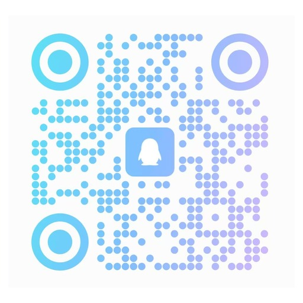

<p align="center"><kbd>　中文　</kbd>　<a href="README.en.md"><kbd>　English　</kbd></a></p>

<h1 align="center">AI 福利站 · Claude Code / Codex 免费额度白嫖导航</h1>

<p align="center">免费额度 · 白嫖 Claude Code / Codex / Cursor 的中转与公益站合集 · 每日签到领福利</p>

<p align="center">
  
  
  
  
</p>

<p align="center">
  <a href="https://agentrouter.org/register?aff=aibw"><b>AgentRouter 注册</b></a> ·
  <a href="https://api520.pro/register?aff=3pox"><b>熊猫API 注册</b></a> ·
  <a href="https://docode.cc/register?aff=1Qof"><b>DoCode 注册</b></a> ·
  <a href="https://us-3.nianhuaapi.com/sign-up?aff=aonj"><b>年华 API 注册</b></a> ·
  <a href="https://free.supxh.xin/register?code=MVU8GX"><b>肖恩AI 注册</b></a> ·
  <a href="https://api456.me/register?aff=zmza"><b>api456.me 注册</b></a> ·
  <a href="https://api.justwoker.icu/register?aff=OIWh"><b>JustDoWork 注册</b></a> ·
  <a href="https://matrix.mzsjai.com/login?redirect=%2Fapp%2Fgrowth%3FinviteCode%3DMX3CDVGATLJW"><b>Matrix 注册</b></a> ·
  <a href="https://seekai.cc/sign-up?aff=dDJy"><b>SeekAi 注册</b></a> ·
  <a href="https://aaawinn.xyz/sign-up?aff=ijFL"><b>Long的AI 注册</b></a> ·
  <a href="https://api.hcnsec.cn/sign-up?aff=3J8z"><b>新疆幻城网安 注册</b></a>
</p>

---

## 🚀 一分钟上车（福利站）

> 下面两张表都是第三方站点，本仓库只做信息聚合。

| 站点 | 状态 | 首日可得 | 额度构成 | 之后每天 | 兼容协议 | 模型 | 注册 | 邀请码 |
| :-- | :--: | :--: | :-- | :--: | :--: | :--: | :--: | :--: |
| **AgentRouter** 🔥 | 🟢 在线 | **$175** | 注册 $100 + 本页邀请 $50 + 首签 $25 | $25/天 | Anthropic + OpenAI | 4 个可查 | <a href="https://agentrouter.org/register?aff=aibw" target="_blank" rel="noopener">点此注册 →</a> | — |
| **熊猫API** 💳 | 🟢 在线 | **200 额度** | 注册 100 额度 + 本页邀请 100 额度 | 无签到 | Anthropic + OpenAI | 151 个可查 | <a href="https://api520.pro/register?aff=3pox" target="_blank" rel="noopener">点此注册 →</a> | — |
| **DoCode** | 🟢 在线 | **300 站内刀** | 注册 50 站内刀 + 本页邀请 250 站内刀 | 无签到 | Anthropic + OpenAI | 需登录查看 | <a href="https://docode.cc/register?aff=1Qof" target="_blank" rel="noopener">点此注册 →</a> | `1Qof` |
| **年华 API** | 🟢 在线 | 站内公示 | — | 支持签到 | Anthropic + OpenAI | 149 个可查 | <a href="https://us-3.nianhuaapi.com/sign-up?aff=aonj" target="_blank" rel="noopener">点此注册 →</a> | `aonj` |
| **肖恩AI** | 🟢 在线 | **≈14000 积分** | 注册 7000 积分 + 本页邀请 5000 积分 + 首签 ≈2000 积分 | ≈2000 积分/天 | Anthropic + OpenAI | 需登录查看 | <a href="https://free.supxh.xin/register?code=MVU8GX" target="_blank" rel="noopener">点此注册 →</a> | `MVU8GX` |
| **api456.me** | 🟢 在线 | **$50** | 注册 $20 + 本页邀请 $20 + 首签 $10 | $10/天 | OpenAI | 需登录查看 | <a href="https://api456.me/register?aff=zmza" target="_blank" rel="noopener">点此注册 →</a> | `zmza` |
| **JustDoWork** | 🟢 在线 | 站内公示 | — | 支持签到 | Anthropic + OpenAI | 需登录查看 | <a href="https://api.justwoker.icu/register?aff=OIWh" target="_blank" rel="noopener">GitHub 注册 →</a> | `OIWh` |
| **Matrix** | 🟢 在线 | **2600 积分** | 本页邀请 600 积分 + 实名认证 2000 积分 | — | OpenAI 兼容 | 需登录查看 | <a href="https://matrix.mzsjai.com/login?redirect=%2Fapp%2Fgrowth%3FinviteCode%3DMX3CDVGATLJW" target="_blank" rel="noopener">点此注册 →</a> | — |
| **SeekAi** | 🔴 异常 | 站内公示 | — | 支持签到 | OpenAI | 需登录查看 | <a href="https://seekai.cc/sign-up?aff=dDJy" target="_blank" rel="noopener">点此注册 →</a> | `dDJy` |
| **Long的AI** | 🟢 在线 | 免费 | 白嫖分组免费 | 无签到 | Anthropic + OpenAI | 需登录查看 | <a href="https://aaawinn.xyz/sign-up?aff=ijFL" target="_blank" rel="noopener">GitHub 注册 →</a> | `ijFL` |
| **新疆幻城网安** | 🟢 在线 | **30000 站内刀** | 注册 30000 站内刀 | 支持签到 | Anthropic + OpenAI | 需登录查看 | <a href="https://api.hcnsec.cn/sign-up?aff=3J8z" target="_blank" rel="noopener">点此注册 →</a> | `3J8z` |

> 「首日可得」= 注册基础额度 + 本页邀请链接额度 + 当天能领的签到额度（每日重置额度池的站点按一天的池子算）；模型、价格、在线状态由脚本抓取站点公开接口自动生成，最后更新：`2026-11-02 01:54 UTC`。
>
> 「邀请码」列写了码的站（DoCode `1Qof`、年华 API `aonj`、肖恩AI `MVU8GX`、api456.me `zmza`、JustDoWork `OIWh`、SeekAi `dDJy`、Long的AI `ijFL`、新疆幻城网安 `3J8z`），注册表单里有一栏要**自己填**，漏填就只拿得到注册基础额度、事后补不上；其余站写 — 是因为邀请额度由链接自带，不用手打。
>
> 5 个按美元计价、且还收新用户的站全注册一遍，第一天手上大约有 **$225** 额度可用；熊猫API 另发 200 额度，DoCode 另发 300 站内刀，肖恩AI 另发 ≈14000 积分，Matrix 另发 2600 积分，Long的AI 另发 免费，新疆幻城网安 另发 30000 站内刀，都是各站自己的计价单位、与美元没有公开换算，未计入这个合计。
>
> 🟡 有 1 个站点已超过 48 小时没抓到接口数据，其明细为上一次成功抓取的快照；在线状态按注册页实际可访问性判断。
>
💳 = 付费中转站：有明确赠送额度，但用完要自己充值、按站内单价计费，别把这里当长期白嫖。

**只想快点用上 Claude Code？** 三步：

1. 点上表的注册链接 → 按站点支持的方式登录（GitHub / 邮箱），额度是按邀请链接发放的，别走裸链
2. 后台「令牌 / API Keys」新建一个 Key
3. 跑一键脚本，或手抄下面对应站点的环境变量

```bash
# 交互式写好 Claude Code 的环境变量（macOS / Linux）
bash scripts/quickstart.sh
```

```powershell
# Windows PowerShell
powershell -ExecutionPolicy Bypass -File scripts/quickstart.ps1
```

## 📚 福利站详情


### 🟢 AgentRouter 🔥 首推

> AI Coding 公益站 · 注册即送额度，签到每日续命

<a href="https://agentrouter.org/register?aff=aibw" target="_blank" rel="noopener"></a>

**为什么值得注册**

- 注册即送 $100，从本页邀请链接进入再多 $50，不需要充值、不需要信用卡
- 每日签到再领 $25，首日合计最高 $175，长期白嫖不断供
- 同时提供 Anthropic 与 OpenAI 两种兼容协议，Claude Code / Codex / Cline / Cursor 都能直连
- 官方文档覆盖十几种客户端，照着抄配置即可

**能拿多少额度**

- 注册即送：**$100**
- 从本页邀请链接注册额外：**$50**（站点接口实测一致）
- 每日签到：**$25/天**（长期续命的关键）
- 首日合计：**$175**　（注册 $100 + 本页邀请 $50 + 首签 $25）

**实时数据**（自动抓取站点公开接口）

- 站点名称：**Agent Router**
- 面板版本：`init-20261016-861e4557`
- 邀请他人可得：**$100**
- 登录方式：GitHub / LinuxDO
- 接口延迟：296 ms

**镜像 / 备用入口**

- 大陆备用域名：<https://ps.air-outer.com> · <a href="https://ps.air-outer.com/register?aff=szt3" target="_blank" rel="noopener">从备用域名注册</a>

**当前可用模型**

| 模型 | 倍率 | 输入 / 1M tokens | 输出 / 1M tokens | 协议 |
| :-- | :--: | :--: | :--: | :--: |
| `claude-opus-5-5` | 3 | $6 | $6 | anthropic / openai |
| `gpt-5.6-sol` | 2 | $4 | $20 | openai |
| `gpt-6-astra` | 4 | $8 | $40 | openai |
| `gpt-6.1-sol` | 2 | $4 | $20 | openai |

<sub>倍率 1 ≈ $2 / 1M tokens，输出价 = 倍率 × 补全倍率 × $2；以站内实时价格为准。</sub>

**注册要求**

- 务必从本页的邀请链接进入注册，否则拿不到邀请额度
- 注册成功后退出再重新登录一次，额度才会显示到账

**接入配置**

<details open><summary><b>Claude Code</b>（Anthropic 兼容，Base URL 不带 <code>/v1</code>）</summary>

```bash
# macOS / Linux
export ANTHROPIC_BASE_URL=https://agentrouter.org
export ANTHROPIC_AUTH_TOKEN=你在站点后台创建的 Key
export ANTHROPIC_MODEL=claude-opus-5-5
npm install -g @anthropic-ai/claude-code@latest && claude
```

```powershell
# Windows PowerShell
$env:ANTHROPIC_BASE_URL = "https://agentrouter.org"
$env:ANTHROPIC_AUTH_TOKEN = "你在站点后台创建的 Key"
$env:ANTHROPIC_MODEL = "claude-opus-5-5"
claude
```

</details>

<details><summary><b>Codex CLI</b>（OpenAI 兼容，写入 <code>~/.codex/config.toml</code>）</summary>

```toml
model = "gpt-6.1-sol"
model_provider = "agentrouter"

[model_providers.agentrouter]
name = "AgentRouter"
base_url = "https://agentrouter.org/v1"
env_key = "AGENTROUTER_API_KEY"
wire_api = "chat"
```

</details>

<details><summary><b>OpenAI SDK / Cherry Studio / Cursor 等通用客户端</b></summary>

```python
from openai import OpenAI

client = OpenAI(api_key="你的 Key", base_url="https://agentrouter.org/v1")
resp = client.chat.completions.create(model="gpt-6.1-sol", messages=[{"role": "user", "content": "ping"}])
print(resp.choices[0].message.content)
```

通用客户端只需填两项：**Base URL** = `https://agentrouter.org/v1`，**API Key** = 站点后台创建的 Key。

</details>

<details><summary><b>连通性自测</b></summary>

```bash
curl -s https://agentrouter.org/v1/chat/completions \
  -H "Authorization: Bearer $KEY" -H "Content-Type: application/json" \
  -d '{"model":"gpt-6.1-sol","messages":[{"role":"user","content":"只回复 OK"}]}'
```

</details>

**如何继续拿额度**

- 每日签到领额度（登录后台点签到）
- 绑定邮箱参与官方不定期抽奖兑换码
- 邀请他人注册，邀请人同样得额度

**⚠️ 使用前必读**

- 官方定位是公益站，不承诺 SLA、不支持充值；上游波动时可能临时停用某些模型
- 请求内容仅支持中 / 英 / 法 / 德 / 俄，其它语言会被拦截并返回 400
- 严禁批量注册、刷量、转售额度、虚假邀请，官方会直接封号

**官方渠道**

- Discord: https://discord.gg/aYq5B4RW3
- X: https://x.com/AgentRouter_0
- 邮箱: agent_router_org@163.com

<details><summary><b>站点最新公告</b>（自动同步）</summary>

- `2026-10-24` 📢 重要通知 claude-opus-5.5 暂时下线，恢复时间另行通知。 gpt-6-astra 取消限量，现已全天候供应，欢迎随时使用。 gpt-6.1sol 不限量低倍率供应，建议优先使用。 📢 Important Notice claude-opus-5.5 is temporarily unavailable. Further updates will follow. gpt-6-astra is now unlimite
- `2026-10-19` ### 📢 供应调整公告 / Supply Adjustment Notice 即日起，**claude-opus-5-5** 模型将实行单独限量供应。每日于**北京时间 9:00**（对应 **UTC 1:00**）投放额度，**用完即止**。 Effective immediately, the **claude-opus-5-5** model will be supplied in limited quantities. Qu
- `2026-09-18` 【分组调整】 不当使用者（非编程用户或使用不支持客户端）将进入 **probation** 分组，**倍率翻倍**并动态更新，以减少浪费。请珍惜额度。 ✅支持客户端： claude-code⭐, codex⭐, openclaw, pi, opencode, ohmyopencode, kilo-code, roocode, cline, crush, droid, qwencode, hermes, zcode, qoder, kim

</details>

---

### 🟢 熊猫API

> New API 付费中转站 · 注册送 100 额度、本页邀请再送 100，151 个模型（Claude Opus 4.6~5 / GPT-6 / Gemini 3.x）按量按次混排

<a href="https://api520.pro/register?aff=3pox" target="_blank" rel="noopener"></a>

**为什么值得注册**

- 注册立得 100 额度，从本页邀请链接进入再得 100，新用户最多一次拿 200 额度（站方 Help 文档原文口径，2026-11-02 核对）
- 公开定价接口免登录可读：2026-11-02 实测 151 条模型记录 = 52 个按量 + 99 个按次（其中 3 条是站方拿模型位当公告栏的占位条目，真模型约 148 个），Claude Opus 4.5~5 与 sonnet 4.6 / fable-5-1、GPT-6 / 6.1-sol / 5.6、Gemini 3.x、Grok、DeepSeek v4.1、Kimi K2.7、MiniMax、GLM 都在架
- Anthropic 与 OpenAI 两条原生路由都活着：匿名 POST /v1/messages 与 /v1/chat/completions 回的是 New API 的 401 Invalid token 而不是 404（2026-11-02 实测），Claude Code 填 Base URL 直连、Codex CLI 走 /v1
- 按次计费的模型把价格写进名字里：kiro Opus 24~27 额度一次、官 key 直连 Opus 280 额度一次、gemini 生图 1 额度一次，单次 1~280 额度不等
- 面板带一键导入 deeplink：CC Switch、Cherry Studio、AionUI、DeepChat、Lobe Chat、OpenCat、AMA 问天等客户端能从后台直接把 Key 推过去
- 站方文档把「买卡密 → 兑换码充值 → 建令牌」三步写全了：1 元 220 额度起，10 元 2200、30 元 6900、50 元 1.2 万、100 元 2.5 万
- 站方文档另列 api521.pro / api522.pro 两个主站域名（本页实测都能打开、面板自报同名），主域名被墙时可以换

**能拿多少额度**

- 注册即送：**100 额度**
- 从本页邀请链接注册额外：**100 额度**
- 首日合计：**200 额度**　（注册 100 额度 + 本页邀请 100 额度）

**实时数据**（自动抓取站点公开接口）

- 站点名称：**熊猫API**
- 面板版本：`v1.0.0-rc.21-5555-gd455867c9-dirty`
- 每日签到：❌
- 开放注册：✅
- 登录方式：账号密码
- 接口延迟：1061 ms

**当前可用模型**

| 模型 | 倍率 | 输入 / 1M tokens | 输出 / 1M tokens | 协议 |
| :-- | :--: | :--: | :--: | :--: |
| `gpt-5.5` | 0.0006125 | 0.001 额度 | 0.01 额度 | openai |
| `gpt-5.6-sol` | 0.0005439 | 0.001 额度 | 0.007 额度 | openai |
| `gpt-5.6-terra` | 0.0002156 | 0 额度 | 0.003 额度 | openai |
| `gpt-6-astra` | 0.002001 | 0.004 额度 | 0.02 额度 | openai |
| `gpt-6-sol` | 0.0003864 | 0.001 额度 | 0.004 额度 | openai |
| `gpt-6.1-sol` | 0.0003864 | 0.001 额度 | 0.004 额度 | openai |
| `按量模型是根据输入输出字数算额度的~要控制字数喔` | 按次 | **4 额度 / 次** | — | openai |
| `测试` | 0.00209484 | 0.004 额度 | 0.021 额度 | openai |
| `熊猫-10-deepseek-v4-pro` | 按次 | **10 额度 / 次** | — | openai |
| `熊猫-10-glm-5.3` | 按次 | **10 额度 / 次** | — | openai |
| `熊猫-13-glm-5.2` | 按次 | **13 额度 / 次** | — | openai |
| `熊猫-15-gemini-生图image-nano-banana-2` | 按次 | **1 额度 / 次** | — | openai |
| `熊猫-7-deepsees-v4-flash` | 按次 | **7 额度 / 次** | — | openai |
| `熊猫-7-ds-v4-flash` | 按次 | **7 额度 / 次** | — | openai |
| `熊猫-8-deepseek-v4.1-flash` | 按次 | **8 额度 / 次** | — | openai |
| `熊猫-8-glm-5.1` | 按次 | **8 额度 / 次** | — | openai |
| `熊猫-8-qwen3.8-max` | 按次 | **8 额度 / 次** | — | openai |
| `熊猫-A-10-gemini-3.1-pro-preview-1000k` | 按次 | **10 额度 / 次** | — | openai |
| `熊猫-A-10-grok-4.5` | 按次 | **10 额度 / 次** | — | openai |
| `熊猫-A-10-grok-4.6` | 按次 | **10 额度 / 次** | — | openai |
| `熊猫-A-10-grok-4.7` | 按次 | **10 额度 / 次** | — | openai |
| `熊猫-A-13-MiniMax-M2.7` | 按次 | **13 额度 / 次** | — | openai |
| `熊猫-A-14-MiniMax-M2.7-highspeed-高速` | 按次 | **14 额度 / 次** | — | openai |
| `熊猫-A-15-gemini-3.1-pro-满血` | 按次 | **15 额度 / 次** | — | openai |
| `熊猫-A-15-MiniMax-M3` | 按次 | **15 额度 / 次** | — | openai |
| `熊猫-A-16-MiniMax-M3-highspeed-高速` | 按次 | **16 额度 / 次** | — | openai |
| `熊猫-A-18-claude-sonnet-4-6-逆` | 按次 | **18 额度 / 次** | — | openai |
| `熊猫-A-19-claude-sonnet-4.6` | 按次 | **19 额度 / 次** | — | openai |
| `熊猫-A-2-gemini-2.5-flash` | 按次 | **2 额度 / 次** | — | openai |
| `熊猫-A-2-gemini-3.5-flash-lite` | 按次 | **2 额度 / 次** | — | openai |
| `熊猫-A-27-kimi-k2.7` | 按次 | **27 额度 / 次** | — | openai |
| `熊猫-A-29-claude-opus-4.6` | 按次 | **29 额度 / 次** | — | openai |
| `熊猫-A-29-claude-opus-4.7` | 按次 | **29 额度 / 次** | — | openai |
| `熊猫-A-29-claude-opus-4.8` | 按次 | **29 额度 / 次** | — | openai |
| `熊猫-A-3-gemini-3-flash-preview` | 按次 | **3 额度 / 次** | — | openai |
| `熊猫-A-3-gemini-3.1-flash-lite` | 按次 | **3 额度 / 次** | — | openai |
| `熊猫-A-39-gemini-4-argon-high-反重力ultra` | 按次 | **39 额度 / 次** | — | openai |
| `熊猫-A-8-kimi-k2.6` | 按次 | **8 额度 / 次** | — | openai |
| `熊猫-A-9-gemini-3.8-flash-search` | 按次 | **9 额度 / 次** | — | openai |
| `熊猫-A-9-gemini-3.8-flash-反重力-tob` | 按次 | **9 额度 / 次** | — | openai |
| `熊猫-aiStudio官-X-20-gemini-3.1-pro-preview` | 按次 | **20 额度 / 次** | — | openai |
| `熊猫-aiStudio官-X-20-gemini-3.1-pro-preview-thinking` | 按次 | **20 额度 / 次** | — | openai |
| `熊猫-aiStudio官-X-20-gemini-3.1-pro-preview-联网` | 按次 | **20 额度 / 次** | — | openai |
| `熊猫-B-10-gemini-3.7-flash` | 按次 | **10 额度 / 次** | — | openai |
| `熊猫-B-7-gemini-3.6-flash-高质量逆` | 按次 | **7 额度 / 次** | — | openai |
| `熊猫-gemini-3.8-flash-反重力-稳定名` | 按次 | **9 额度 / 次** | — | openai |
| `熊猫-K-17-kiro-claude-sonnet-5` | 按次 | **17 额度 / 次** | — | openai |
| `熊猫-vertex逆-23-gemini-3.1-pro-preview` | 按次 | **23 额度 / 次** | — | openai |
| `熊猫-vertex逆-49-gemini-4-argon` | 按次 | **49 额度 / 次** | — | openai |
| `熊猫-W-39-限时官key-claude-sonnet-5` | 按次 | **39 额度 / 次** | — | openai |
| `熊猫-X-10-AS正向-gemini-3.6-flash` | 按次 | **10 额度 / 次** | — | openai |
| `熊猫-X-10-官逆-gemini-3.1-pro` | 按次 | **10 额度 / 次** | — | openai |
| `熊猫-X-10-官逆-gemini-3.1-pro-联网` | 按次 | **10 额度 / 次** | — | openai |
| `熊猫-x-11-gemini-3.1-pro-anti` | 按次 | **11 额度 / 次** | — | openai |
| `熊猫-X-24-kiro-claude-opus-4.5` | 37.5 | 75 额度 | 375 额度 | openai |
| `熊猫-X-24-kiro-claude-opus-4.6` | 按次 | **24 额度 / 次** | — | openai |
| `熊猫-X-24-kiro-claude-opus-4.7` | 按次 | **24 额度 / 次** | — | openai |
| `熊猫-X-24-kiro-claude-opus-4.8` | 按次 | **24 额度 / 次** | — | openai |
| `熊猫-X-24-kiro-claude-opus-5` | 按次 | **24 额度 / 次** | — | openai |
| `熊猫-X-24-kiro-claude-opus-5.5` | 37.5 | 75 额度 | 75 额度 | openai |
| `熊猫-X-27-kiro-claude-opus-4.5` | 按次 | **27 额度 / 次** | — | openai |
| `熊猫-X-27-kiro-claude-opus-4.6` | 按次 | **27 额度 / 次** | — | openai |
| `熊猫-X-27-kiro-claude-opus-4.7` | 按次 | **27 额度 / 次** | — | openai |
| `熊猫-X-27-kiro-claude-opus-4.8` | 按次 | **27 额度 / 次** | — | openai |
| `熊猫-X-27-kiro-claude-opus-5` | 按次 | **27 额度 / 次** | — | openai |
| `熊猫-X-27-kiro-claude-opus-5.5` | 按次 | **27 额度 / 次** | — | openai |
| `熊猫-X-29-claude-opus-5` | 按次 | **29 额度 / 次** | — | openai |
| `熊猫-x-29-最强生图-gpt-image-2.5` | 按次 | **29 额度 / 次** | — | openai |
| `熊猫-官key质量-88-claude-opus-5.5` | 按次 | **88 额度 / 次** | — | openai |
| `熊猫-官逆-14-gemini-4-pro-argon` | 按次 | **14 额度 / 次** | — | openai |
| `熊猫-官逆-7-gemini-3.1-pro` | 按次 | **7 额度 / 次** | — | openai |
| `熊猫-官逆-7-gemini-3.1-pro-thinking` | 按次 | **7 额度 / 次** | — | openai |
| `熊猫-官逆-7-gemini-3.6-flash` | 按次 | **7 额度 / 次** | — | openai |
| `熊猫-官逆-7-gemini-3.6-flash-thinking` | 按次 | **7 额度 / 次** | — | openai |
| `熊猫-官逆-7-gemini-3.7-flash` | 按次 | **7 额度 / 次** | — | openai |
| `熊猫-官逆-7-gemini-3.7-flash-thinking` | 按次 | **7 额度 / 次** | — | openai |
| `熊猫-官逆-7-gemini-3.8-flash` | 按次 | **7 额度 / 次** | — | openai |
| `熊猫-按量-gpt-5.4` | 0.00036875 | 0.001 额度 | 0.006 额度 | openai |
| `熊猫-按量-gpt-5.5` | 0.0006125 | 0.001 额度 | 0.01 额度 | openai |
| `熊猫-按量-gpt-5.6-terra` | 0.000245 | 0 额度 | 0.003 额度 | openai |
| `熊猫-按量-gpt-6-astra` | 0.002001 | 0.004 额度 | 0.02 额度 | openai |
| `熊猫-按量-gpt-6-sol` | 0.0003864 | 0.001 额度 | 0.004 额度 | openai |
| `熊猫-按量-gpt-6.1-sol` | 0.0003864 | 0.001 额度 | 0.004 额度 | openai |
| `熊猫-按量-vertex官-gemini-2.5-pro` | 0.0010125 | 0.002 额度 | 0.016 额度 | openai |
| `熊猫-按量-vertex官-gemini-3.1-pro-preview` | 0.00162 | 0.003 额度 | 0.013 额度 | openai |
| `熊猫-按量-vertex官-gemini-4-argon` | 0.00162 | 0.003 额度 | 0.016 额度 | openai |
| `熊猫-按量-满血非量化-deepseek-v4-pro` | 0.0004554 | 0.001 额度 | 0.002 额度 | openai |
| `熊猫-按量-满血非量化-deepseek-v4.1-flash` | 0.000112 | 0 额度 | 0.001 额度 | openai |
| `熊猫-按量-满血非量化-glm-5.2` | 0.0012144 | 0.002 额度 | 0.009 额度 | openai |
| `熊猫-按量-满血非量化-kimi-k3` | 0.003036 | 0.006 额度 | 0.03 额度 | openai |
| `熊猫-按量-特供顶级-官方正向满血-claude-fable-5-神话模型` | 0.009 | 0.018 额度 | 0.09 额度 | anthropic / openai |
| `熊猫-按量-特供顶级-官方正向满血-claude-haiku-4.5` | 0.00075 | 0.002 额度 | 0.008 额度 | anthropic / openai |
| `熊猫-按量-特供顶级-官方正向满血-claude-opus-4.6` | 0.00375 | 0.008 额度 | 0.038 额度 | anthropic / openai |
| `熊猫-按量-特供顶级-官方正向满血-claude-opus-4.6-thinking` | 0.00375 | 0.008 额度 | 0.038 额度 | anthropic / openai |
| `熊猫-按量-特供顶级-官方正向满血-claude-opus-4.7` | 0.00375 | 0.008 额度 | 0.038 额度 | anthropic / openai |
| `熊猫-按量-特供顶级-官方正向满血-claude-opus-4.8` | 0.00375 | 0.008 额度 | 0.038 额度 | anthropic / openai |
| `熊猫-按量-特供顶级-官方正向满血-claude-sonnet-4.6` | 0.00225 | 0.005 额度 | 0.023 额度 | anthropic / openai |
| `熊猫-按量-特供顶级-官方正向满血-claude-sonnet-4.6-thinking` | 0.00225 | 0.005 额度 | 0.023 额度 | anthropic / openai |
| `熊猫-按量-顶级特供-官max-claude-fable-5-1` | 0.009 | 0.018 额度 | 0.09 额度 | anthropic / openai |
| `熊猫-按量-顶级特供-官max-claude-fable-5-神话模型` | 0.009 | 0.018 额度 | 0.09 额度 | anthropic / openai |
| `熊猫-按量-顶级特供-官max-claude-haiku-4.5` | 0.00075 | 0.002 额度 | 0.008 额度 | anthropic / openai |
| `熊猫-按量-顶级特供-官max-claude-opus-4.6` | 0.00375 | 0.008 额度 | 0.038 额度 | anthropic / openai |
| `熊猫-按量-顶级特供-官max-claude-opus-4.6-thinking` | 0.00375 | 0.008 额度 | 0.038 额度 | anthropic / openai |
| `熊猫-按量-顶级特供-官max-claude-opus-4.7` | 0.00375 | 0.008 额度 | 0.038 额度 | anthropic / openai |
| `熊猫-按量-顶级特供-官max-claude-opus-4.8` | 0.00375 | 0.008 额度 | 0.038 额度 | anthropic / openai |
| `熊猫-按量-顶级特供-官max-claude-opus-5` | 0.00375 | 0.008 额度 | 0.038 额度 | anthropic / openai |
| `熊猫-按量-顶级特供-官max-claude-opus-5.5` | 0.00336 | 0.007 额度 | 0.034 额度 | anthropic / openai |
| `熊猫-按量-顶级特供-官max-claude-sonnet-4.6` | 0.00225 | 0.005 额度 | 0.023 额度 | anthropic / openai |
| `熊猫-特供-7-claude-haiku-4.5-20251001-满血速度快` | 按次 | **7 额度 / 次** | — | openai |
| `熊猫-特供-A-55-claude-opus-4.5-thinking` | 按次 | **55 额度 / 次** | — | openai |
| `熊猫-特供-A-55-claude-opus-4.6` | 按次 | **55 额度 / 次** | — | openai |
| `熊猫-特供-A-55-claude-opus-4.6-thinking` | 按次 | **55 额度 / 次** | — | openai |
| `熊猫-特供-X-10-gpt-5.5` | 按次 | **10 额度 / 次** | — | openai |
| `熊猫-特供-X-19-gpt-5.6-terra` | 按次 | **19 额度 / 次** | — | openai |
| `熊猫-特供-X-22-gpt-5.6-sol` | 按次 | **22 额度 / 次** | — | openai |
| `熊猫-特供-官key直连-200额度-claude-opus-4.8` | 按次 | **200 额度 / 次** | — | openai |
| `熊猫-特供-官key直连-280额度-claude-opus-4.6` | 按次 | **280 额度 / 次** | — | openai |
| `熊猫-特供-官key直连-280额度-claude-opus-4.6-thinking` | 按次 | **280 额度 / 次** | — | openai |
| `熊猫-特供-官key直连-280额度-claude-opus-4.7` | 按次 | **280 额度 / 次** | — | openai |
| `熊猫-特供-官key直连-280额度-claude-opus-4.7-thinking` | 按次 | **280 额度 / 次** | — | openai |
| `熊猫-特供-官key直连-280额度-claude-opus-4.8` | 按次 | **280 额度 / 次** | — | openai |
| `熊猫-特供-官key直连-280额度-claude-opus-4.8-thinking` | 按次 | **280 额度 / 次** | — | openai |
| `熊猫-特供-按量-满血逆-claude-opus-4-6` | 0.001035 | 0.002 额度 | 0.01 额度 | anthropic / openai |
| `熊猫-特供-按量-满血逆-claude-opus-4-7` | 0.001035 | 0.002 额度 | 0.01 额度 | anthropic / openai |
| `熊猫-特供-按量-满血逆-claude-opus-4-8` | 0.001035 | 0.002 额度 | 0.01 额度 | anthropic / openai |
| `熊猫-特供-按量-满血逆-claude-opus-5.5` | 0.0007728 | 0.002 额度 | 0.008 额度 | anthropic / openai |
| `熊猫-特供-按量-满血逆-claude-sonnet-4-6` | 0.000621 | 0.001 额度 | 0.006 额度 | anthropic / openai |
| `熊猫-特供-按量-满血逆-claude-sonnet-4.6` | 0.000531 | 0.001 额度 | 0.005 额度 | anthropic / openai |
| `熊猫-逆向-66-claude-opus-4.6` | 按次 | **66 额度 / 次** | — | openai |
| `熊猫-限时官key-88-claude-opus-4.6` | 按次 | **88 额度 / 次** | — | openai |
| `熊猫-限时官key-88-claude-opus-4.7` | 按次 | **88 额度 / 次** | — | openai |
| `熊猫-限时官key-88-claude-opus-4.8` | 按次 | **88 额度 / 次** | — | openai |
| `熊猫-限时官key质量-88-claude-opus-5` | 按次 | **88 额度 / 次** | — | openai |
| `熊猫-顶级-21-vertex逆-gemini-2.5-pro` | 按次 | **21 额度 / 次** | — | openai |
| `熊猫-顶级-21-vertex逆-gemini-3.1-pro-preview` | 按次 | **21 额度 / 次** | — | openai |
| `熊猫-顶级-X-25-不截断-claude-sonnet-4.6` | 按次 | **25 额度 / 次** | — | openai |
| `熊猫-顶级-X-25-不截断-claude-sonnet-4.6-thinking` | 按次 | **25 额度 / 次** | — | openai |
| `熊猫特供-anti-99-claude-opus-4.6` | 按次 | **99 额度 / 次** | — | openai |
| `熊猫特供-anti-99-claude-opus-4.6-thinking` | 按次 | **99 额度 / 次** | — | openai |
| `熊猫特供-按量-SSS-gemini-3.1-pro-preview` | 0.00075 | 0.002 额度 | 0.009 额度 | openai |
| `熊猫特供-按量-SSS-gemini-3.1-pro-preview-thinking` | 0.00075 | 0.002 额度 | 0.009 额度 | openai |
| `熊猫特供-按量-SSS-gemini-3.6-flash` | 0.0000711 | 0 额度 | 0.001 额度 | openai |
| `熊猫特供-按量-SSS-gemini-3.8-flash` | 0.00003555 | 0 额度 | 0 额度 | openai |
| `熊猫特供-超纯满血-99额度-claude-opus-4.5` | 按次 | **99 额度 / 次** | — | openai |
| `熊猫特供-超纯满血-99额度-claude-opus-4.5-thinking` | 按次 | **99 额度 / 次** | — | openai |
| `熊猫特供-超纯满血-99额度-claude-opus-4.6` | 按次 | **99 额度 / 次** | — | openai |
| `熊猫特供-超纯满血-99额度-claude-opus-4.6-thinking` | 按次 | **99 额度 / 次** | — | openai |
| `熊猫特供-超纯满血-99额度-claude-opus-4.7` | 按次 | **99 额度 / 次** | — | openai |
| `熊猫特供-超纯满血-99额度-claude-opus-4.7-thinking` | 按次 | **99 额度 / 次** | — | openai |
| `熊猫特供S-按量-gemini-3-flash-preview` | 0.0000675 | 0 额度 | 0.001 额度 | openai |
| `随时看 look.api520.pro  监控网站  ～所有模型都超稳` | 37.5 | 75 额度 | 75 额度 | openai |

<sub>标「按次」的模型按请求次数计费，与 tokens 无关；其余按倍率换算，站内以「额度」结算、还要再乘分组倍率。以站内实时价格为准。</sub>

**注册要求**

- 务必从本页邀请链接进入注册（带 ?aff=3pox），被邀请的那 100 额度才会结算
- 只有邮箱 + 密码一条路：面板里 GitHub / LinuxDO / Telegram / 微信 / OIDC / Passkey 的开关全是关的（github_oauth = false、password_register_enabled = true）
- 注册要邮箱验证码（email_verification = true），还要过 Cloudflare Turnstile 人机校验（turnstile_check = true）
- 站方文档提醒「注册邮箱有特殊限制」，常用邮箱被拒时按文档提交售后处理

**接入配置**

<details open><summary><b>Claude Code</b>（Anthropic 兼容，Base URL 不带 <code>/v1</code>）</summary>

```bash
# macOS / Linux
export ANTHROPIC_BASE_URL=https://api520.pro
export ANTHROPIC_AUTH_TOKEN=你在站点后台创建的 Key
export ANTHROPIC_MODEL=<登录后台查看可用模型名>
npm install -g @anthropic-ai/claude-code@latest && claude
```

```powershell
# Windows PowerShell
$env:ANTHROPIC_BASE_URL = "https://api520.pro"
$env:ANTHROPIC_AUTH_TOKEN = "你在站点后台创建的 Key"
$env:ANTHROPIC_MODEL = "<登录后台查看可用模型名>"
claude
```

</details>

<details><summary><b>Codex CLI</b>（OpenAI 兼容，写入 <code>~/.codex/config.toml</code>）</summary>

```toml
model = "gpt-6.1-sol"
model_provider = "api520"

[model_providers.api520]
name = "熊猫API"
base_url = "https://api520.pro/v1"
env_key = "API520_API_KEY"
wire_api = "chat"
```

</details>

<details><summary><b>OpenAI SDK / Cherry Studio / Cursor 等通用客户端</b></summary>

```python
from openai import OpenAI

client = OpenAI(api_key="你的 Key", base_url="https://api520.pro/v1")
resp = client.chat.completions.create(model="gpt-6.1-sol", messages=[{"role": "user", "content": "ping"}])
print(resp.choices[0].message.content)
```

通用客户端只需填两项：**Base URL** = `https://api520.pro/v1`，**API Key** = 站点后台创建的 Key。

</details>

<details><summary><b>连通性自测</b></summary>

```bash
curl -s https://api520.pro/v1/chat/completions \
  -H "Authorization: Bearer $KEY" -H "Content-Type: application/json" \
  -d '{"model":"gpt-6.1-sol","messages":[{"role":"user","content":"只回复 OK"}]}'
```

</details>

**如何继续拿额度**

- 邀请好友：邀请人与被邀请人各得 100 额度，站方文档写明上不封顶
- 站内任务中心开着（enable_task = true），具体奖励公开接口拿不到，登录后台看
- 兑换码充值：控制台 → 钱包管理 → 兑换码充值，卡密从站方淘宝小店买
- 没有每日签到（面板自报 checkin_enabled = false），想续额度只能靠邀请、任务或买卡密

**⚠️ 使用前必读**

- 这是付费中转站，不是公益站：200 额度按站方公示的 1 元 ≈ 220 额度折算约 ¥0.9，按按次价目最多跑 1 次官 key 直连 Opus（280 额度 / 次）或 8 次 kiro Opus（24~27 额度 / 次），只够试吃
- 站内「额度」是自定义单位（🍚、quota_display_type = CUSTOM、price = 7.3），站方没有公开额度与美元的换算，本页按额度原样登记、不折算、也不并入跨站美元合计
- 站点极新：面板 start_time = 2026-10-31，收录时运营不到 3 天，没有历史可用性可查，跑路、改价、改规则的风险自己评估
- 同名模型有多条渠道（官逆 / 逆向 / 官方正向 / kiro / vertex 逆），站方不公示上游来源，「claude-opus-5」不等于官方直连，重活别全压上去
- 公开状态接口的 announcements 字段是空的，站方也不开 Telegram / QQ 群，出问题只能看 Help 文档或找淘宝店客服
- 注册页、API、定价接口都在 Cloudflare 后面，机房 IP 打注册页可能被 403 拦（本页自动探测也常因此显示异常），家用宽带正常
- 按次模型不看 token，但单次 1~280 额度；按量模型的实际扣费 = 倍率 × 分组倍率，以控制台实时价格为准

**官方渠道**

- 文档: https://help.api521.pro
- 购买: https://s.tb.cn/c.0x5qxf（站方文档公示的淘宝小店「熊猫ai的小店2店」）
- 监控: https://look.api520.pro（站方在模型位里公示的监控站，2026-11-02 实测可打开）
- 备用域名: https://api521.pro / https://api522.pro（站方文档标注主站 2 / 主站 3）

---

### 🟢 DoCode

> New API 中转站 · 注册送 50 站内刀，注册时填邀请码 zMRe 再加 250，首日 300 刀，Claude 与 GPT 都在架上

<a href="https://docode.cc/register?aff=1Qof" target="_blank" rel="noopener"></a>

**为什么值得注册**

- ⚠️ 别漏了邀请码：注册表单里的「邀请码」一栏填 zMRe，这 250 站内刀才会到账。从本页链接进去通常会自动带上，但提交前务必肉眼确认那一栏不是空的——没填就只有注册送的 50，事后补不上
- 注册送 50 站内刀，填了邀请码 zMRe 再加 250，首日 300 刀不用充值——注意这个「刀」是站内计价单位，不是美元，换算见下面的风险提示
- Claude 和 GPT 同时在架：站内公告点名 cc / cc-kiro 分组的 sonnet-5、按次计费的 opus4.6，以及 GPT pro / plus、Grok、Gemini、fable-5，一把 Key 通吃，本页多数站只给其中一边
- Anthropic 与 OpenAI 两条原生路由都开着（不带 key 探 /v1/messages 与 /v1/chat/completions 都回 New API 的 401 Invalid token），Claude Code 填 Base URL 就能直连，Codex CLI 走 /v1
- 面板公开配置里带着一键导入的 deeplink：CC Switch、Cherry Studio、DeepChat、OpenCat、Lobe Chat 等客户端可以从后台直接把 Key 推过去
- 主域名之外还有 api.docode.cc（公告写「直连美国」），实测两个入口都活着，主站进不去时可以换

**能拿多少额度**

- 注册即送：**50 站内刀**
- 从本页邀请链接注册额外：**250 站内刀**
- 首日合计：**300 站内刀**　（注册 50 站内刀 + 本页邀请 250 站内刀）

**实时数据**（自动抓取站点公开接口）

- 站点名称：**DoCode**
- 每日签到：❌
- 开放注册：✅
- 登录方式：账号密码
- 接口延迟：1519 ms

**镜像 / 备用入口**

- 直连美国：<https://api.docode.cc> · <a href="https://api.docode.cc/register?aff=zMRe" target="_blank" rel="noopener">从备用域名注册</a>

> 该站把定价页设成了登录可见（`/api/pricing` 返回 401，站点自己的导航配置里 pricing.requireAuth = true），本页不列模型表。站内公告点名在售的有 Claude（cc / cc-kiro 分组，sonnet-5 与按次计费的 opus4.6）、GPT pro / plus、Grok、Gemini、fable-5，另有独立的生图入口 img.docode.cc；完整清单、分组与倍率注册后在控制台「定价」页确认。

**注册要求**

- 邀请码 = zMRe。从本页链接进入（带 ?aff=zMRe）通常会自动填进注册表单的「邀请码」栏，提交前自己再看一眼；空着就只拿得到注册送的 50 站内刀
- 250 站内刀在注册那一刻结算，注册完再去后台补填邀请码是没用的
- 只能邮箱 + 密码建号：公开配置里 github / linuxdo / discord / telegram / 微信 / OIDC / Passkey 的开关全是 false，没有第三方登录入口
- 注册要邮箱验证码（email_verification = true），并且开着 Cloudflare Turnstile 人机校验
- 主域名打不开时换 api.docode.cc，同一套账号与额度

**接入配置**

<details open><summary><b>Claude Code</b>（Anthropic 兼容，Base URL 不带 <code>/v1</code>）</summary>

```bash
# macOS / Linux
export ANTHROPIC_BASE_URL=https://docode.cc
export ANTHROPIC_AUTH_TOKEN=你在站点后台创建的 Key
export ANTHROPIC_MODEL=<登录后台查看可用模型名>
npm install -g @anthropic-ai/claude-code@latest && claude
```

```powershell
# Windows PowerShell
$env:ANTHROPIC_BASE_URL = "https://docode.cc"
$env:ANTHROPIC_AUTH_TOKEN = "你在站点后台创建的 Key"
$env:ANTHROPIC_MODEL = "<登录后台查看可用模型名>"
claude
```

</details>

<details><summary><b>Codex CLI</b>（OpenAI 兼容，写入 <code>~/.codex/config.toml</code>）</summary>

```toml
model = "<登录后台查看可用模型名>"
model_provider = "docode"

[model_providers.docode]
name = "DoCode"
base_url = "https://docode.cc/v1"
env_key = "DOCODE_API_KEY"
wire_api = "chat"
```

</details>

<details><summary><b>OpenAI SDK / Cherry Studio / Cursor 等通用客户端</b></summary>

```python
from openai import OpenAI

client = OpenAI(api_key="你的 Key", base_url="https://docode.cc/v1")
resp = client.chat.completions.create(model="<登录后台查看可用模型名>", messages=[{"role": "user", "content": "ping"}])
print(resp.choices[0].message.content)
```

通用客户端只需填两项：**Base URL** = `https://docode.cc/v1`，**API Key** = 站点后台创建的 Key。

</details>

<details><summary><b>连通性自测</b></summary>

```bash
curl -s https://docode.cc/v1/chat/completions \
  -H "Authorization: Bearer $KEY" -H "Content-Type: application/json" \
  -d '{"model":"<登录后台查看可用模型名>","messages":[{"role":"user","content":"只回复 OK"}]}'
```

</details>

**如何继续拿额度**

- 站内没有签到（面板自报 checkin_enabled = false），额度靠充值和不定时活动，公告里出现过「充 100 送 500 刀」这类限时加码
- 邀请他人注册也有奖励，公告里提过 VIP 用户拉新额度从 80 上调至 120，具体金额登录后台「邀请」页确认

**⚠️ 使用前必读**

- 站内的「刀」不是美元：面板公开的 price = 0.02 就是充值比例，1 元 = 50 站内刀（公告里说平时恢复 1:25），而本页其它站是 ¥7.3 ≈ $1。所以 300 站内刀对应的充值面值只有 ¥6~12，本页也没把它并进跨站的美元合计
- 扣费还要再乘站内倍率：公告里 GPT pro 分组长期在 7~14 倍之间随上游号商价格来回调（New API 口径：倍率 1 = $2 / 百万 tokens）。按 13 倍粗算，300 站内刀约合一千万 tokens 量级的输入额度，输出还要乘补全倍率——量不算小，但一切以控制台实时倍率为准
- 额度数字（注册 50 / 邀请 250）站点公开接口没有暴露：/api/status 里既没有 quota_for_new_user 也没有 quota_for_invitee，本页登记的是站内公示口径，进后台核对一遍再算账
- 没有每日签到，额度用完只能充值或等活动，不像 AgentRouter 那样能每天续命
- 这是付费中转站不是公益站：后台开着在线充值（Stripe 单价 ¥8），公告里大半是充值送额度与倍率涨跌，免费额度用完要付费才能续
- 站内 FAQ 公示的备用域名 ai.docode.pro / ai.docode.life 与公告里的 hk.docode.cc 目前 HTTPS 都连不上（前两个的证书只签了 docode.cc、域名对不上，hk 直接 TLS 握手失败），本页只登记实测可用的 api.docode.cc
- 上游波动写在公告里：GPT plus「全面阵亡」后又「暂时复活」、gpt-5.4 已彻底下架、9 月 10 日还在说「openai 炸了，gpt 全线都不太行」，别当稳定生产通道用

<details><summary><b>站点最新公告</b>（自动同步）</summary>

- `2026-10-22` Gemini Ultra分组上架，仅Gemini 4 Argon，高中低三档模型
- `2026-10-15` -已修复好！ 生图功能暂时不可用，原因为 OpenAI 官方协议变更。 预计这两天修复好
- `2026-10-09` gpt 全系已大幅下调倍率，gptpro 最低 7 倍，不降智最低 15 倍，官 key 最低 24 倍。

</details>

---

### 🟢 年华 API

> New API 定制版中转站 · 倍率公开可查（89 模型 / 16 分组），签到领随机额度，公益分组 0.05 倍率、另有 0 元一次的多模态模型

<a href="https://us-3.nianhuaapi.com/sign-up?aff=aonj" target="_blank" rel="noopener"></a>

**为什么值得注册**

- 89 个模型、16 个分组的倍率都挂在公开接口上（/api/pricing 免登录可读，2026-09-24 实测），Claude 侧有 opus-5 / opus-5-5 / opus-4-8 / sonnet-5 / fable-5-1，GPT 侧有 gpt-6 系与 gpt-5.6 系，Grok 4.3~4.6、Gemini 3.x、kiro 分组都在架
- 「公益」分组组倍率 0.05，是站内最便宜的计价分组（11 个模型，含 gpt-5-5 / gpt-5-3 / gpt-5-mini / agnes 系，面板分组说明写「svip 免费」），另有 3 个标价 0 元的 MiMo 语音模型（mimo-v2.5-tts / -voiceclone / -voicedesign）
- 每日签到已开启（面板 checkin_enabled = true），奖励是随机额度，长期白嫖有续命来源
- 四套端点都活着：/v1/chat/completions、/v1/messages、/v1/responses、/v1/images/generations 匿名请求返回 401 而不是 404（2026-09-24 实测），另有 Gemini 原生路径与 /v1/embeddings，Claude Code / Codex / Gemini CLI 都能对接
- 站方文档把三条线路讲清楚了：US3 是唯一 Web 前端与默认 API 入口，US1 与原主节点只作 API 备用线路，「所有活动节点共享账号、令牌、余额和模型权限」，换线路不用重新注册
- 客户端填法官方文档直接给表：Claude Code 填 https://us-3.nianhuaapi.com（Messages 路径 /v1/messages），Codex / Cherry Studio / Open WebUI 填 https://us-3.nianhuaapi.com/v1；面板 FAQ 还写了 CC Switch 一键导入（令牌管理页「更多 → CC Switch」）

**实时数据**（自动抓取站点公开接口）

- 站点名称：**年华 API 中转站**
- 面板版本：`1.0.0-rc.46-nianhua-payguard-20261025`
- 每日签到：✅
- 开放注册：✅
- 登录方式：账号密码
- 接口延迟：1450 ms

**当前可用模型**

| 模型 | 倍率 | 输入 / 1M tokens | 输出 / 1M tokens | 协议 |
| :-- | :--: | :--: | :--: | :--: |
| `agnes-1.5-flash` | 按次 | **$1 / 次** | — | openai |
| `agnes-2.0-flash` | 按次 | **$1 / 次** | — | openai |
| `agnes-2.5-flash` | 37.5 | $75 | $75 | openai |
| `agnes-3.0-flash` | 37.5 | $75 | $75 | openai |
| `agnes-image-2.0-flash` | 37.5 | $75 | $75 | openai |
| `agnes-image-2.1-flash` | 37.5 | $75 | $75 | openai |
| `agnes-image-2.5-flash` | 37.5 | $75 | $75 | openai |
| `agnes-video-2.5-flash` | 37.5 | $75 | $75 | openai |
| `bge-m3` | 0 | $0 | $0 | openai |
| `bge-multilingual-gemma2` | 0 | $0 | $0 | openai |
| `big-pickle` | 0 | $0 | $0 | openai |
| `cat-jam-free` | 0 | $0 | $0 | openai |
| `claude-fable-5` | 5 | $10 | $50 | anthropic / openai |
| `claude-fable-5-1` | 5 | $10 | $50 | anthropic / openai |
| `claude-haiku-4-5` | 0.5 | $1 | $5 | anthropic / openai |
| `claude-haiku-4-5-20251001` | 0.5 | $1 | $5 | anthropic / openai |
| `claude-opus-4-6` | 2.5 | $5 | $25 | anthropic / openai |
| `claude-opus-4-6-thinking` | 2.5 | $5 | $25 | anthropic / openai |
| `claude-opus-4-7` | 2.5 | $5 | $25 | anthropic / openai |
| `claude-opus-4-8` | 2.5 | $5 | $25 | anthropic / openai |
| `claude-opus-5` | 2.5 | $5 | $25 | anthropic / openai |
| `claude-opus-5-5` | 2 | $4 | $20 | anthropic / openai |
| `claude-sonnet-4-6` | 1.5 | $3 | $15 | anthropic / openai |
| `claude-sonnet-4-6-thinking` | 2.5 | $5 | $25 | anthropic / openai |
| `claude-sonnet-5` | 1.5 | $3 | $3 | anthropic / openai |
| `claude-sonnet-5-5` | 37.5 | $75 | $75 | anthropic / openai |
| `codex-auto-review` | 1.25 | $2.5 | $15 | openai |
| `codex-gpt-image-2` | 按次 | **$0.3 / 次** | — | image-generation / openai |
| `cohere/north-mini-code:free` | 0 | $0 | $0 | openai |
| `DeepSeek-V4-Flash-0731` | 1.5 | $3 | $9 | openai |
| `deepseek-v4.1-flash-free` | 1 | $2 | $8 | openai |
| `dots-studio/dots-3-note-preview:free` | 0 | $0 | $0 | openai |
| `gemini-2.5-flash` | 0.15 | $0.3 | $2.5 | gemini / openai |
| `gemini-2.5-flash-lite` | 0.05 | $0.1 | $0.4 | gemini / openai |
| `gemini-2.5-pro` | 0.625 | $1.25 | $10 | gemini / openai |
| `gemini-3-flash` | 0.25 | $0.5 | $3 | gemini / openai |
| `gemini-3-flash-agent` | 0.125 | $0.25 | $1.5 | gemini / openai |
| `gemini-3-flash-preview` | 0.25 | $0.5 | $3 | gemini / openai |
| `gemini-3-pro-high` | 2 | $4 | $18 | gemini / openai |
| `gemini-3-pro-low` | 1 | $2 | $12 | gemini / openai |
| `gemini-3.1-flash-image` | 按次 | **$0.5 / 次** | — | gemini / openai |
| `gemini-3.1-flash-lite` | 0.125 | $0.25 | $1.5 | gemini / openai |
| `gemini-3.1-flash-lite-preview` | 0.125 | $0.25 | $1.5 | gemini / openai |
| `gemini-3.1-pro` | 2 | $4 | $18 | gemini / openai |
| `gemini-3.1-pro-low` | 1 | $2 | $12 | gemini / openai |
| `gemini-3.5-flash` | 0.25 | $0.5 | $3 | gemini / openai |
| `gemini-3.5-flash-low` | 0.125 | $0.25 | $1.5 | gemini / openai |
| `gemini-3.7-flash` | 0.75 | $1.5 | $7.5 | gemini / openai |
| `gemini-3.8-flash` | 0.75 | $1.5 | $7.5 | gemini / openai |
| `gemini-4-argon` | 2 | $4 | $20 | gemini / openai |
| `gemini-pro-agent` | 2 | $4 | $18 | gemini / openai |
| `GLM-5.3-Flash` | 0.4 | $0.8 | $2.8 | openai |
| `gpt-4o-audio-preview` | 1.25 | $2.5 | $10 | openai |
| `gpt-4o-realtime-preview` | 2.5 | $5 | $20 | openai |
| `gpt-5-3` | 0.875 | $1.75 | $14 | openai |
| `gpt-5-3-mini` | 0.875 | $1.75 | $14 | openai |
| `gpt-5-5` | 0.5 | $1 | $8 | openai |
| `gpt-5-5-mini` | 0 | $0 | $0 | openai |
| `gpt-5-mini` | 0.125 | $0.25 | $2 | openai |
| `gpt-5.1-codex` | 0.625 | $1.25 | $10 | openai |
| `gpt-5.2` | 0.875 | $1.75 | $14 | openai |
| `gpt-5.2-2025-12-11` | 0.875 | $1.75 | $14 | openai |
| `gpt-5.2-chat-latest` | 0.875 | $1.75 | $14 | openai |
| `gpt-5.2-pro` | 10.5 | $21 | $168 | openai |
| `gpt-5.2-pro-2025-12-11` | 10.5 | $21 | $168 | openai |
| `gpt-5.3-codex` | 0.875 | $1.75 | $14 | openai |
| `gpt-5.3-codex-spark` | 0.875 | $1.75 | $14 | openai |
| `gpt-5.4` | 1.25 | $2.5 | $15 | openai |
| `gpt-5.4-2026-03-05` | 1.25 | $2.5 | $15 | openai |
| `gpt-5.4-mini` | 0.375 | $0.75 | $4.5 | openai |
| `gpt-5.4-openai-compact` | 2.5 | $5 | $30 | openai |
| `gpt-5.5` | 2.5 | $5 | $30 | openai |
| `gpt-5.5-openai-compact` | 2.5 | $5 | $30 | openai |
| `gpt-5.6` | 2 | $4 | $20 | openai |
| `gpt-5.6-luna` | 37.5 | $75 | $450 | openai |
| `gpt-5.6-sol` | 2.5 | $5 | $30 | openai |
| `gpt-5.6-terra` | 37.5 | $75 | $450 | openai |
| `gpt-6` | 37.5 | $75 | $150 | openai |
| `gpt-6-astra` | 37.5 | $75 | $150 | openai |
| `gpt-6-luna` | 37.5 | $75 | $150 | openai |
| `gpt-6-sol` | 37.5 | $75 | $150 | openai |
| `gpt-6.1-sol` | 37.5 | $75 | $150 | openai |
| `gpt-6.1-terra` | 37.5 | $75 | $150 | openai |
| `gpt-image-1` | 2.5 | $5 | $40 | image-generation / openai |
| `gpt-image-1.5` | 按次 | **$0.16 / 次** | — | image-generation / openai |
| `gpt-image-2` | 按次 | **$0.16 / 次** | — | image-generation / openai |
| `gpt-image-2-4k` | 按次 | **$0.45 / 次** | — | image-generation / openai |
| `gpt-image-2-max` | 按次 | **$0.2 / 次** | — | image-generation / openai |
| `gpt-image-2.5` | 按次 | **$0.16 / 次** | — | image-generation / openai |
| `gpt-image-2.5-flare` | 按次 | **$0.16 / 次** | — | image-generation / openai |
| `gpt-image-2.5-sunburst` | 按次 | **$0.16 / 次** | — | image-generation / openai |
| `gpt-oss-120b` | 0.075 | $0.15 | $0.6 | openai |
| `gpt-oss:20b-llm7` | 0.0375 | $0.075 | $0.3 | openai |
| `gpt-oss:20b-ovh` | 0.0375 | $0.075 | $0.3 | openai |
| `gpt-oss:20b-pollinations` | 0.0375 | $0.075 | $0.3 | openai |
| `gpt-reserve` | 37.5 | $75 | $150 | openai |
| `grok-3-mini` | 1.25 | $2.5 | $5 | openai / openai-response |
| `grok-3-mini-fast` | 1.25 | $2.5 | $5 | openai / openai-response |
| `grok-4.20-0309-reasoning` | 1.25 | $2.5 | $5 | openai / openai-response |
| `grok-4.20-multi-agent-0309` | 1.25 | $2.5 | $5 | openai / openai-response |
| `grok-4.3` | 1.25 | $2.5 | $5 | openai / openai-response |
| `grok-4.5` | 1 | $2 | $6 | openai / openai-response |
| `grok-4.6` | 1 | $2 | $6 | openai / openai-response |
| `grok-build` | 1 | $2 | $6 | openai / openai-response |
| `grok-build-0.1` | 1 | $2 | $4 | openai / openai-response |
| `grok-imagine` | 按次 | **$0.2 / 次** | — | openai / openai-response |
| `grok-imagine-image` | 按次 | **$0.3 / 次** | — | openai / openai-response |
| `grok-imagine-image-quality` | 按次 | **$0.4 / 次** | — | openai / openai-response |
| `grok-imagine-video` | 按次 | **$6 / 次** | — | openai / openai-response |
| `grok-imagine-video-1.5` | 按次 | **$10 / 次** | — | openai / openai-response |
| `grok-imagine-video-1.5-preview` | 按次 | **$17.5 / 次** | — | openai / openai-response |
| `kilo-auto/free` | 0 | $0 | $0 | openai |
| `liquid/lfm-2.5-2.6b:free` | 0 | $0 | $0 | openai |
| `longcat-2.5-preview-free` | 0 | $0 | $0 | openai |
| `Meta-Llama-3_3-70B-Instruct` | 0.37 | $0.74 | $0.74 | openai |
| `mimo-v2.5-asr` | 0.14 | $0.28 | $0.56 | openai |
| `mimo-v2.5-tts` | 0 | $0 | $0 | openai |
| `mimo-v2.5-tts-voiceclone` | 0 | $0 | $0 | openai |
| `mimo-v2.5-tts-voicedesign` | 0 | $0 | $0 | openai |
| `mimo-v2.6-flash-free` | 0.5 | $1 | $2 | openai |
| `minimax-m2.7` | 0.3 | $0.6 | $2.4 | openai |
| `Mistral-7B-Instruct-v0.3` | 0.055 | $0.11 | $0.11 | openai |
| `Mistral-Nemo-Instruct-2407` | 0 | $0 | $0 | openai |
| `Mistral-Small-3.2-24B-Instruct-2506` | 0.05 | $0.1 | $0.31 | openai |
| `muse-spark-1.2-contributor-free` | 0 | $0 | $0 | openai |
| `muse-spark-1.3-contributor-free` | 0 | $0 | $0 | openai |
| `nano-banana-2` | 按次 | **$0.3 / 次** | — | gemini / openai |
| `nemotron-3-nano:30b` | 0 | $0 | $0 | openai |
| `nemotron-3.5-lightning-free-kilo` | 0 | $0 | $0 | openai |
| `nemotron-3.5-lightning-free-opencode` | 0 | $0 | $0 | openai |
| `nvidia/nemotron-3-nano-omni-30b-a3b-reasoning:free` | 0 | $0 | $0 | openai |
| `nvidia/nemotron-3-super-120b-a12b:free` | 0 | $0 | $0 | openai |
| `nvidia/nemotron-3-ultra-550b-a55b:free` | 0 | $0 | $0 | openai |
| `openrouter/free` | 0 | $0 | $0 | openai |
| `poolside/laguna-s-2.1:free` | 0 | $0 | $0 | openai |
| `poolside/laguna-xs-2.1:free` | 0 | $0 | $0 | openai |
| `Qwen2.5-VL-72B-Instruct` | 0 | $0 | $0 | openai |
| `Qwen3-Embedding-8B` | 0 | $0 | $0 | openai |
| `Qwen3.5-397B-A17B` | 0.6 | $1.2 | $7.2 | openai |
| `Qwen3.5-9B` | 0 | $0 | $0 | openai |
| `Qwen3.6-27B` | 1.5 | $3 | $18 | openai |
| `Qwen3.8-27B` | 1.5 | $3 | $12 | openai |
| `space-bunny-free` | 0 | $0 | $0 | openai |
| `stable-diffusion-xl-base-v10` | 0 | $0 | $0 | openai |
| `step-5-preview-free-kilo` | 3.5 | $7 | $20 | openai |
| `step-5-preview-free-opencode` | 3.5 | $7 | $20 | openai |
| `thinkingmachines/inkling-small:free` | 0 | $0 | $0 | openai |
| `whisper-large-v3` | 1.3583333333333334 | $2.717 | $0 | openai |
| `whisper-large-v3-turbo` | 0.425 | $0.85 | $0 | openai |

<sub>标「按次」的模型按请求次数计费，与 tokens 用量无关；其余倍率 1 ≈ $2 / 1M tokens。以站内实时价格为准。</sub>

**注册要求**

- 务必从本页邀请链接进入注册（带 ?aff=aonj），邀请额度才会结算
- 只能用邮箱 + 密码建号：面板里 GitHub / LinuxDO / Discord / Telegram / 微信 / OIDC / Passkey 的开关全是关的，没有第三方登录入口（password_register_enabled = true）
- 注册要邮箱验证码（email_verification = true），并且开着 Cloudflare Turnstile 人机校验（turnstile_check = true）
- 站点是付费中转站，注册不强制付费，但免费额度只有签到（随机）与公益分组，别当纯公益站用

**接入配置**

<details open><summary><b>Claude Code</b>（Anthropic 兼容，Base URL 不带 <code>/v1</code>）</summary>

```bash
# macOS / Linux
export ANTHROPIC_BASE_URL=https://us-3.nianhuaapi.com
export ANTHROPIC_AUTH_TOKEN=你在站点后台创建的 Key
export ANTHROPIC_MODEL=claude-opus-5-5
npm install -g @anthropic-ai/claude-code@latest && claude
```

```powershell
# Windows PowerShell
$env:ANTHROPIC_BASE_URL = "https://us-3.nianhuaapi.com"
$env:ANTHROPIC_AUTH_TOKEN = "你在站点后台创建的 Key"
$env:ANTHROPIC_MODEL = "claude-opus-5-5"
claude
```

</details>

<details><summary><b>Codex CLI</b>（OpenAI 兼容，写入 <code>~/.codex/config.toml</code>）</summary>

```toml
model = "gpt-oss-120b"
model_provider = "nianhua"

[model_providers.nianhua]
name = "年华 API"
base_url = "https://us-3.nianhuaapi.com/v1"
env_key = "NIANHUA_API_KEY"
wire_api = "chat"
```

</details>

<details><summary><b>OpenAI SDK / Cherry Studio / Cursor 等通用客户端</b></summary>

```python
from openai import OpenAI

client = OpenAI(api_key="你的 Key", base_url="https://us-3.nianhuaapi.com/v1")
resp = client.chat.completions.create(model="gpt-oss-120b", messages=[{"role": "user", "content": "ping"}])
print(resp.choices[0].message.content)
```

通用客户端只需填两项：**Base URL** = `https://us-3.nianhuaapi.com/v1`，**API Key** = 站点后台创建的 Key。

</details>

<details><summary><b>连通性自测</b></summary>

```bash
curl -s https://us-3.nianhuaapi.com/v1/chat/completions \
  -H "Authorization: Bearer $KEY" -H "Content-Type: application/json" \
  -d '{"model":"gpt-oss-120b","messages":[{"role":"user","content":"只回复 OK"}]}'
```

</details>

**如何继续拿额度**

- 每日签到领随机额度（面板已开启），登录后台点一下就行
- 邀请他人注册（面板有 Invitation Code / Invitation Quota / Invitee Reward 一整套邀请机制），额度数字进后台核对
- 公益分组 0.05 倍率几乎不要钱，svip 用户在公益分组免费；另有 3 个 0 元 MiMo 语音模型与 agnes 系可以直接白跑
- 面板开着订阅套餐与兑换码（enable_task / 促销代码入口都有），公告里不定期放活动价

**⚠️ 使用前必读**

- 这是付费中转站不是公益站：后台开着在线充值（Stripe 单价 ¥8），FAQ 里大半篇幅在讲套餐与倍率，站方公告自己说「因为成本过高移除 max 分组」「取消要求新用户免费送额度机制（遭不住了）」——免费额度只有签到与公益分组
- 站内「刀」不是美元：面板 price = 1（约 ¥1 ≈ 站内 1 刀），和多数站「¥7.3 ≈ $1」差 7 倍，FAQ 里又写「套餐 0.05~0.24 元一美元额度」、「普通用户 0.8x / 套餐用户 0.6x」，口径互相对不上；本页不把它并进跨站美元合计，一切以控制台实时倍率为准
- 公益分组的 GPT 系模型站方公告写明「支持联网搜索，但是不支持工具调用」，要在公益分组里跑工具调用得用 agnes 系（公告原话「保留 agnes 模型，支持支持完整工具调用」）；想跑 Claude Code / Codex 得换到 kiro / CCMax / GPT 等分组
- 带连字符的模型名是简版：FAQ 说 gpt-5-5「只支持文字对话，不支持图片以及任何其他调用」，gpt-5.5 才是完整模型；image2 只支持默认分辨率生图、image2-max 才支持 4K——挑模型时别只看名字像
- 面板的自动分组（auto_groups）里没有「公益」：默认列的是 GPT / GPTPro / 企业Pro / Grok / Gemini / kiro / CCMax支持外接 / GPT官转 / GPT-Image，新令牌走自动分组不会自动落到公益分组，得在令牌里手动选
- 本页没有登记注册 / 签到 / 邀请的具体额度数字：公开接口里既没有 quota_for_new_user 也没有 quota_for_invitee，站方 2026-06-03 公告又说取消了新用户免费送额度、把拉新额度挪到备用站 api.nianhua.store（该站当前连不上），网上流传的数字与公告对不上，就不猜了，注册后自己进后台核对
- 站点有过一次数据丢失事故：2026-05-16 公告原话「中转站因为IDC服务器厂家跑路导致数据丢失，340 后面用户需要重新注册，付费用户可以在QQ群内发送付款记录恢复额度」
- 站方公示的另外两条线路（US1 三网 CMI、原主节点 newapi.makelove.cloud）在当前网络下连不上，文档自己也标注「部分中国网络不可达」；本页只登记实测可用的 US3，备用线路请自行验证
- 注册页与 API 都挂在 Cloudflare 后面，机房 IP 打开注册页可能被 403 拦（家用宽带正常），注册还要过 Turnstile 人机校验；站点上游为多渠道聚合（公告说是 sub2api 调度 + kiro / anti 号池），同一模型的实际质量随分组走，别当稳定生产通道用

**官方渠道**

- QQ群: 1093317048（面板公告 id 1 公示的交流群）
- 服务器监控: https://vps.makelove.cloud（页脚公示）
- 文档: https://us-3.nianhuaapi.com/docs/

<details><summary><b>站点最新公告</b>（自动同步）</summary>

- `2026-07-05` adobe4k image2更新 k12 活动0.01(svip）gpt分组几乎免费可爽登
- `2026-06-29` gpt,claude均通过sub2api调度提高稳定性，kiro聚合 原本的anti-claude/gemini改了分组名称，svip免费使用 公益分组不可用模型移除，保留gpt，支持联网搜索，但是不支持工具调用,保留agnes模型，支持支持完整工具调用 更新gemini分组 gpt-image-2生图newapi单独服务器避免高并发生图影响 新增无期限套餐（7.12日结束）
- `2026-06-19` 添加US-1大带宽优化节点，尽快放弃日本节点

</details>

---

### 🟢 肖恩AI

> 免费大模型API · 注册送5000额度，每日签到1000~3000，邀请双方各得2000

<a href="https://free.supxh.xin/register?code=MVU8GX" target="_blank" rel="noopener"></a>

**为什么值得注册**

- 从本页邀请链接注册即得 7000~10000 额度；邀请码 MVU8GX 可再得 5000，首日理论最高 15000 点
- 站内不定期开放限时额外领取 15000 额度的活动，登录后台查看当前是否有可领任务
- 支持每日签到（页面文案为 1000~3000），长期白嫖有续命来源
- 定价页免登录可读（/api/models/pricing 公开返回 191 个模型），本页可直接列出可用模型
- 注册方式为 QQ 邮箱 + 邮箱验证码，邀请码字段选填但建议填上拿满额度

**能拿多少额度**

- 注册即送：**7000 积分**
- 从本页邀请链接注册额外：**5000 积分**
- 每日签到：**≈2000 积分/天**（长期续命的关键）
- 首日合计：**≈14000 积分**　（注册 7000 积分 + 本页邀请 5000 积分 + 首签 ≈2000 积分）

**实时数据**（自动抓取站点公开接口）

- 接口延迟：1461 ms

> 2026-09-20 公开定价页返回 191 个模型，含 stepfun、deepseek-v4.1-flash、gpt-5.5、gemini-2.5-flash、claude-sonnet-4-6、kimi-k2.5 等。注意返回里同时混有大量免费与付费条目，模型可用性与倍率以控制台为准。

**注册要求**

- 仅支持 QQ 邮箱注册，需要邮箱验证码
- 邀请码选填，但从本页链接进入并填写 MVU8GX 可额外得 5000 额度
- 注册页有人机校验，遇到拦截属于正常防护

**接入配置**

<details open><summary><b>Claude Code</b>（Anthropic 兼容，Base URL 不带 <code>/v1</code>）</summary>

```bash
# macOS / Linux
export ANTHROPIC_BASE_URL=https://free.supxh.xin
export ANTHROPIC_AUTH_TOKEN=你在站点后台创建的 Key
export ANTHROPIC_MODEL=<登录后台查看可用模型名>
npm install -g @anthropic-ai/claude-code@latest && claude
```

```powershell
# Windows PowerShell
$env:ANTHROPIC_BASE_URL = "https://free.supxh.xin"
$env:ANTHROPIC_AUTH_TOKEN = "你在站点后台创建的 Key"
$env:ANTHROPIC_MODEL = "<登录后台查看可用模型名>"
claude
```

</details>

<details><summary><b>Codex CLI</b>（OpenAI 兼容，写入 <code>~/.codex/config.toml</code>）</summary>

```toml
model = "<登录后台查看可用模型名>"
model_provider = "supxh"

[model_providers.supxh]
name = "肖恩AI"
base_url = "https://free.supxh.xin/v1"
env_key = "SUPXH_API_KEY"
wire_api = "chat"
```

</details>

<details><summary><b>OpenAI SDK / Cherry Studio / Cursor 等通用客户端</b></summary>

```python
from openai import OpenAI

client = OpenAI(api_key="你的 Key", base_url="https://free.supxh.xin/v1")
resp = client.chat.completions.create(model="<登录后台查看可用模型名>", messages=[{"role": "user", "content": "ping"}])
print(resp.choices[0].message.content)
```

通用客户端只需填两项：**Base URL** = `https://free.supxh.xin/v1`，**API Key** = 站点后台创建的 Key。

</details>

<details><summary><b>连通性自测</b></summary>

```bash
curl -s https://free.supxh.xin/v1/chat/completions \
  -H "Authorization: Bearer $KEY" -H "Content-Type: application/json" \
  -d '{"model":"<登录后台查看可用模型名>","messages":[{"role":"user","content":"只回复 OK"}]}'
```

</details>

**如何继续拿额度**

- 每日签到可领额度（登录后台操作）
- 邀请他人注册，邀请双方各得 5000 额度
- 额度类型为积分，可用于兑换模型调用

**⚠️ 使用前必读**

- 积分点数和人民币/美元折算未在公开接口暴露，本页按站点公示登记，入账以后台为准
- 模型列表虽可公开读取，但免费/付费线路、模型上下架、倍率调整均可能随时变化
- 该站为新收录站点，稳定性与可用性尚待长期观察

---

### 🟢 api456.me

> New API 中转站 · 注册送$20，每日签到，支持 OpenAI 协议

<a href="https://api456.me/register?aff=zmza" target="_blank" rel="noopener"></a>

**为什么值得注册**

- 从本页邀请链接注册即得 $20 额度，邀请码 zmza 可再得 $20，首日合计 $30
- 每日签到支持，长期白嫖有续命来源
- OpenAI 兼容协议，Claude Code / Codex / Cursor 都能直连
- 定价页免登录可读（/api/pricing 公开返回）

**能拿多少额度**

- 注册即送：**$20**
- 从本页邀请链接注册额外：**$20**
- 每日签到：**$10/天**（长期续命的关键）
- 首日合计：**$50**　（注册 $20 + 本页邀请 $20 + 首签 $10）

**实时数据**（自动抓取站点公开接口）

- 站点名称：**可萌中转站**
- 面板版本：`v1.0.0-rc.45-api456.1`
- 每日签到：✅
- 开放注册：✅
- 登录方式：账号密码
- 接口延迟：1811 ms

> 模型清单与价格需登录后在控制台查看（/api/pricing 匿名请求需登录），本页不列模型表。

**注册要求**

- 从本页邀请链接进入注册（带 ?aff=zmza），邀请额度才会发放
- 只能用 GitHub 授权登录
- 注册需要邮箱验证码并有人机校验

**接入配置**

<details><summary><b>Codex CLI</b>（OpenAI 兼容，写入 <code>~/.codex/config.toml</code>）</summary>

```toml
model = "<登录后台查看可用模型名>"
model_provider = "api456"

[model_providers.api456]
name = "api456.me"
base_url = "https://api456.me/v1"
env_key = "API456_API_KEY"
wire_api = "chat"
```

</details>

<details><summary><b>OpenAI SDK / Cherry Studio / Cursor 等通用客户端</b></summary>

```python
from openai import OpenAI

client = OpenAI(api_key="你的 Key", base_url="https://api456.me/v1")
resp = client.chat.completions.create(model="<登录后台查看可用模型名>", messages=[{"role": "user", "content": "ping"}])
print(resp.choices[0].message.content)
```

通用客户端只需填两项：**Base URL** = `https://api456.me/v1`，**API Key** = 站点后台创建的 Key。

</details>

<details><summary><b>连通性自测</b></summary>

```bash
curl -s https://api456.me/v1/chat/completions \
  -H "Authorization: Bearer $KEY" -H "Content-Type: application/json" \
  -d '{"model":"<登录后台查看可用模型名>","messages":[{"role":"user","content":"只回复 OK"}]}'
```

</details>

**如何继续拿额度**

- 每日签到领额度（登录后台操作）
- 邀请他人注册，邀请双方各得 $20

**⚠️ 使用前必读**

- 额度数字站点公开接口不暴露，注册后进后台核对实际到账
- 站点挂在 Cloudflare 后面，匿名探测可能被 WAF 拦，属正常防护
- 上游为第三方中转，模型与倍率随公告调整，别当稳定生产通道用

<details><summary><b>站点最新公告</b>（自动同步）</summary>

- `2026-10-31` **安全提醒**：我们对一批长期未使用的密钥做了安全更换，旧密钥已失效。如果你的程序提示密钥无效，登录控制台，到令牌页面复制新密钥替换即可，余额不受影响。
- `2026-04-29` gpt-5.5 ??????????????????????????
- `2026-04-10` **?????????**?????????? API ????????????????????????????????????????????

</details>

---

### 🟢 JustDoWork

> New API 中转站 · 只用 GitHub 登录，主打 gpt-5.6 系模型，签到 + 任务持续拿额度，Anthropic 原生协议直连 Claude Code / Codex

<a href="https://api.justwoker.icu/register?aff=OIWh" target="_blank" rel="noopener"></a>

**为什么值得注册**

- 只用 GitHub 授权登录，不用记密码、不用邮箱验证码（面板 email_verification = false），注册流程干净
- 每日签到与站内任务都开着（checkin_enabled / enable_task 均为 true），登录后台点一下就能持续拿额度
- 主打 gpt-5.6 系模型（gpt-5.6-luna / sol / terra），实测支持 function calling，能跑 Claude Code / Codex 的工具调用
- Anthropic 原生协议在架：Claude Code 填 Base URL 直连 /v1/messages，OpenAI 兼容路由走 /v1，Codex CLI 也能对接

**实时数据**（自动抓取站点公开接口）

- 站点名称：**JustDoWork**
- 面板版本：`v1.0.0-rc.23`
- 每日签到：✅
- 开放注册：✅（站点关掉了邮箱密码注册，得用 GitHub 登录建号（防批量注册的常规做法）。）
- 登录方式：GitHub / 账号密码
- GitHub 账号需满 **365 天**
- 接口延迟：1786 ms

> 模型定价页需要登录（/api/pricing 匿名请求返回 401，面板 pricing.requireAuth = true），本页不列模型表。实测主力是 gpt-5.6 系（gpt-5.6-luna / sol / terra），每次请求会带约 2000 tokens 的固定隐藏提示词；完整清单与倍率请登录控制台「定价」页确认。

**注册要求**

- 务必从本页邀请链接进入注册（带 ?aff=OIWh），邀请额度才会发放
- 只能用 GitHub 授权登录：面板里邮箱 / LinuxDO / Telegram / 微信 / OIDC 登录开关都是关的，没有邮箱密码注册入口
- 注册开着 Cloudflare Turnstile 人机校验，注册页与 API 都在 Cloudflare 后面，机房 IP 可能被 403 拦，家用宽带正常

**接入配置**

<details open><summary><b>Claude Code</b>（Anthropic 兼容，Base URL 不带 <code>/v1</code>）</summary>

```bash
# macOS / Linux
export ANTHROPIC_BASE_URL=https://api.justwoker.icu
export ANTHROPIC_AUTH_TOKEN=你在站点后台创建的 Key
export ANTHROPIC_MODEL=<登录后台查看可用模型名>
npm install -g @anthropic-ai/claude-code@latest && claude
```

```powershell
# Windows PowerShell
$env:ANTHROPIC_BASE_URL = "https://api.justwoker.icu"
$env:ANTHROPIC_AUTH_TOKEN = "你在站点后台创建的 Key"
$env:ANTHROPIC_MODEL = "<登录后台查看可用模型名>"
claude
```

</details>

<details><summary><b>Codex CLI</b>（OpenAI 兼容，写入 <code>~/.codex/config.toml</code>）</summary>

```toml
model = "<登录后台查看可用模型名>"
model_provider = "justwoker"

[model_providers.justwoker]
name = "JustDoWork"
base_url = "https://api.justwoker.icu/v1"
env_key = "JUSTWOKER_API_KEY"
wire_api = "chat"
```

</details>

<details><summary><b>OpenAI SDK / Cherry Studio / Cursor 等通用客户端</b></summary>

```python
from openai import OpenAI

client = OpenAI(api_key="你的 Key", base_url="https://api.justwoker.icu/v1")
resp = client.chat.completions.create(model="<登录后台查看可用模型名>", messages=[{"role": "user", "content": "ping"}])
print(resp.choices[0].message.content)
```

通用客户端只需填两项：**Base URL** = `https://api.justwoker.icu/v1`，**API Key** = 站点后台创建的 Key。

</details>

<details><summary><b>连通性自测</b></summary>

```bash
curl -s https://api.justwoker.icu/v1/chat/completions \
  -H "Authorization: Bearer $KEY" -H "Content-Type: application/json" \
  -d '{"model":"<登录后台查看可用模型名>","messages":[{"role":"user","content":"只回复 OK"}]}'
```

</details>

**如何继续拿额度**

- 每日签到领额度（面板已开启），登录后台点一下就行
- 站内任务中心也能拿额度（enable_task 已开启）
- 邀请他人注册，邀请人可获得额度

**⚠️ 使用前必读**

- 额度数字站点公开接口不暴露（/api/status 里 quota_for_new_user / quota_for_invitee 均为空），注册后进后台核对实际到账
- 面板 price = 7.3（¥7.3 ≈ 站内 $1），额度按人民币口径显示，本页不做美元折算
- 站点挂在 Cloudflare 后面，/chat/completions 等端点匿名探测会被 WAF 返回 403，属正常防护，不代表接口不可用
- 上游为第三方中转，gpt-5.6 系模型在大上下文 / 高并发时可能出现超时或断流，别当稳定生产通道用
- 模型可用性与价格随上游调整，以控制台实时页面为准

---

### 🟢 Matrix

> 统一 API 网关 + 开源应用商店 · 邀请注册送 600 积分，实名再送 2000

<a href="https://matrix.mzsjai.com/login?redirect=%2Fapp%2Fgrowth%3FinviteCode%3DMX3CDVGATLJW" target="_blank" rel="noopener"></a>

**为什么值得注册**

- 从本页邀请链接注册即得 600 获赠积分，注册就发、不用实名、不用充值
- 完成个人实名认证再领 2,000 积分，是这个站拿额度最快的一步
- 一把 Key 调通 OpenAI / Anthropic / Google / DeepSeek / Moonshot / 智谱 / 阿里 等多家模型，OpenAI 兼容协议直连 Cursor / Cherry Studio / Open WebUI / Aider
- 自带开源应用商店，登录后一键拉起独立容器实例，容器内的 AI 调用自动走你的 Matrix Key

**能拿多少额度**

- 从本页邀请链接注册额外：**600 积分**
- 首日合计：**2600 积分**　（本页邀请 600 积分 + 实名认证 2000 积分）

**实时数据**（自动抓取站点公开接口）

- 接口延迟：2960 ms

> 模型清单与价格需登录后在控制台「模型列表」查看（按每百万 Tokens 计价，可按厂商 / 上下文窗口筛选），站点没有公开的模型与定价接口，本页不做承诺。

**注册要求**

- 务必从本页邀请链接进入注册（带 inviteCode），奖励仅对新用户首次注册有效，否则 600 积分不发放
- 被邀请者注册即得 600 获赠积分，不要求先实名；2,000 积分的实名奖励要自己去钱包页领取
- 同一用户 / 同一实名主体只能领一次实名奖励；异常注册、重复绑定邀请关系不发奖

**接入配置**

> 官方文档把网关地址写成占位符「<Matrix 网关地址>/v1」，并注明当前地址只显示在登录后的 API Key 详情页，本页不做猜测。

1. 从本页邀请链接注册并登录（杭电统一身份认证 / 手机验证码 / 邮箱 + 密码 任选一种）
2. 进入控制台「API Key」新建一把 Key：Token 以 mat- 开头且只显示一次，复制好；同一页面能看到当前网关地址
3. 客户端里填 Base URL = 网关地址 + /v1、API Key = 刚复制的 mat- Key，模型名到控制台「模型列表」页确认

控制台入口：<https://matrix.mzsjai.com/app/apikey>

**如何继续拿额度**

- 完成个人实名认证，在钱包页领 2,000 积分（一次性）
- 邀请好友注册，邀请者与被邀请者各得 600 积分 / 人
- 站内「反馈赢兑换码」：建议被采纳会送额度
- 注册后钱包里还有一笔初始体验额度，站方没公示具体数目，本页不计入合计

**⚠️ 使用前必读**

- 额度是站内积分，站方没有公开积分与美元的换算，本页按积分原样显示，不折算美元、也不并入跨站的美元合计
- 活动奖励发的是「获赠积分」，长期有效，但只能调用支持获赠积分的模型与平台服务
- 增长活动官方写明有效期至 2026 年 12 月 31 日，之后规则可能调整
- 只提供 OpenAI 兼容协议，官方文档没有 Anthropic 原生接口，Claude Code 不能直连（要用得自己做协议转换）
- 应用商店的容器实例按规格 × 运行时长计费，体验完记得在控制台关停 / 删除，否则会一直扣额度
- 站内的 Qoder 订阅、充值等是付费商品，注意与免费活动奖励区分
- 实名认证要提交个人身份信息，为 2,000 积分做不做这一步请自行判断

**官方渠道**

- 文档: https://matrix.mzsjai.com/docs/quickstart
- 反馈: https://matrix.mzsjai.com/docs/contact

---

### 🔴 SeekAi

> New API 中转站 · 注册送额度，签到与邀请持续续命，支持 Claude Code / Codex / Cursor

<a href="https://seekai.cc/sign-up?aff=dDJy" target="_blank" rel="noopener"></a>

**为什么值得注册**

- 新用户注册即送可用余额，站方称默认额度足够免费用半年，邀请人与被邀请人都有奖励
- 每日签到已开启，登录后台点签到即可持续续命
- 支持邮箱密码、GitHub、Telegram 三种登录方式，注册需要邮箱验证码并通过 Cloudflare Turnstile 人机校验
- OpenAI 兼容协议直连 Claude Code / Codex / Cursor / Cherry Studio 等主流客户端

**实时数据**（自动抓取站点公开接口）

- ⚠ 接口已连续 52 小时没抓到新数据，下列信息为 `2026-10-30 22:19 UTC` 的快照
- 站点名称：**SeekAi**
- 面板版本：`v1.0.0-rc.25`
- 每日签到：✅
- 开放注册：✅
- 登录方式：GitHub / Telegram / 账号密码
- 接口延迟：175 ms

**镜像 / 备用入口**

- API 域名：<https://api.hcnsec.cn> · <a href="https://api.hcnsec.cn/sign-up?aff=3J8z" target="_blank" rel="noopener">从备用域名注册</a>

> 模型清单与价格需登录后在控制台「模型广场」查看，公开接口不暴露具体模型与定价；站内公告提到 Claude / DeepSeek / GPT / Gemini / Step 等多类模型。

**注册要求**

- 务必从本页邀请链接进入注册（带 ?aff=dDJy），邀请额度才会发放
- 注册需要邮箱验证码，并经过 Cloudflare Turnstile 人机校验
- 新用户注册即送默认余额，同时可通过邀请、签到、任务继续获取额度

**接入配置**

<details><summary><b>Codex CLI</b>（OpenAI 兼容，写入 <code>~/.codex/config.toml</code>）</summary>

```toml
model = "<登录后台查看可用模型名>"
model_provider = "seekai"

[model_providers.seekai]
name = "SeekAi"
base_url = "https://seekai.cc/v1"
env_key = "SEEKAI_API_KEY"
wire_api = "chat"
```

</details>

<details><summary><b>OpenAI SDK / Cherry Studio / Cursor 等通用客户端</b></summary>

```python
from openai import OpenAI

client = OpenAI(api_key="你的 Key", base_url="https://seekai.cc/v1")
resp = client.chat.completions.create(model="<登录后台查看可用模型名>", messages=[{"role": "user", "content": "ping"}])
print(resp.choices[0].message.content)
```

通用客户端只需填两项：**Base URL** = `https://seekai.cc/v1`，**API Key** = 站点后台创建的 Key。

</details>

<details><summary><b>连通性自测</b></summary>

```bash
curl -s https://seekai.cc/v1/chat/completions \
  -H "Authorization: Bearer $KEY" -H "Content-Type: application/json" \
  -d '{"model":"<登录后台查看可用模型名>","messages":[{"role":"user","content":"只回复 OK"}]}'
```

</details>

**如何继续拿额度**

- 每日签到领额度（登录后台点签到）
- 邀请他人注册，邀请人与被邀请者都能获得额度
- 关注站内公告，不定期开放任务与活动兑换码

**⚠️ 使用前必读**

- 免费用户高峰时段会限速或遇到模型不可用，站方建议深夜或凌晨挂长任务，白天优先使用 step / auto / qwen3.6 等小模型
- 额度是站内余额，公开接口没有美元换算，本页只做定性描述，不做美元折算
- 模型可用性与价格会随上游调整，以控制台实时页面为准
- 站点备案主体为新疆幻城网安科技，运营主体与同域名下的建站业务共用同一备案主体

**官方渠道**

- Telegram: https://t.me/ModelFreeApi
- 邮箱: yangyuqi@xjhcit.cn
- QQ群: 94355225

---

### 🟢 Long的AI

> New API 中转站 · 白嫖分组全部免费、费用 0 元，GitHub 账号满 120 天可注册，GPT 系模型走 Anthropic 协议

<a href="https://aaawinn.xyz/sign-up?aff=ijFL" target="_blank" rel="noopener"></a>

**为什么值得注册**

- 白嫖分组站方公告写明「永久免费」，费用 0 元，2026-09-17 刚更新了 deepseek-v4 相关版本与 4.1，公告说后续 kimi3 会下架
- 注册只用 GitHub 授权，不用记密码，但要求 GitHub 账号注册时间满 120 天（站方防脚本刷号）
- 三种协议都活着：/v1/chat/completions、/v1/messages、/v1/responses 匿名请求返回 401 而不是 404（2026-09-17 实测）
- 白嫖分组的模型来源贴在公开池页面，站方称站点收入全部投进白嫖分组

**能拿多少额度**

- 首日合计：**免费**

**实时数据**（自动抓取站点公开接口）

- 站点名称：**Long的AI**
- 每日签到：❌
- 开放注册：✅（站点关掉了邮箱密码注册，得用 GitHub 登录建号（防批量注册的常规做法）。）
- 登录方式：GitHub
- 接口延迟：2489 ms

> 站点的模型价格接口不公开（/api/pricing 匿名请求返回 401，要登录管理页才看得到），白嫖分组的模型来源公示在 https://aaawinn.xyz/public-pool；站方公告提到白嫖分组的 GPT 系模型只支持 Anthropic 协议对接，OpenAI 协议有兼容问题。

**注册要求**

- 务必从本页邀请链接进入注册（带 ?aff=ijFL），站方公告称带站内邀请码注册可白嫖站内 5 的额度（单位未写明）
- 新账号必须使用注册时间至少满 120 天的 GitHub 账号，注册时需同意用户协议与隐私政策
- 站点没有邮箱注册入口，也没有每日签到；OAuth 只有 GitHub 一条路

**接入配置**

<details open><summary><b>Claude Code</b>（Anthropic 兼容，Base URL 不带 <code>/v1</code>）</summary>

```bash
# macOS / Linux
export ANTHROPIC_BASE_URL=https://aaawinn.xyz
export ANTHROPIC_AUTH_TOKEN=你在站点后台创建的 Key
export ANTHROPIC_MODEL=<登录后台查看可用模型名>
npm install -g @anthropic-ai/claude-code@latest && claude
```

```powershell
# Windows PowerShell
$env:ANTHROPIC_BASE_URL = "https://aaawinn.xyz"
$env:ANTHROPIC_AUTH_TOKEN = "你在站点后台创建的 Key"
$env:ANTHROPIC_MODEL = "<登录后台查看可用模型名>"
claude
```

</details>

<details><summary><b>Codex CLI</b>（OpenAI 兼容，写入 <code>~/.codex/config.toml</code>）</summary>

```toml
model = "<登录后台查看可用模型名>"
model_provider = "aaawinn"

[model_providers.aaawinn]
name = "Long的AI"
base_url = "https://aaawinn.xyz/v1"
env_key = "AAAWINN_API_KEY"
wire_api = "chat"
```

</details>

<details><summary><b>OpenAI SDK / Cherry Studio / Cursor 等通用客户端</b></summary>

```python
from openai import OpenAI

client = OpenAI(api_key="你的 Key", base_url="https://aaawinn.xyz/v1")
resp = client.chat.completions.create(model="<登录后台查看可用模型名>", messages=[{"role": "user", "content": "ping"}])
print(resp.choices[0].message.content)
```

通用客户端只需填两项：**Base URL** = `https://aaawinn.xyz/v1`，**API Key** = 站点后台创建的 Key。

</details>

<details><summary><b>连通性自测</b></summary>

```bash
curl -s https://aaawinn.xyz/v1/chat/completions \
  -H "Authorization: Bearer $KEY" -H "Content-Type: application/json" \
  -d '{"model":"<登录后台查看可用模型名>","messages":[{"role":"user","content":"只回复 OK"}]}'
```

</details>

**如何继续拿额度**

- 白嫖分组本身就是长期免费的主力，公告原话是「白嫖的相关模型永久免费」
- 拉新时如果邀请额度没到账，可以联系站长（微信 SuperLong1129）手动下发——站方说是脚本刷号太多导致的
- 需要更强的模型时可以走付费分组：国模挪到了 0.2 倍率分组，站方称来源是 WorkBuddy

**⚠️ 使用前必读**

- 白嫖分组站方自己讲得很实在：「后续 kimi3 会下架」「白嫖分组模型不怎么维护」——能白嫖的模型会随公告变动，别指望长期跟进新模型
- 白嫖分组的 GPT 系模型只支持 Anthropic 协议对接（公告原话：OpenAI 协议有兼容问题），所以下面接入配置要按 Claude Code 的填法走 Anthropic 端点，用 OpenAI 端点接 GPT 会失败
- 面板 price=7（¥7 ≈ 站内 $1），但站方又公告「0.2 元等于平台 1 美元」，两处口径对不上；站内「美元」当站内刀看就行，本页不做美元折算
- 注册门槛是满 120 天的 GitHub 账号，新号直接被拦；站方一直在公告里抱怨脚本刷号，风控可能继续加码
- 站点很新（面板 start_time 是 2026-09-11），规则与稳定性都还在变，自己评估风险

**官方渠道**

- 微信: SuperLong1129（可领新用户体验额度）
- QQ: 1171999840
- 模型来源公示: https://aaawinn.xyz/public-pool
- 文档: https://www.yuque.com/riyeqiaodaimadelong/bk54gx

<details><summary><b>站点最新公告</b>（自动同步）</summary>

- `2026-09-17` 免费模型 deepseek-v4 相关版本 以及 4.1 已更新 后续 kimi3会下架
- `2026-09-11` 拉新卡住的小伙伴可以联系站长 手动下发一下 额度 ，因为目前 太多人进行脚本刷号了，希望理解一下，然后 白嫖的相关模型 也是永久给大家使用的
- `2026-09-10` 白嫖分组的gpt模型 只支持 anthropic 协议对接 ，测试下来 openai 协议会出现一些兼容行问题 模型来源 在https://aaawinn.xyz/public-pool 中 ，目前带着站内邀请码注册 可以白嫖站内5的额度 然后 本站得到的额度全部都会再 白嫖分组给大家使用呢

</details>

---

### 🟢 新疆幻城网安

> New API 公益网关 · 系统名「新疆幻城网安科技公益大模型安全网关」，签到 + 任务 + 邀请都能拿额度，注册即送 30000 站内$，免费分组里有标价 0 元一次的模型

<a href="https://api.hcnsec.cn/sign-up?aff=3J8z" target="_blank" rel="noopener"></a>

**为什么值得注册**

- 注册就送 30000 站内$（面板 price=7.3，约 ¥219k 面值，本页按站内单位显示、不并入美元合计）
- 注册就送默认余额，站方 FAQ 说「新用户默认余额够随便用半年」（因为二次分发已经调低过一次默认额度）
- 每日签到、邀请、站内任务三条路都能拿额度，公告里还有「1 万额度兑 1 天 SVIP」这种兑换活动
- 免费分组确实有 0 元一次的模型：2026-09-12 上的 Qwen3.8-Flash-Next（站方自己标注「不太稳定」），deepseek-v4-flash-vision-exp 也对免费用户开放
- 三种协议都活着：/v1/chat/completions、/v1/messages、/v1/responses 匿名请求返回 401 而不是 404（2026-09-17 实测）
- 站方自己在公告里劝免费用户切 auto / step / qwen3.8-27b 这类小模型，预期管理做得比多数站诚实

**能拿多少额度**

- 注册即送：**30000 站内刀**
- 首日合计：**30000 站内刀**

**实时数据**（自动抓取站点公开接口）

- 站点名称：**新疆幻城网安科技公益大模型安全网关**
- 面板版本：`v1.0.0-rc.47-hc12`
- 每日签到：✅
- 开放注册：✅
- 登录方式：Passkey / 账号密码
- 接口延迟：3764 ms

> 模型价格页需要登录（/api/pricing 匿名请求返回 401），不过站内公告里的名字可以直接抄：Qwen3.8-Flash-Next（0 元一次）、DeepSeek-V4.1-Flash 系（付费分组约 2 元一次，vision-exp 版本免费用户可用）、longcat-2.0（一次 1 元）、glm-5.3-flash、qwen3.8-27b、step 系、spark-x2.5、Qwen3.6-35B-A3B，站方还开源了 SparkMuse-4B 与 Qing-Sec-20B，均可在 ModelScope 搜到（hcnote/SparkMuse-4B）。

**注册要求**

- 务必从本页邀请链接进入注册（带 ?aff=3J8z），邀请额度才会发放
- 注册需要邮箱验证码；登录可以用密码或 Passkey，站点没开 Turnstile 人机校验
- 站方 FAQ 重点提醒：不管买哪个套餐，都要新建一个密钥并把分组选成对应套餐的分组，否则调不通

**接入配置**

<details open><summary><b>Claude Code</b>（Anthropic 兼容，Base URL 不带 <code>/v1</code>）</summary>

```bash
# macOS / Linux
export ANTHROPIC_BASE_URL=https://api.hcnsec.cn
export ANTHROPIC_AUTH_TOKEN=你在站点后台创建的 Key
export ANTHROPIC_MODEL=<登录后台查看可用模型名>
npm install -g @anthropic-ai/claude-code@latest && claude
```

```powershell
# Windows PowerShell
$env:ANTHROPIC_BASE_URL = "https://api.hcnsec.cn"
$env:ANTHROPIC_AUTH_TOKEN = "你在站点后台创建的 Key"
$env:ANTHROPIC_MODEL = "<登录后台查看可用模型名>"
claude
```

</details>

<details><summary><b>Codex CLI</b>（OpenAI 兼容，写入 <code>~/.codex/config.toml</code>）</summary>

```toml
model = "<登录后台查看可用模型名>"
model_provider = "hcnsec"

[model_providers.hcnsec]
name = "新疆幻城网安"
base_url = "https://api.hcnsec.cn/v1"
env_key = "HCNSEC_API_KEY"
wire_api = "chat"
```

</details>

<details><summary><b>OpenAI SDK / Cherry Studio / Cursor 等通用客户端</b></summary>

```python
from openai import OpenAI

client = OpenAI(api_key="你的 Key", base_url="https://api.hcnsec.cn/v1")
resp = client.chat.completions.create(model="<登录后台查看可用模型名>", messages=[{"role": "user", "content": "ping"}])
print(resp.choices[0].message.content)
```

通用客户端只需填两项：**Base URL** = `https://api.hcnsec.cn/v1`，**API Key** = 站点后台创建的 Key。

</details>

<details><summary><b>连通性自测</b></summary>

```bash
curl -s https://api.hcnsec.cn/v1/chat/completions \
  -H "Authorization: Bearer $KEY" -H "Content-Type: application/json" \
  -d '{"model":"<登录后台查看可用模型名>","messages":[{"role":"user","content":"只回复 OK"}]}'
```

</details>

**如何继续拿额度**

- 每日签到领额度（面板已开启），登录后台点一下就行
- 邀请他人注册：公告提醒邀请额度转钱包时金额填 49990，别填「5 万」，填错会失败
- 站内任务中心也能拿额度（enable_task 已开启）
- 公告里不定期有「1 万额度兑 1 天 SVIP」，用余额支付，每天不定时开放

**⚠️ 使用前必读**

- 免费用户走的是第三方低价上游，站方自己在公告里写「模型真实度有待考证」，还提到免费用户的 glm-5.3-flash 不能识图——别拿它跑生产关键任务
- 公告直接说免费用户的好模型可用率极低，建议切 auto / step / qwen3.8-27b 这类；免费通道的延迟与稳定性都随缘
- 面板 price=7.3（¥7.3 ≈ 站内 $1），额度按人民币口径显示，本页不做美元折算
- 备案主体是新疆幻城网安科技，与 SeekAi 共用同一备案主体和售后邮箱，两个站点在公告里互相导流，可能是同一家公司/同一个站长在运营
- 注册页与 API 都挂在 Cloudflare 后面，机房 IP 打注册页会被 403 拦（本页自动探测也是这个原因），家用宽带正常
- 站方公告明确「没有淘宝 / 闲鱼代售」，警惕第三方倒卖

**官方渠道**

- 邮箱: yangyuqi@xjhcit.cn
- QQ群: 943554225
- 使用教程: https://hcnote.cn/2026/07/12/12831.html
- 白嫖导航: https://link.hcnsec.cn（站方标注为非本站链接）

<details><summary><b>站点最新公告</b>（自动同步）</summary>

- `2026-10-29` 本站已将本站同款修改过的网站源码进行开源，包括智能路由算法，风控系统，实名系统，日志记录系统等，欢迎给星星 https://github.com/yangqi1309134997-coder/new-api-hcnsec
- `2026-10-22` 我在用 LongCat AI 开放平台，体验LongCat最新模型，编程、推理、Agent 工具调用能力持续进化！通过我的链接完成实名认证，你我各得 1000 万 Tokens（叠加平台新人礼包最高可得 2000 万）；首购下单即可返实付金额 5%！立即体验： https://longcat.chat/platform/product?inviteCode=A406CK91 邀请码：A406CK91。
- `2026-10-17` DeepSeek-V4.1-Flash我站svip已经切换为DeepSeek-V4.1-Flash-10.17您无需改动，正常使用即可使用1017最新版，免费用户目前依旧没有切换为最新版，请耐心等待

</details>

---

## 📦 历史区 · 已停用站点

这些站已确认不可用，保留名称与归档原因；不再推荐注册、不展示额度、也不再定时探测。历史记录仍可在变动日志里查到，确认恢复后可重新收录。

- **启源星**（`2026-11-02` 归档） — 2026-11-01 22:02 UTC 起注册页与公开接口连续探测不到（首页、注册页、状态接口都没响应），确认停运，移入历史区；站点恢复后可重新收录

---

## 🔔 额度变了，这里会通知你

CI 每 6 小时抓一次各站接口，与上一次快照逐字段比对，目前已攒下 156 个样本、覆盖约 40.8 天。额度调整、掉线与恢复、模型上下线、价格变动都会自动记一条：

- 点仓库右上角 **Watch → Custom → Releases**：有重要变动时 GitHub 直接发邮件

最近几条：

- `2026-11-02` 💰 AgentRouter 邀请他人的奖励 $50 → $100
- `2026-11-02` ➕ AgentRouter 上线模型：claude-opus-5-5、gpt-5.6-sol、gpt-6.1-sol
- `2026-11-02` ➖ AgentRouter 下线模型：claude-opus-4-8、claude-opus-5、deepseek-v4-flash
- `2026-11-02` 🏷️ AgentRouter gpt-6-astra 价格 $6 入 / $30 出（每 1M） → $8 入 / $40 出（每 1M）
- `2026-11-02` 📢 AgentRouter 发了公告：📢 重要通知 claude-opus-5.5 暂时下线，恢复时间另行通知。 gpt-6-astra 取消限量，现已全天候供应，欢迎随时使用。 gpt-6.1sol 不限量低倍率供应，建议优先使用。 📢 Important Notice claude-opus-5.5 is t
- `2026-11-02` 📢 AgentRouter 发了公告：### 📢 供应调整公告 / Supply Adjustment Notice 即日起，**claude-opus-5-5** 模型将实行单独限量供应。每日于**北京时间 9:00**（对应 **UTC 1:00**）投放额度，**用完即止**。 Effective immed

完整记录见 [CHANGELOG.md](CHANGELOG.md)。

---

## 🧰 仓库里有什么

| 文件 | 作用 |
| :-- | :-- |
| [`data/sites.json`](data/sites.json) | 唯一数据源：站点信息与推广链接 |
| [`data/live.json`](data/live.json) | 自动抓取的实时快照（额度 / 模型 / 在线状态） |
| [`data/history.json`](data/history.json) | 每 6 小时一个样本的可用性时间序列 |
| [`data/changelog.json`](data/changelog.json) | 快照比对出来的变动事件流 |
| [`scripts/refresh.mjs`](scripts/refresh.mjs) | 抓取站点公开接口 |
| [`scripts/lib/merge.mjs`](scripts/lib/merge.mjs) | 抓取失败时沿用上次快照，页面不会被刷空 |
| [`scripts/lib/credits.mjs`](scripts/lib/credits.mjs) | 额度口径：注册 + 邀请 + 签到 = 首日可得 |
| [`scripts/lib/diff.mjs`](scripts/lib/diff.mjs) | 比对两份快照，只挑「影响值不值得注册」的变动 |
| [`scripts/lib/archived.mjs`](scripts/lib/archived.mjs) | 归档口径：死站移进历史区，不再探测、不再吆喝额度 |
| [`scripts/history.mjs`](scripts/history.mjs) | 归档历史 + 生成 CHANGELOG / Release / 推送素材 |
| [`scripts/build.mjs`](scripts/build.mjs) | 用数据重新生成 README 与 docs/ 全站 |
| [`scripts/notify.mjs`](scripts/notify.mjs) | 重要变动推到 Telegram（没配 secret 就跳过） |
| [`scripts/check.mjs`](scripts/check.mjs) | 链接与站点健康检查，失效即 CI 报警 |
| [`scripts/test.mjs`](scripts/test.mjs) | 合并逻辑与额度口径的单测（零依赖，`npm test`） |
| [`scripts/quickstart.sh`](scripts/quickstart.sh) / [`.ps1`](scripts/quickstart.ps1) | 交互式配置 Claude Code 环境变量 |

本地跑一遍：

```bash
npm test          # 单测（不联网）
npm run refresh   # 抓最新数据
npm run history   # 归档历史 + 生成变动日志
npm run build     # 重新生成 README + docs/
npm run check     # 校验链接是否还活着
```

## ❓ 常见问题

<details><summary><b>注册完为什么看不到额度？</b></summary>

公益站的额度多在登录时结算，**退出登录再重新登录一次**通常就会到账；余额偶尔显示 $0 是前端展示问题，稍后刷新即可。

</details>

<details><summary><b>Claude Code 报 401 / Unauthorized？</b></summary>

按顺序排查：Base URL 是否误加了 `/v1`（Anthropic 协议不要加）、Key 是否复制完整、模型名是否在站内可用清单里、当前客户端是否属于该站支持的客户端。

</details>

<details><summary><b>请求返回 400 content blocked？</b></summary>

部分站点只放行中 / 英 / 法 / 德 / 俄，提示词里混入其它语言会被上游拦截，换语言重试即可。

</details>

<details><summary><b>之前登录过 Claude Pro / Max，切过来会冲突吗？</b></summary>

会。环境变量优先级高于订阅登录，想切回官方订阅就 `unset ANTHROPIC_BASE_URL ANTHROPIC_AUTH_TOKEN ANTHROPIC_MODEL` 后重开终端。

</details>

## 🤝 收录新的福利站

发现好用的公益站 / 中转站？两种方式：

- 提 [Issue](https://github.com/Q-shuang-dot/ai-coding-welfare/issues/new?template=new-site.yml) 填个表单，我来收录
- 或者直接 PR：往 `data/sites.json` 加一条，跑 `npm run refresh && npm run build` 后提交

收录标准：**能免费拿到额度**（付费中转也可以，但必须有明确、公开的赠送 / 试用额度，并在页面上标明它是付费站）、注册流程不套娃、站点公开接口可探测。

## ⚠️ 免责声明

- 本页注册链接为**邀请链接**，通过它注册双方都会获得站点发放的额度；不影响你的注册流程与额度多少。
- 本仓库只做信息聚合，**与各站点无隶属关系**，不代收费用、不承诺可用性。公益站随时可能改规则、限速或关站。
- 请勿把生产密钥、隐私数据、企业代码丢给来源不明的中转服务；重要项目请用官方 API。
- 请遵守各站点与上游模型服务商的使用条款，禁止批量注册、刷量、转售额度等行为，封号自负。
- 页面上的额度 / 模型 / 价格由脚本自动抓取，仅代表抓取那一刻的状态，**一切以站内实时公示为准**。

## 💬 交流群

<p align="center">
  
</p>

<p align="center">QQ 群：<b>1125690737</b>（GCMP-福利站） · 扫码或搜群号加入，第一时间获取站点变动与上车技巧。</p>

---

<p align="center"><b>觉得有用点个 ⭐ Star</b>，福利站有变动时这里会自动更新。</p>

<sub>关键词：AI 福利站 · 白嫖 Claude Code · 免费 Codex · Claude Code 免费 · Claude Code 中转 · Codex 免费额度 · Codex 中转 · Codex 公益站 · AI API 中转站 · 公益站 · 免费 API 额度 · 每日免费额度 · AI 福利 · 白嫖 API · 免费 AI 工具 · claude-opus-5 API · New API · AgentRouter · GPT-5.6 Sol 中转 · claude-opus-5 按次计费</sub>

<!-- 本文件由 scripts/build.mjs 自动生成，请修改 data/sites.json 或 scripts/lib/render-readme.mjs -->